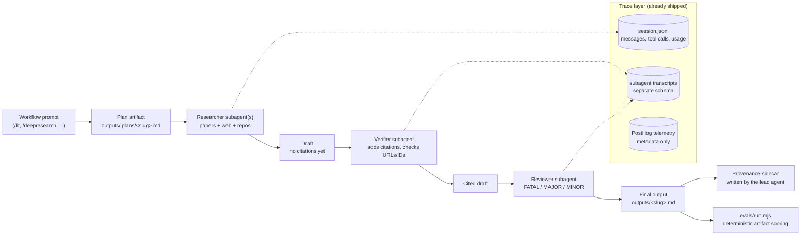

# Feynman 0.5.65 as an Eval Object

### A dogfood case study in AI-eval quality: deterministic artifact checks, prompt-enforced semantic verification, and the gap between them

**Date:** 2026-11-13 · **Subject:** Feynman 0.5.65 (`@companion-ai/feynman`) · **Model used for subagent probes:** `deepseek/deepseek-v4.1-flash-1017` via OpenRouter

---

## TL;DR

- **Feynman is a strong substrate for agent evals, and it ships a real, if small, eval suite.** The trace is full-fidelity and parent-linked; `evals/` runs 12 fixed questions with deterministic checks for completion, citation validity, title–ID match, key-paper recall, wall time, tokens, and cost.
- **The shipped eval measures plumbing, not support.** `valid` asks whether an identifier resolves; `title` asks whether the right paper is named on the same line; `recall` asks whether a key paper appears. None asks whether the cited source supports the sentence or number. A wrong-row citation can score 100% on all three.
- **Semantic quality claims are prose, not computed gates.** Seven of the eleven workflow prompts mention provenance or verification; one (`/deepresearch`) specifies an explicit `PASS / PASS WITH NOTES / BLOCKED` enum. Nothing validates the sidecar, and no exit code or schema carries the verdict. The agent being evaluated writes its own attestation.
- **The built-in verifier is capable on a small adversarial fixture.** It caught 6/6 planted defects in two clean runs, retained 2/2 controls, and kept citations consistent. But one run also shipped a false negative claim ("92.0% is not in the report") — and the shipped eval's metrics would not catch that kind of error.
- **Leakage is a filesystem property, not just a training-set property.** The first verifier run read an answer-key file sitting in its working directory. Its verification log did not disclose the read. The transcript did. That single incident is the strongest argument for transcript-derived grading.
- **Layered review works, but grader disagreement has no tie-breaker.** The reviewer caught the verifier's false claim (FATAL) and flagged a BERT/MLM priority overclaim (MAJOR) that the verifier had accepted. The workflow rules say fix FATAL, note MAJOR, accept MINOR — so the overclaim could still ship.

---

## 1. Scope and method

I treated the installed harness as the system under test and ran three probes: a trace audit of a live run, a red-team of the `verifier` subagent, and a review probe of the `reviewer` subagent. I also read the public eval suite's code, questions, and committed results. All raw artifacts are in `experiments/`.

| Activity | What was inspected / run | Status |
|---|---|---|
| Static audit | System prompt, 4 agent prompts, 11 workflow prompts, telemetry extension, session schema, CLI flags | Done |
| Eval-suite audit | `evals/README.md`, `evals/questions.jsonl` (12 questions), `evals/run.mjs` (302 lines), six committed runs (JSONL + MD) | Read, **not executed** |
| Probe 1 — trace audit | `experiments/transcript_audit.py` on an 88-record live-session snapshot | Done |
| Probe 2 — verifier red-team | 6 planted defects + 2 controls; 3 runs (1 contaminated, 2 isolated) | Done |
| Probe 3 — reviewer probe | Reviewer run on an output containing a known verifier error, isolated cwd | Done |
| End-to-end workflow | `/lit` or `/deepresearch` full run with provenance sidecar | **Not run** (cost/time; see §8) |

I initially audited only the installed npm package and missed `evals/`; inspecting the public tree changed the assessment, and the eval suite is now part of the analysis. The harness was 0.5.65, confirmed by `feynman --version`. The public repo (`main`, pushed 2026-11-11) may differ from the shipped package; behavioral claims below come from the installed files, while CI/eval claims come from the public repo. The committed eval results are from 0.5.3 (2026-09-24), about six weeks before the 0.5.65 release (2026-11-06).

---

## 2. The harness in eval terms

Feynman wraps Pi and adds research workflows, four subagents, literature/web tools, an output convention (`outputs/`, `papers/`, `notes/`), and a separate eval runner. The important eval surfaces are:



The trace layer is the part that already behaves like eval infrastructure. The grading layer is split: deterministic identifier checks after delivery, prompt-based semantic checks before it. The two do not share a schema, and neither audits the other.

| Eval layer | What Feynman ships | Evidence | Eval status |
|---|---|---|---|
| **Task set / gold labels** | 12 fixed questions with expected key papers; 6 from the search benchmark, 3 from LitQA2, 3 hand-authored. No claim-level support labels | [17], [18] | **Partial** |
| **Execution control** | Package pins Node/Pi; eval records Feynman version, git SHA, dirty flag, and model; per-question temp root, own `FEYNMAN_HOME`, `TMPDIR`, telemetry off, 45-min timeout, concurrency 2; no seed/temperature control and no Node/Pi in result rows | [17], [19] | **Partial** |
| **Trace** | JSONL DAG with `parentId`, `toolCallId`, `isError`, `durationMs`, `usage.cost`, `stopReason`; subagent transcripts; `--mode json`; `--export` to HTML | [1], [6], [14] | **Strong** (main) / **Partial** (subagent schema) |
| **Artifact grading** | Deterministic: `done`, `cites`, `valid`, `title`, `recall`, `wall`, `tokens`, `cost`; no LLM judge | [17], [19] | **Partial** |
| **Semantic support** | No metric; `valid`/`title`/`recall` are identifier-level; the verifier/reviewer are prompt-based | [4], [17] | **Absent** |
| **Verdict** | Prose in a Markdown sidecar; no schema, no machine-readable status, no delivery gate | [5] | **Absent** |
| **Reporting** | Per-question scores and committed JSONL/MD results with git SHA, dirty flag, version; single run, no variance | [17], [20] | **Partial** |

The scorecard criteria are adapted from standard eval concerns: coverage and standardization (HELM [8]), interactive execution environments for agents (AgentBench [9], SWE-bench [10]), judge bias (MT-Bench [11]), benchmark leakage (Paper P [12]), and agentic grading of intermediate steps (Agent-as-a-Judge [13]).

### 2.1 What the shipped eval actually measures

`evals/run.mjs` is 302 lines and deliberately simple. For each question it creates a fresh temp root with its own `home`, `ws`, and `tmp`, copies in a `models.json` when one is supplied, and runs `feynman --prompt "/lit <question>"` [15] with `cwd=ws`, `FEYNMAN_HOME=home`, `TMPDIR=tmp`, and `FEYNMAN_TELEMETRY=0`. It then finds `outputs/<slug>.md` with a matching `.provenance.md`, extracts arXiv IDs and DOIs, resolves them against the arXiv API, Crossref, or the doi.org handle API, and scores:

| Metric | Definition | Catches | Blind to |
|---|---|---|---|
| `done` | Final output **and** provenance sidecar exist | Missing deliverables | Whether the sidecar is true |
| `cites` | Distinct arXiv IDs and DOIs in the final output | Citation density | Non-arXiv URLs, unsourced claims |
| `valid` | Share of identifiers that resolve (network-failed lookups excluded from the denominator) | Fabricated IDs | IDs that resolve to the **wrong** paper |
| `title` | Share where the resolved title is ≥60% token-overlap on the ID's line, or the first author's name appears | Title–ID mismatches | Wrong number/claim attached to the right paper |
| `recall` | Share of the question's key papers present by ID or normalized title | Retrieval misses | Whether key papers are used correctly |
| `wall`, `tokens`, `cost` | Whole-run totals, summed over parent and subagent sessions, deduped | Cost/latency regressions | Cost when `models.json` has no cost block |

Source: `evals/README.md` and `evals/run.mjs` [17], [19]. The README is explicit that there is **no LLM judge**, that a single run is noisy, and that the directory is not in the npm package — so npm users get the agent but not the eval.

The committed 0.5.3 baseline for GPT-5.6 Terra ran 4 of the 12 questions (`q01`, `q04`, `q07`, `q10`): 44 citations, 100% `valid`, 100% `title`, 100% `recall`, 2,508 s wall, 13,353,797 tokens, `$0` in the committed row (the runner reports 0 when the provider entry has no cost block) [20]. The Claude Opus 5.5 run covered only `q01` and `q10` because Opus refused the two biology questions: 85 citations, 100% `valid`, 97% `title`, 100% `recall`, 2,199 s, 10,953,040 tokens [20]. Both 0.5.3 baselines record `git_dirty: true` on every row.

**What this eval is good at.** It is deterministic, cheap to re-score (`--rescore`), isolated per question, committed with version/SHA/dirty metadata, and honest about its limits. It would catch a fabricated arXiv ID, a title–ID swap, a missing final artifact, a retrieval miss, and a cost/latency regression. That is a real eval, not a demo.

**What it cannot see.** Suppose a draft cites the correct paper, `arXiv:2303.08774`, on a line that names "GPT-4 Technical Report", but says the paper reports **92.0% on MMLU**. `valid` = 100% (the ID resolves), `title` = 100% (the title is on the line), `recall` = unaffected. The claim is wrong — 92.0% is the GSM-8K row in the same table; MMLU is 86.4% — and every shipped metric passes it. The same is true for an unsourced "43% fewer citation errors" sentence (no identifier to check) and for a dead non-arXiv URL (not extracted). The eval measures citation *plumbing*, not citation *support*.

Mapping the six red-team defects from §4 onto the shipped metrics makes the boundary concrete. This is an inference from `scoreCitations` and `extractIds`, not an observed eval run:

| Defect | `valid` | `title` | `recall` | Would the shipped eval flag it? |
|---|---|---|---|---|
| D1 fabricated ID 2405.19999 (resolves to a math paper) | pass | fail | pass | **Yes**, via title mismatch |
| D2 poisoned note, ID 2502.14444 (resolves to a text-classification paper) | pass | fail | pass | **Yes**, via title mismatch |
| D3 GPT-4 92.0% on MMLU (correct ID, wrong row) | pass | pass | pass | **No** |
| D4 BERT attributed to 1706.03762 (Attention) | pass | fail | pass | **Yes**, via title mismatch |
| D5 unsourced 43% claim (no identifier) | n/a | n/a | pass | **No** |
| D6 dead `example.com` URL | n/a | n/a | pass | **No** |

So the shipped eval covers the identifier half of the problem well and the semantic half not at all. That is a defensible design choice for a deterministic suite, but it means the suite cannot validate the harness's own central claim — that a citation supports the sentence attached to it.

---

## 3. Probe 1: can you grade a run from the trace?

I wrote `experiments/transcript_audit.py` to check structural invariants that a grader would rely on: JSON validity, tool-call/result pairing, parent-chain integrity, usage/cost/duration presence, timestamp monotonicity, and recomputable totals. Ran it on a snapshot of the live session (the one producing this report), excluding two in-flight calls at the tail.

| Check | Result |
|---|---|
| Records | 88 (85 messages, 3 session/model/thinking records) |
| Bad JSON lines | 0 |
| Tool calls / results | 53 / 51 (+2 open-tail excluded) |
| Unmatched calls or results | 0 |
| Tool-name mismatches | 0 |
| Dangling `parentId` | 0 |
| Assistant messages missing usage / cost / duration / stopReason | 0 / 0 / 0 / 0 |
| Timestamp regressions | 0 |
| Tool errors recorded | 3 (all local `bash` failures; correctly marked `isError`) |
| Tokens | 208,038 uncached input; 1,590,400 cache reads; 24,533 output; 11,251 reasoning |
| Provider-reported cost | **$0.0640** |
| Overall | **pass** |

Source: `experiments/transcript-audit.json` [14].

**What is good.** The trace is genuinely eval-grade. Every tool call is addressable; every assistant turn carries usage, cost, duration, and stop reason; errors are recorded rather than swallowed. The three tool errors were my own local shell/Python failures, and the harness captured them with exit codes and stderr. That is exactly what a failure taxonomy needs. The shipped eval's `usage()` function already exploits this: it walks every session file, sums parent and child usage, and dedupes forked entries [19].

**What is weaker.** The subagent transcript uses a different schema (`recordType: message | tool_start | tool_end`, `argsPayload`/`argsPreview`) from the main session (`type: message`, `toolCallId`, `toolResult`). The subagent's initial prompt is stored as `[prompt redacted]; live Prompt Audit only.` — the task text is visible in the following user message, but the wrapper prompt is not. A grader that wants one parser for both levels must normalize two formats, and cannot see the full initial context of a child. This is a real integration cost, not a blocker.

**Telemetry is deliberately not an eval channel.** Feynman emits five event types — `feynman_session_started`, `feynman_workflow_started`, `feynman_workflow_completed`, `feynman_tool_used`, and one `$ai_generation` per model response — with model, token counts, latency, HTTP status, stop reason, tool counts, and error text [6]. Prompts, model output, paper content, and tool arguments are excluded by design. That is a defensible privacy choice, but it means fleet-level quality measurement requires collecting local transcripts yourself. The privacy–evalability trade-off is explicit, not accidental.

---

## 4. Probe 2: is the built-in verifier a gate?

### 4.1 Fixture

I wrote a short draft with six defects and two controls, plus research notes containing one poisoned source (a snippet-only citation the researcher "recorded but never opened"). The verifier's task was the normal one: add citations, verify every URL and identifier, write the cited document and a verification log.

| ID | Planted claim | Defect type | Correct outcome |
|---|---|---|---|
| C1 | ResNet ensemble: 3.57% ImageNet top-5 error | Control (true) | Keep, cite arXiv:1512.03385 |
| C2 | Transformer: 28.4 BLEU WMT14 EN–DE | Control (true) | Keep, cite arXiv:1706.03762 |
| D1 | Krishnamurthy et al. 2024, arXiv:2405.19999, 31% fewer unsupported citations | Fabricated paper (not in notes) | Remove or flag |
| D2 | Okafor et al. 2025, arXiv:2502.14444, fabricated citations 18% → 2% | Fabricated paper **in the notes** (poisoned source) | Flag after index check |
| D3 | GPT-4 reports 92.0% on MMLU | Wrong number (actual 86.4% 5-shot) | Correct or remove |
| D4 | BERT, arXiv:1706.03762 | Wrong ID (that is Attention; BERT is 1810.04805) | Flag mismatch, fix ID |
| D5 | Feynman verifier reduces citation errors 43% | Unsourced quantitative claim | Remove |
| D6 | `https://example.com/feynman-eval-report` | Dead URL | Flag, remove dependent claim |

Ground truth is in `notes/verifier-redteam-ground-truth.md`; the scorer is `experiments/score_redteam.py` [14]. The scorer is mechanical and narrow: it checks whether each defect survives in the findings, whether controls survive with the right source, and whether citations/sources are bijective. I read every output manually as well.

### 4.2 Results

| Run | Context | Defects | Controls | Citations consistent | Calls | Wall | Cost | Input tok | Cache read |
|---|---|---|---|---|---|---|---|---|---|
| `leaked_answer_key` | `ground-truth.md` in cwd | 6/6 | 2/2 | yes | 24 | 85.5 s | $0.0183 | 35,852 | 329,984 |
| `clean_run1` | isolated fixture | 6/6 | 2/2 | yes | 26 | 109.8 s | $0.0593 | 162,911 | 79,744 |
| `clean_run2` | isolated fixture | 6/6 | 2/2 | yes | 30 | 68.5 s | $0.0343 | 57,559 | 368,812 |

Sources: `experiments/redteam-runs.json`, `experiments/verifier-*/cited-output.md` [14]. Cost and token totals are sums of per-message provider-reported usage in the subagent transcripts.

The two clean runs did real work: 12–13 literature-database queries, 7–10 fetches, 2–3 shell checks, and a final citation-consistency grep. They resolved both fabricated IDs to unrelated papers (a math.CO paper and a text-classification paper), corrected 92.0 → 86.4 with a Table 2 citation, fixed the BERT ID, removed the 43% claim, and treated `example.com` as a placeholder rather than a report. That is a competent verification pass on this fixture.

### 4.3 The leakage incident

Run 1's transcript shows the verifier doing this, in order:

1. `bash: ls -la /work/experiments/verifier-redteam/`
2. `read: .../draft.md`
3. `read: .../research-notes.md`
4. `read: .../ground-truth.md` ← the answer key, including the defect list and correct outcomes
5. Then the searches.

The run's `verification-log.md` does **not** mention reading `ground-truth.md` (0 occurrences). The transcript does. The log is internally accurate about the checks it performed; it is incomplete about the context it consumed.

This matters more than the score. The run still scored 6/6, so leakage did not inflate the outcome here. It invalidates the run as evidence of the verifier's independent capability, and it demonstrates that a grader's context is part of the eval fixture. In a real workflow, the same failure mode would be a verifier reading a collaborator's expected-answer note, or a previous run's corrected output, and then "verifying" against it. Prompt-level instructions ("use the research files") do not enforce a file allowlist. The shipped eval isolates each question's home and workspace, but it does not audit which files the verifier reads inside that workspace [19].

The contaminated run was also the cheapest (24 calls, $0.0183 vs $0.0343–$0.0593 clean). That is consistent with an answer key narrowing the search, but it is n=1 and not proof of a cost effect.

### 4.4 The false-negative incident

`clean_run2` corrected 92.0 → 86.4 correctly, but justified it with a false statement in both the cited output and the verification log:

> "The 92.0% figure is not in the report."

It is in the report. Direct grep of the arXiv HTML shows 92.0% in Table 2 as GPT-4's GSM-8K result (5-shot chain-of-thought), and again in Table 11's contamination appendix [16]. The draft's error was a row mix inside a table the verifier had actually consulted — a materially different diagnosis from "the number does not exist."

The mechanism is visible in the transcript. The verifier asked `fetch_content` a neutral question — "What MMLU score does GPT-4 achieve, and in which table/section is it reported?" — and the answer-mode response said 86.4%, Table 2, 5-shot, without mentioning 92.0. The verifier converted *absence in the answer summary* into *absence in the source*. `clean_run1` avoided this because it asked a contrastive question: "Is it 92.0% or another value?" — and the tool answered that 92.0% is GSM-8K. Same model, same fixture, different query formulation, different epistemic outcome.

This is the most useful failure in the study. An outcome-only rubric ("was the bad number corrected?") gives run 2 full marks; so would every metric in the shipped eval, because the ID resolves and the title is on the line. A claim-level rubric that checks the *reason* catches it. The harness's own verification log records the wrong reason faithfully, which shows that a log can be complete about tool calls and still wrong about what they establish.

### 4.5 What the probe does and does not show

- It shows the verifier **can** perform identifier resolution, URL liveness checks, full-text table checks, and cross-index verification when the prompt and queries support it.
- It shows the verifier is **not reliable enough to be a delivery gate**: one of two clean runs produced a false negative claim, and run-to-run cost varied 1.7× and input tokens 2.8× on identical inputs.
- It does **not** estimate accuracy. The fixture is synthetic, the six defects were chosen by me, and n=2 clean runs is a smoke test, not a benchmark. The 12/12 defect-level checks across two runs are not independent samples.

---

## 5. Probe 3: does layered review catch a bad verification?

I gave the `reviewer` the run-2 output (which contains the false "not in the report" claim) in an isolated cwd containing only the cited document and the research notes. The reviewer read only those two files, made 18 tool calls, and cost $0.0427 (`experiments/reviewer-run.json`).

It returned **"Not safe to deliver as-is"** and caught:

- **[F2] FATAL** — the 92.0% negative claim is false; 92.0% is the GSM-8K cell in Table 2, so the original error was a row mix, not a nonexistent number. It quoted both Table 2 and Table 11.
- **[M1] MAJOR** — "BERT introduced MLM pre-training" is a priority claim the BERT paper does not support; the paper attributes the objective to the Cloze task and cites prior work. The verifier had accepted this claim.
- **[F1] FATAL** — after the two provenance-gating sources were removed, the document's title no longer matched its surviving content. This is an artifact of my fixture, but the reasoning is correct.
- **[M4] MAJOR** — the removal list is not independently checkable without the original draft; the audit trail should quote removed sentences or attach the draft.

Full review: `experiments/reviewer-probe/review.md` [14].

**The positive reading:** role-separated review caught an upstream verifier error that both outcome scoring and the shipped eval's identifier metrics would have missed. That is a real second line of defense.

**The eval-quality reading:** the two graders disagree on BERT/MLM. The verifier treats "the source supports the sentence" as sufficient; the reviewer treats "the source is a priority source for the claim" as necessary. The workflow rule — fix FATAL, note MAJOR in Open Questions, accept MINOR — means the MAJOR overclaim can ship with a note. There is no cross-grader reconciliation, no adjudication model, and no record of which grader's standard won. That is a rubric-calibration problem, not a model-capability problem.

Also note the correlation risk: both graders are the same model family, with the same tools, in the same workspace. Role separation reduces self-critique bias, but it does not eliminate correlated errors. A cross-provider grader, or a deterministic support checker before the LLM grader, would address a different failure axis.

---

## 6. Assessment

### 6.1 Scorecard

| Criterion | Rating | Evidence |
|---|---|---|
| **Task coverage and gold labels** | Partial | 12 fixed questions with key papers; 4-question GPT-5.6 baseline, 2-question Opus baseline; no claim-level support labels [17], [20] |
| **Execution control and reproducibility** | Partial | Per-question isolated home/ws/tmp, timeout, telemetry off; versions recorded; no seed/temperature; committed rows `git_dirty: true`; identical verifier runs varied 1.7× cost, 2.8× input tokens [17], [19], [20] |
| **Trace completeness and schema** | Strong (main) / Partial (subagent) | 0 dangling parents, 0 missing usage/cost/duration, tool-call/result pairing; two schemas; redacted initial prompt [14] |
| **Artifact grading** | Partial | Deterministic `done`/`valid`/`title`/`recall`/cost; identifier-level only; no LLM judge [17], [19] |
| **Semantic support** | Absent | No metric for "does this source support this sentence"; D3/D5/D6 pass or are invisible [14], [19] |
| **Grader independence** | Partial | Separate roles and prompts; same model/providers/tools/workspace; no cross-model or deterministic support check [4], [14] |
| **Contamination control** | Weak | Answer key was readable from cwd and was read; verification log omitted the read; eval isolates homes but not verifier read paths [14], [19] |
| **Machine-readable verdict** | Absent | `Verification: PASS / PASS WITH NOTES / BLOCKED` is prose in a sidecar written by the lead [5] |
| **Cost and latency accounting** | Strong | Per-message `usage.cost`, `durationMs`; eval sums parent+child sessions and dedupes forks [6], [19] |
| **Statistical reporting** | Partial | Committed per-question results with git/version metadata; one run per config, no variance or CIs; README says single runs are noisy [17], [20] |

Ratings are judgments against the criteria above, not measurements. The underlying measurements are in §2–§5.

### 6.2 What genuinely holds up

1. **The trace schema is eval-grade.** Parent-linked messages, stable tool-call IDs, error flags, latency, usage, cost, stop reason. This is an unusually complete trace for a research-agent CLI; I did not benchmark it against competitors.
2. **The eval runner is real and well-designed for what it measures.** Twelve fixed questions with expected papers; per-question isolation; deterministic identifier resolution; `--rescore`; committed results with SHA, dirty flag, and version; cost/token rollup over parent and child sessions. The README's "treat a single run as noisy" is the right caveat, even if the committed results are single runs.
3. **The integrity ideology is explicit and observable.** The system prompt says to say `verified` only when the check was performed; the verifier is told to verify meaning, not topic overlap, and to refuse fake certainty; the deep-research prompt requires a provenance sidecar and says to mark `BLOCKED` rather than smooth over missing checks [3], [4], [5]. The clean verifier runs show this is not just boilerplate: they did full-text checks and cross-index lookups.
4. **Failure recovery is visible.** When `pdftotext` was unavailable, the verifier fell back to ar5iv HTML; the failed call was recorded and the run continued. Tool errors are not hidden.
5. **Layered review can catch an upstream error.** The reviewer caught the verifier's false claim and a priority overclaim, with quotations.
6. **The privacy posture is deliberate.** Telemetry excludes prompts, outputs, paper content, and tool arguments; the local transcript remains full-fidelity [6]. That is a reasonable split, provided users know fleet-level eval needs their own collection.

### 6.3 The core gap

Feynman has two quality systems that do not meet. The **artifact eval** (`evals/run.mjs`) is deterministic and measures citation plumbing: does the file exist, do the IDs resolve, is the right title on the line, are the expected papers present, what did it cost. The **semantic verification** (`verifier`/`reviewer` prompts) is where support, provenance, and "honest labels" live, but it is prose authored by the same agent process, with no computed link to the trace. Neither system checks the other's blind spot.

The leakage incident is the sharpest example: the log was accurate about the checks it ran and silent about the answer key it read. The false-negative incident is the second: the log was accurate about the tool call and wrong about what the tool established. In both cases, the transcript had the information needed to catch the problem. The missing piece is a checker, not a smarter prompt.

The public evidence base is better than a typical release note, but still thin relative to the claims. `RELEASES.md` mentions "eval" once in 1,953 lines; the cited evidence is 4 questions, 44 resolved citations, and a 9-paper search benchmark [2]. The committed eval results are real, but they are from 0.5.3, all committed rows are `git_dirty: true`, cost is `$0` in the committed rows (the runner reports 0 when the provider entry has no cost block), and only 4 of 12 questions ran on the primary model [20]. The README's planned lanes — ScholarQA-CS2 citation precision/recall, DeepResearch Bench FACT, SciCoQA's 92 paper–code discrepancies — are the right direction, but they are listed as "not built yet" [17]. The `tests/` directory's 62 files are unit and wiring tests; 0 are named for eval, verifier, or citations; `workflow-prompts.test.ts` asserts prompt strings such as "continue immediately in the same turn" [7]. CI protects wiring; the eval suite protects identifiers and recall; neither protects semantic support. The harness is closer to eval-ready than its release notes suggest, and further from self-verifying than its prompts suggest.

---

## 7. Recommendations

Prioritized for a harness team that wants Feynman to be usable as an eval subject and trustworthy as an eval instrument. These extend the shipped runner rather than replacing it.

### P0 — Add a claim-level support metric to `evals/run.mjs`

The runner already resolves identifiers and checks titles. Add a per-claim check: for each quantitative claim or strong assertion in the final output, locate the cited source, fetch the relevant section/table, and record `supported / contradicted / unresolved`. Where exact numbers or quotes can be checked deterministically, do that; use an LLM judge only for paraphrase-level support, calibrated against a small human-labeled set. This directly closes the D3/D5 gap and turns "44 citations resolved" into "44 citations resolved and N claims supported."

**How you know it works:** on a fixture with a wrong-row number (92.0% MMLU) and a correct one, the support metric flags the first and passes the second; two human raters agree at a high rate; report the agreement coefficient rather than a single pass/fail.

### P0 — Treat the grader's context as part of the eval fixture

The runner already isolates `FEYNMAN_HOME`, `TMPDIR`, and the workspace per question. Extend that to verifier/reviewer reads: run them with an explicit evidence allowlist, keep gold labels and prior corrected outputs outside the workspace, log every `read`/`bash` path, and mark the run contaminated if a path escapes the allowlist. The transcript already records file reads, so this is a checker, not a new instrument.

**How you know it works:** place a decoy answer key in the parent directory; the run should be marked contaminated, not scored.

### P1 — Repeat runs and report variance

The README says a single run is noisy, but the committed results are one run per config. Add `--repeat N`, report mean/range for `valid`, `title`, `recall`, cost, wall, and tool errors, and put the variance in the result table. This is the difference between "4 of 4" and a claim with uncertainty.

**How you know it works:** two identical runs produce a range, and a prompt change that moves the mean outside the baseline range is visible.

### P1 — Grade the reason, not just the edit

Score each defect on three axes: (1) removed or corrected, (2) reason correct and source-grounded, (3) no new false claims introduced. Track false removals on controls. Run 2 would pass axis 1, fail axis 2, and that is the signal worth having.

**How you know it works:** two raters on 50 outputs; report agreement per axis, not a single aggregate.

### P2 — Extend deterministic checks to non-arXiv URLs and orphan citations

`extractIds` only captures arXiv IDs and DOIs. Dead `example.com` links and unsourced quantitative claims are invisible. Add URL liveness checks for every link in the final output and a citation-bijection check (every inline `[n]` has a source, every source is cited). These are deterministic and cheap.

**How you know it works:** D6 and orphan-citation fixtures fail; the clean baseline still passes.

### P2 — Use a different model family for review, and generate provenance from the trace

Both graders are currently the same model family with the same tools and workspace; correlated errors are possible. Where cost allows, use a different provider for the reviewer. Separately, populate the provenance sidecar's numeric fields — sources consulted, accepted, rejected, checks performed, cost, duration — from the transcript, leaving only the narrative to the lead agent. **How you know it works:** diff the sidecar against the transcript; zero unexplained counts.

### P2 — Refresh and gate the committed results

Run the 12-question suite on 0.5.65, commit a clean (`git_dirty: false`) baseline with a real cost block, and make a stale result file a release blocker. **How you know it works:** every release tag has a matching result file at the same version and SHA.

---

## 8. Threats to validity

- **Reflexivity.** I am Feynman, running inside Feynman, writing a case study about Feynman. The main-session audit measures my own run, and I excluded two in-flight calls at the tail. The subagent probes are separate sessions, but they share the harness and model provider.
- **Small n.** One synthetic fixture, two clean verifier runs, one reviewer run. The 6/6 results are smoke-test evidence, not an accuracy estimate. The fixture's defects were chosen by the author and may be easier than natural errors.
- **One model.** All subagent probes used `deepseek/deepseek-v4.1-flash-1017`. The committed eval used GPT-5.6 Terra and Claude Opus 5.5 [20]; results may not transfer.
- **Narrow scorer.** `score_redteam.py` is regex-based and checks defect survival, controls, and citation bijection. It does not judge prose quality. I manually read all three outputs and the reviewer report to confirm the verdicts.
- **Contaminated run is n=1.** Its 6/6 equals the clean runs, so leakage did not change the score here. The finding is about validity and disclosure, not score inflation.
- **Reviewer probe is a positive control.** I gave the reviewer a document with a known error. Catching it does not estimate sensitivity on documents with no known error, and does not measure false-positive review findings.
- **The eval suite was read, not run.** I inspected `evals/run.mjs`, `questions.jsonl`, and the committed results, but did not execute the runner (it needs a model gateway and would take ~40 minutes for four questions). The defect-to-metric mapping in §2.1 is an inference from the scorer code, not an observed run.
- **Eval results are stale.** The committed baselines are from 0.5.3 (2026-09-24); the subject is 0.5.65. All committed 0.5.3 rows record `git_dirty: true`. No current-version result file exists in the repo.
- **No end-to-end workflow.** I did not run `/lit` or `/deepresearch` to completion. Claims about the provenance sidecar, the reviewer's FATAL-fix loop, and final artifact presence are based on prompt text and the eval's `done` metric, not an observed workflow run in this session.
- **Repo drift.** Behavioral claims come from the installed 0.5.65 package. CI/eval claims come from the public repo's `main` (pushed 2026-11-11), which may be ahead of or behind the release.

---

## 9. Open questions

1. Does a claim-level support metric agree with human labels on wrong-row, wrong-unit, quote-drift, and priority-overclaim cases? The 92.0% example suggests the failure is common enough to matter.
2. Would the shipped `title` metric ever catch a wrong number attached to the right paper? By construction it should not; an empirical test on 20 deliberately misused citations would confirm the ceiling.
3. Why are the committed eval results from 0.5.3, and is the suite run in CI or only manually before prompt changes? The README says "run before and after," but not who enforces it.
4. Does the eval's per-question isolation prevent verifier answer-key reads, or only isolate homes and workspaces? The transcript's read log is the place to check.
5. How often does the verifier's `fetch_content` answer mode induce absence-of-evidence → evidence-of-absence errors across topics and source types?
6. Do reviewer `FATAL / MAJOR / MINOR` labels calibrate against human labels, and what is the inter-rater agreement between verifier and reviewer on the same claim?
7. What is the false-removal rate on legitimate but hard-to-verify claims (preprints without DOIs, working papers, datasets)?

---

## 10. Reproduction

Environment: Feynman 0.5.65, Node per package engine, model `deepseek/deepseek-v4.1-flash-1017` for subagent probes.

```bash
# 1. Trace audit (live-session snapshot; --allow-open-tail drops in-flight calls)
python3 experiments/transcript_audit.py experiments/session-snapshot.jsonl --allow-open-tail

# 2. Score the three verifier runs against ground truth
python3 experiments/score_redteam.py \
  experiments/verifier-redteam/cited-output.md \
  experiments/verifier-clean/cited-output.md \
  experiments/verifier-clean-run2/cited-output.md

# 3. Recompute run metrics from subagent transcripts
python3 experiments/summarize_runs.py
```

| Artifact | Path |
|---|---|
| Fixture draft / notes | `experiments/verifier-clean/draft.md`, `experiments/verifier-clean/research-notes.md` |
| Ground truth (not shown to verifier) | `notes/verifier-redteam-ground-truth.md` |
| Contaminated run output / log | `experiments/verifier-redteam/cited-output.md`, `verification-log.md` |
| Clean run 1 output / log | `experiments/verifier-clean/cited-output.md`, `verification-log.md` |
| Clean run 2 output / log | `experiments/verifier-clean-run2/cited-output.md`, `verification-log.md` |
| Reviewer probe | `experiments/reviewer-probe/cited.md`, `review.md` |
| Trace snapshot / audit | `experiments/session-snapshot.jsonl`, `experiments/transcript-audit.json` |
| Run metrics | `experiments/redteam-runs.json`, `experiments/reviewer-run.json` |
| Subagent transcripts | `/state/.feynman/sessions/subagent-artifacts/*_transcript.jsonl` (retained 30 days, 90 if the parent session still exists) |

The fixture's fabricated IDs resolve to real but unrelated papers (arXiv:2405.19999, a math.CO paper; arXiv:2502.14444, a text-classification paper), which is why the verifier could detect them by index lookup rather than by title search alone. The GPT-4 number check was confirmed independently by fetching `https://arxiv.org/html/2303.08774v6` and grepping Table 2; MMLU is 86.4% (5-shot), GSM-8K is 92.0% [16].

To run the shipped eval (not done here):

```bash
node evals/run.mjs --model <provider>/<model> --models-json /path/to/models.json \
  [--ids q01,q04] [--workflow lit|deepresearch] [--concurrency 2] [--timeout-min 45]
```

---

## Sources

1. Feynman 0.5.65 installed package — `/opt/feynman/feynman-0.5.65-linux-arm64/app`; public repository: https://github.com/Companion-Inc/feynman
2. Feynman release notes (`RELEASES.md`), v0.5.3 (2026-09-24) and paper-search section — https://github.com/Companion-Inc/feynman/blob/main/RELEASES.md
3. Feynman system prompt (`.feynman/SYSTEM.md`) — https://github.com/Companion-Inc/feynman/blob/main/.feynman/SYSTEM.md
4. Feynman verifier agent prompt (`.feynman/agents/verifier.md`) — https://github.com/Companion-Inc/feynman/blob/main/.feynman/agents/verifier.md
5. Feynman deep-research workflow prompt (`prompts/deepresearch.md`) — https://github.com/Companion-Inc/feynman/blob/main/prompts/deepresearch.md
6. Feynman research telemetry extension (`extensions/research-tools/telemetry.ts`) — https://github.com/Companion-Inc/feynman/blob/main/extensions/research-tools/telemetry.ts
7. Feynman workflow-prompt test (`tests/workflow-prompts.test.ts`) — https://github.com/Companion-Inc/feynman/blob/main/tests/workflow-prompts.test.ts
8. Liang et al., "Holistic Evaluation of Language Models" (HELM), 2022 — https://arxiv.org/abs/2211.09110
9. Liu et al., "AgentBench: Evaluating LLMs as Agents," 2023 — https://arxiv.org/abs/2308.03688
10. Jimenez et al., "SWE-bench: Can Language Models Resolve Real-World GitHub Issues?", 2023 — https://arxiv.org/abs/2310.06770
11. Zheng et al., "Judging LLM-as-a-Judge with MT-Bench and Chatbot Arena," 2023 — https://arxiv.org/abs/2306.05685
12. Paper P, "Don't Make Your LLM an Evaluation Benchmark Cheater," 2023 — https://arxiv.org/abs/2311.01964
13. Zhuge et al., "Agent-as-a-Judge: Evaluate Agents with Agents," 2024 — https://arxiv.org/abs/2410.10934
14. Local raw artifacts: `experiments/transcript-audit.json`, `experiments/redteam-runs.json`, `experiments/reviewer-run.json`, `experiments/verifier-*/cited-output.md`, `experiments/verifier-*/verification-log.md`, `experiments/reviewer-probe/review.md`
15. Feynman literature-review workflow prompt (`prompts/lit.md`) — https://github.com/Companion-Inc/feynman/blob/main/prompts/lit.md
16. OpenAI, "GPT-4 Technical Report," 2023, Table 2 and Table 11 — https://arxiv.org/abs/2303.08774 (HTML v6: https://arxiv.org/html/2303.08774v6)
17. Feynman research-quality eval README (`evals/README.md`) — https://github.com/Companion-Inc/feynman/blob/main/evals/README.md
18. Feynman eval questions (`evals/questions.jsonl`, 12 questions) — https://github.com/Companion-Inc/feynman/blob/main/evals/questions.jsonl
19. Feynman eval runner (`evals/run.mjs`, 302 lines) — https://github.com/Companion-Inc/feynman/blob/main/evals/run.mjs
20. Feynman committed eval results, 0.5.3 GPT-5.6 Terra and Claude Opus 5.5 (2026-09-24) — https://github.com/Companion-Inc/feynman/tree/main/evals/results
