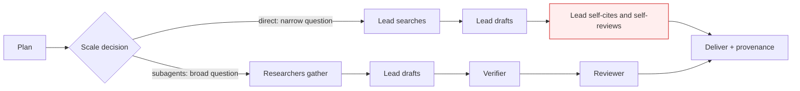

# Dogfooding Feynman: an eval-quality case study of an AI research agent

**Harness:** Feynman 0.5.65 (released 2026-11-06)  
**Model:** `openrouter/deepseek/deepseek-v4.1-flash-1017`, thinking high  
**Session:** 2026-11-13, one session, `/work`  
**Status:** Complete, with explicit limitations. All probes were pre-registered before execution.  
**Verification:** PASS WITH NOTES — behavioral probes completed; the upstream eval harness was audited from code and committed results but not re-executed.

---

## Executive summary

I treated Feynman as both the object and the instrument of an evaluation. The result is a split verdict:

1. **The bundled research agents are strong.** Across two controlled verifier probes, the verifier caught **9 of 9** seeded citation/number defects with **0 false positives** on 4 valid claims. A researcher subagent refused a fabricated paper and documented a 10-source negative search without inventing an identifier. A reviewer caught the arithmetic impossibility in a deliberately underpowered evaluation paper.
2. **The instrument layer is weaker than the agents.** Crossref "DOI lookup" is implemented as a fuzzy `/works?query=` search. Three identifier-shaped queries returned unrelated records and no `not_found` signal; a non-existent DOI produced three unrelated papers and a `totalCount` of 16,049,765. `fetch_content` returns soft-404 placeholder pages as ordinary success.
3. **Feynman has a real eval harness — upstream, not in the release.** `evals/` contains 12 fixed questions, deterministic citation checks against arXiv/Crossref/doi.org, isolated homes and workspaces, git/version metadata, and before/after result files. It is excluded from the npm package.
4. **That eval harness is reproducible but narrow and currently ceilinged.** Across the six committed result files, `valid` is 100% on every completed question, `title` is 92–100%, and `recall` is 100% whenever a final output exists. The metrics discriminate completion, not research quality. The committed results stop at v0.5.3; the installed release is v0.5.65.
5. **Integrity is prompt-governed, not runtime-enforced.** Provenance sidecars are mandated by prompts, but no runtime check validates their contents. The eval's `done` metric only checks that a sidecar file exists. The direct-search path explicitly skips the verifier and reviewer, so the cheapest workflow gets the least independent checking.

The short version: **the evaluator is better than its instruments.** Feynman's prompts produce careful epistemic behavior; its tool contracts and runtime enforcement do not yet guarantee it.

---

## 1. What was tested

The case study has two halves:

- **Static audit** of the shipped harness: system prompt, agent definitions, workflow prompts, tool implementation, telemetry, package contents, and the upstream `evals/` directory.
- **Behavioral probes** using the harness itself: metadata lookup, negative-record handling, verifier defect detection, researcher non-existent-entity handling, reviewer eval critique, and URL-failure behavior.

The probe protocol and pass/fail rules were written to disk before execution [S24]:

- `experiments/feynman-eval-case-study/protocol.md`
- `experiments/feynman-eval-case-study/probe-outputs.md` (raw observations)
- Fixtures and outputs under `experiments/feynman-eval-case-study/`

The model was a DeepSeek v4.1 Flash model. That matters: the agent results below may not generalize to other models, and they are a reminder that harness quality is model-dependent.

---

## 2. Feynman's own eval stack

### 2.1 What exists

The public repo [S1] contains `evals/`, which the npm package excludes [S17]. Its README describes "a small fixed eval for Feynman's research workflows" that runs `/lit` or `/deepresearch` on each question and scores artifacts "with deterministic checks against arXiv, Crossref and doi.org. No LLM judge." [S2]

The repo also carries a conventional `tests/` suite, also excluded from the npm package, so an installed user cannot run either suite without cloning the repo; those are unit/integration tests, not research-quality evals. The eval README is explicit about what it has not built: ScholarQA-CS2 citation precision/recall, DeepResearch Bench FACT, and SciCoQA's 92 paper-code discrepancies. [S2]

The eval design is unusually concrete for an agent repo:

| Property | Implementation |
|---|---|
| Fixed question set | 12 questions: 6 paper-discovery queries, 3 LitQA2 items, 3 hand-authored non-ML topics [S4] |
| Isolation | Fresh temp workspace and `FEYNMAN_HOME` per question; `FEYNMAN_TELEMETRY=0` [S3] |
| Determinism | Identifier extraction + arXiv/Crossref/doi.org resolution; no LLM judge [S3] |
| Versioning | Records git SHA, dirty flag, Feynman version, model, wall time, tokens, cost [S3] |
| Re-scoring | `--rescore` re-scores kept workdirs without rerunning the agent [S2] |
| Before/after | Committed pre/post result pairs around a prompt change [S6][S5] |

The before/after pair is the strongest evidence that the eval loop is real. Adding a `bg_wait` rule to `SYSTEM.md` moved the GPT run from **75% done** (q04 had no final provenance file) to **100% done**, while the other metrics stayed at their ceiling. The eval caught a real workflow regression. [S6][S5]

### 2.2 What the metrics actually measure

| Metric | Checks | Does not check |
|---|---|---|
| `done` | A final `outputs/<slug>.md` exists **and** a `.provenance.md` sidecar exists [S3] | Whether the sidecar is truthful or complete |
| `cites` | Count of distinct arXiv IDs and DOIs in the final text | Uncited claims; citation relevance |
| `valid` | Share of identifiers that resolve via arXiv, Crossref, or the doi.org handle API; network failures excluded [S2] | Whether the source supports the attached claim |
| `title` | At least 60% of the resolved title's word tokens appear on a line carrying the ID, or the first author's surname appears [S2] | Wrong number, wrong quote, wrong conclusion; short-name citations miss |
| `recall` | Expected key papers appear by ID or exact normalized title [S2] | Completeness beyond 1–2 key papers; precision |
| `wall`, `tokens`, `cost` | Usage summed over parent and subagent session files [S3] | `cost` is $0 when the model entry has no cost block [S2] |

That table is the central eval-quality finding. The harness measures **citation identity and workflow completion**, not **claim support**. A system can cite 40 real papers, attach every one to a false claim, and still score 100% `valid` and 100% `title`.

### 2.3 The ceiling problem

Across the six committed result files in `evals/results/`: [S31]

- `valid` is **100% on every completed question** in every run.
- `title` is **92–100%** on completed questions.
- `recall` is **100% whenever a final output exists**; 0 only when the run produced no output.
- `done` is the only metric with meaningful variance: **50%, 75%, 75%, 100%, 100%, 100%** across the runs I inspected. [S5][S6][S7][S8]

A metric that is 100% across six runs and three models is not discriminating research quality. It may be measuring something real — these models are good at citing resolvable papers — but it cannot tell a well-supported brief from a citation-laundered one. The README itself warns: "Treat a single run as noisy" and "look at the listed failures rather than only the percentages." [S2] The committed results do list failures: Claude q10 had a 93% title match with three wrong-paper attachments, which is exactly the kind of signal the metric can catch. [S7] But the aggregate table hides it behind a 97%.

There is also a **currency gap**. The committed results are dated 2026-09-23/24 and cover v0.5.0–0.5.3. The installed release is v0.5.65, dated 2026-11-06. The README's rule is to run the eval before and after any prompt, tool, or Pi-version change. The committed public evidence trail does not cover the current release. [S2][S16]

### 2.4 Cost of evaluation

The eval is not cheap. A 4-question GPT run used **13.4–14.1M tokens** and **42–47 minutes** of wall time; the 4-question Sonnet baseline used **72.2M tokens** and **~2.2 hours**. [S5][S8] That is a reasonable price for a release gate, but it explains why the committed runs use 2–4 questions rather than all 12. Inference: few users will run it from the installed package, which makes the npm exclusion matter for external auditability.

---

## 3. Dogfooding results

### 3.1 Identity and metadata: exact where the API is exact, fuzzy where it is not

| Probe | Expected | Observed | Verdict |
|---|---|---|---|
| arXiv `1706.03762` | 2017, Vaswani, "Attention Is All You Need" | Exact match; 8 authors; 2017-06-12 [S9] | **Pass** |
| OpenAlex `W2626778328` | Same paper, 2017, Vaswani | Exact match; 136,211 citations [S14] | **Pass** |
| Crossref `10.48550/arXiv.1706.03762` | Exact DOI record | Top 3 unrelated DOI records; `totalCount` 6,599,726; no `not_found` | **Fail** |
| Crossref `10.9999/not.a.real.doi.2026` | Not found | Top 3 unrelated records; `totalCount` 16,049,765; no `not_found` | **Fail** |
| Crossref title `Attention Is All You Need Vaswani 2017` | 2017 NeurIPS record | Top 3 are 2025 `posted-content` records under DOI prefix `10.65215` | **Fail (identity)** |
| Semantic Scholar fabricated title | 0 results | `totalCount: 0`, no results [S25] | **Pass** |

All Crossref observations are transcribed in [S25]; the underlying implementation is [S19]. The implementation explains the Crossref behavior: `searchCrossref` always builds `${CROSSREF_BASE}/works?query=...` and never uses the `/works/{doi}` endpoint. [S19] The tool description says "Crossref DOI metadata" and the parameter description says "identifier ... or DOI," so a model can reasonably expect an exact lookup and get a relevance-ranked keyword search instead. This is a **search/lookup conflation**, not a model hallucination.

The title query also surfaced a concrete data-quality hazard [S13]. The top record, `10.65215/r5bs2d54`, has the correct title, type `posted-content`, publisher "Shenzhen Medical Academy of Research and Translation," and creation date 2025-11-13. Its DOI resolution chain ends in a **404**:

`https://doi.org/10.65215/r5bs2d54` → 302 → `langtaosha.org.cn/index.php/lts/preprint/view/10` → 302 → `/lts/en/preprint/view/10` → 404.

A verifier that checks only "does Crossref have this title?" would attach a 2025 zombie DOI to a 2017 paper. Neither verifier probe used it — the hard log explicitly says the `10.65215/*` records were "low-quality ... not used" — but the tool gave them no warning. [S27]

### 3.2 Verifier: 9/9 seeded defects, 0 false positives

I ran two controlled verifier probes.

**Coached probe.** The draft contained 5 seeded defects; the research notes explicitly recorded three of them as dead/unverifiable. The verifier:

| Defect | Outcome |
|---|---|
| Transformer attributed to 2019 | Corrected to 2017 |
| Fabricated Chen/Liu/Park paper + 41% + arXiv:2309.99999 | Removed; arXiv returned "no record" |
| GPT-3 95.2% zero-shot TriviaQA | Corrected to 64.3% zero-shot / 71.2% few-shot |
| Dead `example.com` survey + 68% | Removed; identified the IANA placeholder |
| "10x cheaper than RNNs" | Softened to the paper's qualitative claim |
| Valid: Transformer uses multi-head self-attention | Retained with citation |
| Valid: BERT uses MLM + NSP | Retained with citation |

Score: **5/5 defects, 0/2 false positives.** [S26]

**Hard probe.** The second draft had 4 defects and research notes that did **not** flag them. The verifier again caught all four: wrong Vaswani year (2019→2017), wrong GPT-3 number (95.2→64.3), unsupported 10x claim (removed), wrong Devlin year (2021→2019). It retained both valid claims, added NeurIPS and ACL Anthology venue records, and recorded its checks source by source. [S27]

The hard log is the most useful artifact of the whole session. It shows the verifier doing the right things:

- It noticed that Crossref is the wrong index for arXiv DOIs (`10.48550/*` is DataCite, not Crossref) and switched to OpenAlex/Semantic Scholar.
- It fetched the GPT-3 PDF [S11] and read Table 3.3 rather than trusting the abstract; it also read the BERT paper [S12] for the MLM/NSP claim.
- It recorded the version discrepancy between the NeurIPS abstract (27.5/41.1 BLEU) and arXiv v7 (28.4/41.8 BLEU), and noted that no BLEU figure survived into the output, so the discrepancy did not affect a claim.
- It recorded Semantic Scholar HTTP 429, OpenAlex noise, and the `10.65215/*` spam records as limitations rather than silently using them.

I independently confirmed the NeurIPS-vs-arXiv BLEU discrepancy from the NeurIPS abstract page. [S10] The verifier's version note is accurate.

**Caveat.** The coached probe measures compliance with explicit notes more than independent discovery. The hard probe is the stronger evidence. Both use the same model; a different model may behave differently.

### 3.3 Researcher: a clean negative

The researcher was asked to verify a fabricated paper: "Sparse Tensor Routing for Low-Power Federated Learning" by Zhang, Okafor, and Lindqvist (2022).

It returned **"THE PAPER DOES NOT EXIST"** and refused to substitute an adjacent real paper. Its evidence table lists 10 sources across Semantic Scholar, arXiv, OpenAlex, Crossref, DBLP (blocked by an anti-bot challenge), and web search. It ran a control query (`ti:"federated learning"` → 3 entries) to prove the arXiv endpoint was working, distinguished direct API checks from indirect web checks, and stated the residual uncertainty: absence in open indexes is strong but not mathematically conclusive. [S28]

This is exactly the behavior the agent prompt asks for: "If a search returns zero results, the thing does not exist — do not invent it," and "URL or it didn't happen." [S21]

### 3.4 Reviewer: catches an eval that cannot support its own claim

I gave the reviewer a deliberately flawed 26-line paper with an evaluation claim: 80.1% → 80.3% on a 100-example split, 3 seeds, no CIs, self-trained baseline, no ablation, 2× latency, SOTA claim, production recommendation.

The reviewer caught every seeded flaw and added a quantitative catch I did not seed:

> The reported means, 80.1% and 80.3%, correspond to 240.3/300 and 240.9/300 — non-integer numerators, hence unattainable. Either the split is not 100 examples, or more than 3 runs are averaged, or the numbers were not produced by the described procedure.

It also computed the binomial standard error at p≈0.8, n=100 (≈4 points), noted the claimed 0.2-point gain is ~1/20 of one SE, and flagged the latency confound (routing may change retrieval depth, invalidating the accuracy comparison). [S29]

This is a genuine eval-quality critique, not a style review. The arithmetic check is verifiable under the paper's stated protocol: a mean of three runs on 100 examples must be a multiple of 1/300 ≈ 0.333 percentage points; 80.1% is 240.3/300 and 80.3% is 240.9/300.

### 3.5 Failure transparency: explicit errors are good; soft-404s are not

| URL | Observed behavior | Verdict |
|---|---|---|
| `https://doi.org/10.65215/r5bs2d54` | Explicit `HTTP 406: Not Acceptable` tool error with fallback advice | **Pass** |
| `https://arxiv.org/abs/2309.99999` | HTTP-200 page containing "There is no record..." | **Partial** — correct, but only if the reader reads the content |
| `https://example.com/2024-ml-evaluation-survey` | HTTP-200 IANA placeholder page [S15] | **Fail as a liveness check** |

The example.com case is the important one. The verifier prompt says "Verify every source URL — use fetch_content to confirm each URL resolves and contains the claimed content." [S20] A verifier that stops at "it resolved" would pass a placeholder page. The coached verifier did not: it read the page, recognized the IANA notice, and removed the claim. [S26] But the tool provides no content-integrity signal, so this depends on the model's diligence.

---

## 4. What this says about eval quality

### 4.1 The evaluator is better than its instruments

The agents' epistemic behavior is strong. The tools they rely on are not always identity-safe. The pattern matters for AI-eval quality: the prompt-level policy is good, but the measurement layer is a fuzzy search API, a URL fetcher that treats soft-404s as content, and a provenance contract that is not machine-checked.

For AI-eval quality, the lesson is to evaluate the **whole measurement chain**, not just the model's prose. A citation is only as good as the identifier resolution behind it; a "verified" label is only as good as the check that produced it.

### 4.2 Prompt-level integrity is not a system-level guarantee

Feynman's prompts are unusually explicit about provenance:

- The system prompt says every quantitative claim must trace to a source URL, research note, raw artifact path, or command output. [S23]
- The verifier prompt says to remove unsourced claims and verify meaning, not topic overlap. [S20]
- The `deepresearch` prompt requires a plan, draft, cited draft, verification, and provenance sidecar. [S19]

But the only runtime check on output artifacts is `wroteResearchOutput`, which scans `outputs/` and `papers/` for **any** recently modified file to set a telemetry boolean. [S18] There is no parser that checks the provenance sidecar's fields, no citation-support validator, and no gate that blocks delivery when verification is `BLOCKED`. The prompt says "use `Verification: BLOCKED`"; nothing enforces it.

The upstream eval inherits the same gap: `findFinal` requires a `.provenance.md` file to exist, but does not read it. [S3] A fabricated provenance file earns `done=yes`.

### 4.3 The direct-search path is the weakest link

`/deepresearch` has two modes:



In direct mode, the prompt says: "Do citation yourself" and "Do not spawn the `verifier` subagent for simple direct-search runs." [S19] That is a reasonable cost decision, but it means the most common cheap workflow has **no independent check**. The self-review is a conflict of interest: the agent that wrote the claim also decides whether it is supported.

The same pattern appears in `/lit`: the prompt tells the agent to spawn the verifier and reviewer, but nothing in the runtime verifies that the spawn occurred. The prompt also says "Use the `researcher` subagent when the sweep is wide enough" — another discretionary gate. [S22]

### 4.4 What a better eval would measure

The current eval measures citation identity, key-paper recall, and completion. A better eval for research quality would add:

1. **Claim-level support.** For each quantitative claim, check that the cited source contains the number/quote/conclusion. This is the failure mode my verifier probes target, and the current eval cannot see it.
2. **Negative controls.** Questions with no answer, fabricated papers, and dead URLs, scored on refusal and non-invention. The researcher probe shows the agent can do this; the eval does not test it.
3. **Provenance truth.** Parse the sidecar; check that the listed sources match the citations and that `Verification:` is consistent with the checks.
4. **Discriminative power.** Report the distribution across runs, not just means. A metric at 100% across six runs is a ceiling, not a result.
5. **Coverage.** Run all 12 questions, or state which subset and why. The committed results cover 2–4.
6. **Cost honesty.** Report $0 only when the provider truly costs $0; otherwise mark cost unavailable. [S2]

### 4.5 Telemetry: metadata-only by design, with an error-text boundary

The extension captures five event families: session start, workflow start, tool use, `$ai_generation`, and workflow completion. `$ai_generation` includes model, provider, token counts, cache counts, latency, HTTP status, and stop reason, but explicitly no `$ai_input` or `$ai_output_choices`; tool arguments and prompts are not captured. [S18]

The exception is error text. `error_message` and `pi_stderr` are sent raw up to 4,000 characters, with only the home directory replaced by `~`. [S18] The README's "never sends ... paper content" promise therefore depends on tool error messages not containing paper text; the code does not classify or redact content. This is a policy boundary, not an observed leak. It is the kind of boundary an eval-quality review should state explicitly rather than infer from a privacy claim.

---

## 5. Recommendations for Feynman

Prioritized by eval-quality impact per unit of change:

**P0 — Make identifier lookup exact or explicitly fuzzy.**
Add `crossref_get_work:DOI` using `https://api.crossref.org/works/{doi}` and return a `not_found` field for identifier-shaped queries. Do not silently fall back to `/works?query=`. The current behavior turns a non-existent DOI into three unrelated papers. [S19]

**P0 — Detect soft-404s in `fetch_content`.**
Return a content-integrity flag when the page is a known placeholder domain (example.com, parked pages), a "no record" page, or a title/entity mismatch. The verifier prompt already asks for meaning-level checks; the tool should make them cheap. [S20]

**P1 — Machine-check provenance.**
Add a validator that parses the sidecar, confirms every inline `[N]` maps to a source, and marks `Verification: PASS/BLOCKED` only when the underlying checks are present. Use it in the eval's `done` metric. This closes the gap between "a sidecar exists" and "the sidecar is true." [S3][S18]

**P1 — Require independent verification in direct mode, scaled to the claim.**
For a one-paragraph answer, a single verifier pass over the final claims is cheap. For a full brief, keep the current verifier + reviewer. The current binary (direct = no independent check) is the wrong tradeoff for an integrity-first agent. [S19]

**P1 — Publish eval results with each release, and cover all 12 questions.**
The current public results stop at v0.5.3. Add a release-gate summary (even a 4-question smoke run) to `RELEASES.md`, state the subset, and cover all 12 questions across a release cycle rather than in one expensive run. The eval is already deterministic and committed; the missing piece is currency. [S2][S16]

**P2 — Add claim-level and negative-control probes to the eval.**
Seed a known wrong number and a fabricated citation into a fixture, and score whether the verifier removes them. This is the same design I used here; it is cheap and directly measures the failure mode the current metrics miss.

**P2 — Report uncertainty and ceiling.**
Add per-question rows to the summary (already in JSONL), and a note when a metric is at 100% across all runs. The README already says single runs are noisy; the table should say when a metric cannot discriminate. [S2]

**P2 — Reduce duplicate tool output.**
OpenAlex returns the same work in both `results` and top-level fields, and arXiv returns `records` and `results`; this inflates context. Not an integrity bug, but it makes long research runs more expensive. [S14]

---

## 6. Threats to validity

- **N = 1 session, one model, one date.** The agent results are a lower bound and may not generalize to frontier models or other providers.
- **The fixtures were authored by the harness itself.** This is dogfooding bias. Mitigation: the protocol and scoring rules were written before execution, the hard verifier probe did not leak the defects in its notes, and raw outputs are saved.
- **The coached verifier probe is easier than the hard probe.** I report them separately and weight the hard probe more heavily.
- **The reviewer probe uses an intentionally flawed paper.** It measures whether the reviewer can catch seeded eval-quality flaws, not whether it reviews real papers well.
- **The upstream eval harness was not executed.** Running it requires a repo build and provider quota; this case study audits the code and the committed results, not a fresh run. That is a `not run` item, not a `pass`.
- **Crossref data changes.** The `10.65215/*` records may be removed or changed; the observation is dated 2026-11-13 and saved in `upstream/crossref-10.65215-r5bs2d54.json`.
- **Telemetry audit is static.** I inspected the code paths but did not capture a live PostHog payload. The claim that prompts/model output are excluded is supported by the `$ai_generation` property list, not by a network capture. [S18]

---

## 7. Open questions

1. Does the hard-verifier performance hold on a frontier model, and on a model with a smaller context window?
2. What is the verifier's false-positive rate on obscure but valid citations, especially non-English and non-DOI sources?
3. Would the upstream eval still show 100% `valid` on the full 12 questions at v0.5.65, or is the ceiling an artifact of the 4-question subsets?
4. Can a provenance validator be strict enough to catch fabricated sidecars without rejecting legitimate multi-source briefs?
5. How much does the direct-mode self-check cost in accuracy versus a verifier pass? A paired A/B on the same drafts would answer this.
6. Does the `10.65215/*` Crossref pollution affect other classic papers, or is it specific to this title? A small sample of 20 classic papers would quantify the hazard.

---

## 8. Reproduction

```bash
# Harness and model
/opt/feynman/current/app/bin/feynman.js --version        # 0.5.65
cat /work/.sandbox/environment.txt                        # model + image

# Protocol and raw observations
cat experiments/feynman-eval-case-study/protocol.md
cat experiments/feynman-eval-case-study/probe-outputs.md

# Verifier probes
cat experiments/feynman-eval-case-study/verifier-output.md
cat experiments/feynman-eval-case-study/verifier-log.md
cat experiments/feynman-eval-case-study/verifier-hard-output.md
cat experiments/feynman-eval-case-study/verifier-hard-log.md

# Researcher and reviewer probes
cat experiments/feynman-eval-case-study/researcher-nonexistent-output.md
cat experiments/feynman-eval-case-study/reviewer-eval-output.md

# Upstream eval audit (copied from the public repo; local copies under [S30])
cat experiments/feynman-eval-case-study/upstream/README.md
cat experiments/feynman-eval-case-study/upstream/run.mjs
cat experiments/feynman-eval-case-study/upstream/questions.jsonl
cat experiments/feynman-eval-case-study/upstream/pre-wait-gpt.md
cat experiments/feynman-eval-case-study/upstream/post-wait-gpt.md
```

The parent session trace, including every parent tool call and the returned subagent results, is at:

`/state/.feynman/sessions/2026-11-13T13-08-35-301Z_01a1d506-3164-77c2-a925-c045394b666d.jsonl`

The parent session record contains the model (`openrouter/deepseek/deepseek-v4.1-flash-1017`), every parent tool call, and the raw outputs. Subagent-internal traces live under the same session directory. These traces are local to this environment, not part of the delivered artifact.

---

## Sources

**Feynman repository and eval harness**

- [S1] Companion-Inc/feynman repository — https://github.com/Companion-Inc/feynman
- [S2] `evals/README.md` — https://github.com/Companion-Inc/feynman/blob/main/evals/README.md
- [S3] `evals/run.mjs` — https://github.com/Companion-Inc/feynman/blob/main/evals/run.mjs
- [S4] `evals/questions.jsonl` — https://github.com/Companion-Inc/feynman/blob/main/evals/questions.jsonl
- [S5] Post-wait GPT result — https://github.com/Companion-Inc/feynman/blob/main/evals/results/2026-09-24-lit-0.5.3-ferrylane-openai_gpt-5.6-terra.md
- [S6] Pre-wait GPT result — https://github.com/Companion-Inc/feynman/blob/main/evals/results/2026-09-24-lit-0.5.3-pre-wait-ferrylane-openai_gpt-5.6-terra.md
- [S7] Claude Opus 5.5 result — https://github.com/Companion-Inc/feynman/blob/main/evals/results/2026-09-24-lit-0.5.3-ferrylane_claude-opus-5-5.md
- [S8] Claude Sonnet 5 baseline — https://github.com/Companion-Inc/feynman/blob/main/evals/results/2026-09-23-lit-ferrylane-openai_claude-sonnet-5.md
- [S16] `RELEASES.md` (v0.5.65, 2026-11-06) — https://github.com/Companion-Inc/feynman/blob/main/RELEASES.md
- [S17] `package.json` `files` allowlist (excludes `evals/`, `tests/`, `src/`) — https://github.com/Companion-Inc/feynman/blob/main/package.json

**Shipped Feynman v0.5.65 code and prompts**

- [S18] Research telemetry extension — `feynman-0.5.65-linux-arm64/app/extensions/research-tools/telemetry.ts`; PostHog client — `.../dist/telemetry/posthog.js`
- [S19] Deep research prompt — `feynman-0.5.65-linux-arm64/app/prompts/deepresearch.md`; Crossref tool — `.../extensions/research-tools/science-databases.ts`
- [S20] Verifier agent — `feynman-0.5.65-linux-arm64/app/.feynman/agents/verifier.md`
- [S21] Researcher agent — `feynman-0.5.65-linux-arm64/app/.feynman/agents/researcher.md`
- [S22] Reviewer agent — `feynman-0.5.65-linux-arm64/app/.feynman/agents/reviewer.md`; literature prompt — `.../prompts/lit.md`
- [S23] System prompt — `feynman-0.5.65-linux-arm64/app/.feynman/SYSTEM.md`

**Primary literature and metadata**

- [S9] Vaswani et al., "Attention Is All You Need," NeurIPS 2017 — https://arxiv.org/abs/1706.03762
- [S10] NeurIPS 2017 proceedings abstract — https://papers.nips.cc/paper_files/paper/2017/hash/3f5ee243547dee91fbd053c1c4a845aa-Abstract.html
- [S11] Brown et al., "Language Models are Few-Shot Learners," 2020 — https://arxiv.org/abs/2005.14165
- [S12] Devlin et al., "BERT: Pre-training of Deep Bidirectional Transformers," 2019 — https://arxiv.org/abs/1810.04805
- [S13] Crossref record for `10.65215/r5bs2d54` — https://api.crossref.org/works/10.65215/r5bs2d54
- [S14] OpenAlex work `W2626778328` — https://openalex.org/W2626778328
- [S15] IANA example domains — https://example.com

**Local artifacts**

- [S24] `experiments/feynman-eval-case-study/protocol.md`
- [S25] `experiments/feynman-eval-case-study/probe-outputs.md`
- [S26] `experiments/feynman-eval-case-study/verifier-output.md`, `verifier-log.md`
- [S27] `experiments/feynman-eval-case-study/verifier-hard-output.md`, `verifier-hard-log.md`
- [S28] `experiments/feynman-eval-case-study/researcher-nonexistent-output.md`
- [S29] `experiments/feynman-eval-case-study/reviewer-eval-output.md`
- [S30] `experiments/feynman-eval-case-study/upstream/` (copied eval code and results)
- [S31] Committed eval results directory — https://github.com/Companion-Inc/feynman/tree/main/evals/results
