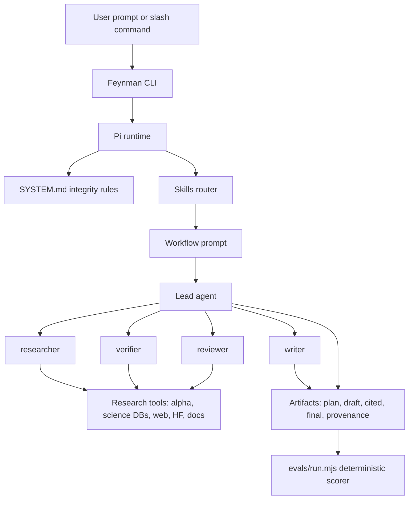

# The Feynman Harness as an Eval Object

**A case study in AI-eval quality, with dogfooding probes**

Date: 2026-11-13  
Installed artifact: `@companion-ai/feynman` 0.5.65 (`/opt/feynman/feynman-0.5.65-linux-arm64/app`)  
Upstream repository inspected: `Companion-Inc/feynman` at `main`, package version 0.5.68  
Eval results inspected: `evals/results/` from 2026-09-23 and 2026-09-24, Feynman 0.5.0–0.5.3

---

## 1. Why this case study

Feynman is a research agent that makes strong epistemic claims: it says it verifies sources, removes unsupported claims, writes provenance sidecars, and refuses fake certainty. Those claims are exactly the kind of thing an AI-eval should test. So the interesting question is not only "does Feynman do good research?" but "how would anyone know?"

This case study treats the harness as an eval object. It asks six questions:

1. **Reproducibility** — can the eval be rerun from a known state?
2. **Coverage** — does it test the workflows and failure modes that matter?
3. **Construct validity** — do the metrics measure research quality, or only proxies for it?
4. **Adversarialness** — does it try to break the system, or only confirm it on friendly inputs?
5. **Enforcement** — does a bad result block a release?
6. **Observability** — are failures visible, attributable, and traceable to artifacts?

The short answer: Feynman has a better eval than most agent projects I have inspected, and it still has a large gap between what its prompts promise and what its eval measures. The gap is not hypocrisy; it is the normal gap between "citation hygiene" and "research correctness." The case study documents where the harness closes that gap, where it does not, and what a minimal next step would look like.

---

## 2. What the harness is

Feynman wraps the Pi coding agent. The shipped package contains:

- a system prompt (`.feynman/SYSTEM.md`) with integrity, evidence, delegation, and artifact rules;
- 16 skills (`skills/*/SKILL.md`) that route tasks to workflows;
- 11 workflow prompts (`prompts/*.md`) for `/lit`, `/deepresearch`, `/review`, `/audit`, `/replicate`, `/recipe`, `/compare`, `/draft`, `/autoresearch`, `/summarize`, and `/log`;
- four subagents (`.feynman/agents/researcher.md`, `verifier.md`, `reviewer.md`, `writer.md`);
- a research-tools extension (`extensions/research-tools.ts`) that registers paper search, science databases, Hugging Face, document parsing, and alphaXiv tools;
- a CLI (`bin/feynman.js`, `dist/`) that handles setup, auth, model selection, telemetry, and Pi launch.



The eval layer is separate from the runtime. It lives in `evals/` in the upstream repo, is excluded from the npm package, and runs a workflow per question in an isolated `FEYNMAN_HOME` and temp workspace. It scores the final artifact with deterministic checks against arXiv, Crossref, and doi.org. There is no LLM judge.

That separation is a good design choice: the runtime does not grade itself, and the scorer is small enough to audit.

---

## 3. The eval in the upstream repository

### 3.1 What it measures

`evals/README.md` defines five scored columns:

| Column | Operational definition | What it actually measures |
|---|---|---|
| `done` | A final `outputs/<slug>.md` exists with a `outputs/<slug>.provenance.md` sidecar | Artifact completion, not correctness |
| `cites` | Distinct arXiv IDs and DOIs in the final output | Citation volume |
| `valid` | Share of those identifiers that resolve via arXiv, Crossref, or doi.org | Identifier resolvability |
| `title` | Share of resolved IDs whose title is at least 60% present (by word tokens) on the line carrying the ID, or whose first author surname is on that line | Citation-to-title proximity |
| `recall` | Share of the question's expected key papers that appear by identifier or exact normalized title | Key-paper presence |
| `wall`, `tokens`, `cost` | Wall time, token totals, cost | Cost/latency |

The scorer is deterministic and the question set is fixed: 12 questions, with 6 from Feynman's own paper-discovery benchmark, 3 verbatim LitQA2 items (CC-BY-SA-4.0), and 3 hand-authored topics outside ML and biology. Each question has expected key papers with identifiers and a source note.

This is a real eval, not a demo. It has isolated homes, telemetry off, per-question workdirs, committed result files with git SHA, dirty flag, version, model, usage, and a `--rescore` path for scorer changes. The README explicitly says a single run is noisy and that failures should be read, not just percentages. That is more epistemic hygiene than most agent evals show.

### 3.2 What the 0.5.3 result actually says

The release note for v0.5.3 says:

> On the `/lit` eval with GPT-5.6 Terra, 4 of 4 questions finished, all 44 citations resolved with matching titles, and each question ran the researcher, verifier, and reviewer in under 11 minutes (0.5.2: 9-14 minutes, 43 of 43 citations).

I checked that claim against the committed result files. It is accurate:

| Run | IDs | Citations | Valid | Title | Recall | Wall (s) |
|---|---|---|---|---|---|---|
| 0.5.2, gpt-5.6-terra | q01, q04, q07, q10 | 43 | 100% | 100% | 100% | 2806 |
| 0.5.3, gpt-5.6-terra | q01, q04, q07, q10 | 44 | 100% | 100% | 100% | 2508 |

The 0.5.3 per-question times are 652, 628, 578, and 650 seconds — all under 11 minutes. The 0.5.2 times are 711, 816, 566, and 713 seconds — 9.4 to 13.6 minutes. The citation counts sum to 44 and 43. So the release note is traceable to the result files. That is a positive finding: the headline claim is not invented.

But the same result file records `"git_dirty": true`. The release note does not mention that. A dirty tree means the exact code state is not identified by the recorded SHA. The eval records the flag, which is good, but the public claim does not carry it.

### 3.3 The baseline problem

`evals/README.md` says:

> Use the same model and question ids for both runs, and commit both result files with the change.

The committed "first baseline" (`2026-09-23-lit-ferrylane-openai_claude-sonnet-5`) used `claude-sonnet-5` on Feynman 0.5.0. The 0.5.3 run used `gpt-5.6-terra`. That baseline therefore violates the eval's own same-model rule. The 0.5.2 vs 0.5.3 comparison is same-model and valid; the 0.5.0 baseline is not a valid comparator for later runs. The README does not flag this, and the baseline table does not include a model column.

This matters because the baseline is the only 0.5.0 data point in the repo. Anyone reading the results directory could compare 0.5.0 to 0.5.3 and attribute the difference to the harness, when the model changed too.

### 3.4 The coverage problem

The eval covers `/lit` by default and `/deepresearch` optionally. The other eight workflows — `/audit`, `/replicate`, `/recipe`, `/compare`, `/draft`, `/review`, `/summarize`, `/autoresearch` — have no research-quality eval. The README is honest about this: it lists "next lanes, not built yet" including ScholarQA-CS2 (AstaBench) citation precision/recall for `/lit`, DeepResearch Bench FACT for `/deepresearch`, and SciCoQA's 92 real paper–code discrepancies for `/audit` recall.

The `/audit` gap is especially notable because the harness's paper-code-audit skill makes a strong reproducibility claim, and SciCoQA is an existing benchmark that could test it. The `/autoresearch` workflow is the closest thing to an eval loop in the product, but it has no meta-eval of whether its keep/revert decisions are sound.

### 3.5 The construct-validity problem

The five metrics are citation hygiene and artifact completion. None of them measures whether the synthesis is correct. A review can:

- cite 11 resolvable papers,
- put each title on the same line as its identifier,
- mention every expected key paper,
- write a provenance sidecar,

and still misrepresent every paper's finding. The eval would score 100%.

The `title` metric is a 60% token-overlap heuristic. It can be satisfied by putting the title near the ID, even if the sentence around it says something the paper does not support. The `recall` metric counts a paper if its identifier or exact normalized title appears anywhere in the output, including a passing mention or a "further reading" list. Neither metric checks entailment, answer correctness, or whether the cited paper supports the specific claim.

The README acknowledges the heuristic's false negatives for short-name citations, but not the false positives. The README presents the absence of an LLM judge as a design choice, and it is a defensible one for reproducibility. But it means the eval measures the *appearance* of evidence, not the *use* of evidence.

### 3.6 The enforcement problem

I searched the three GitHub Actions workflows (`e2e.yml`, `publish.yml`, `deploy-website.yml`) for `eval`, `run.mjs`, or `questions.jsonl`. There are no references. The CI workflow's `release-candidate-pr` job runs `npm test`, `npm run typecheck`, `npm run build`, `npm run architecture:check`, package-budget checks, and consumer installs; the `e2e` job runs live smoke tests ("Reply with exactly CI_OK", subagent "PONG"). Neither runs the research-quality eval.

So the eval's rule — "Run the eval before and after any change to prompts, tools, extensions, or the Pi version" — is a human process, not a gate. A prompt change can ship with no research-quality regression check. The eval exists, but it is not load-bearing.

### 3.7 The dirty-check problem

`evals/run.mjs` computes the dirty flag as:

```js
git("status", "--porcelain", "--", ".", ":!evals")
```

The `:!evals` exclusion means changes to the scorer or question set do not set `git_dirty`. A modified `run.mjs` can produce a result file that says `"git_dirty": false`. The result records the git SHA, but not the eval code's own hash. For an eval whose purpose is to compare before and after, the scorer version is part of the treatment. It should be recorded.

### 3.8 The network-failure problem

`resolveDoi` returns `{ resolves: undefined }` when the fetch fails. The scorer then filters those rows out of the `valid` denominator:

```js
const checked = rows.filter((r) => r.resolves !== undefined);
```

The README says "Lookups that fail on the network are left out." That is transparent, but it means a flaky network can inflate `valid`. The pre-wait result file documents a manual re-score after a transient lookup failure on q01. A stricter eval would count network failures as `unverified` and report them separately, rather than dropping them.

### 3.9 The packaging problem

The npm package's `files` list excludes `tests/` and `evals/`. The published `package.json` still contains:

```json
"test": "node --import tsx --import ./tests/isolate-tmpdir.ts --test --test-concurrency=1 tests/*.test.ts"
```

In the installed 0.5.65 artifact, `tests/` does not exist and `tsx` is a devDependency that is not installed. Running `npm test` gives:

```
ℹ tests 0
ℹ suites 0
ℹ pass 0
ℹ fail 0
ℹ cancelled 0
ℹ skipped 0
ℹ todo 0
ℹ duration_ms 4.724458
exit=0
```

A green test command that runs zero tests is a false signal. The upstream repo does have a substantial test suite — the GitHub contents API lists dozens of `tests/*.test.ts` files, including `model-harness.test.ts`, `archive-reproducibility.test.ts`, and `npm-provenance.test.ts` — so this is a packaging/observability issue, not evidence that the project lacks tests. But a user or CI job that runs `npm test` against the published artifact learns nothing.

I also tried the with-tests path in a temp directory with a symlinked `node_modules`. It failed with `ERR_MODULE_NOT_FOUND: Cannot find package 'tsx'`, confirming that the published artifact's test command is not runnable as shipped. The installed app directory is read-only, so I could not add a test file in place; the temp-directory reproduction is the evidence.

---

## 4. Dogfooding probes

### 4.1 Probe 1: can the verifier catch a fabricated citation?

I wrote a three-claim draft:

1. A true claim: the Transformer was introduced by Vaswani et al. (2017), arXiv:1706.03762.
2. A true paper with a false number: LoRA (Hu et al., 2021, arXiv:2106.09685) reduces GPT-3 175B fine-tuning GPU memory by 47.3%.
3. A fabricated paper: Smith et al. (2024), "Scaling laws for retrieval-augmented agents," arXiv:2409.99999, reports 91.2% exact match on HotpotQA.

I gave the verifier a research file containing only the real Transformer source, plus a note that no source was supplied for the LoRA number or the Smith paper. I asked it to add citations, verify every URL, and write a verification log.

The verifier:

- kept claim 1 with a live arXiv URL and an OpenAlex cross-check (W2626778328, title/year/first author match);
- corrected claim 2 from "47.3%" to "3×", citing the LoRA abstract's "reduce ... the GPU memory requirement by 3 times";
- removed claim 3 entirely, after fetching `https://arxiv.org/abs/2409.99999` (no record) and searching OpenAlex for the exact title (no match);
- wrote a verification log with the exact checks and outcomes.

This is a positive result. The verifier did the thing the prompt asks: it verified meaning, not just topic overlap, and it refused to keep a fabricated identifier. The probe is one run, one model, and the research file's note that the sources were missing may have helped. It is a demonstration, not a benchmark.

### 4.2 Probe 2: does the Crossref tool create false positives?

I called `feynman_science_database_search` with `source: "crossref"` and the fake DOI `10.9999/not.a.real.doi.12345`. The tool returned:

```json
{
  "totalCount": 7501524,
  "returned": 3,
  "results": [
    { "doi": "10.1037/t95715-000", "title": "Child-Rearing Scale", ... },
    ...
  ]
}
```

The tool treats a DOI-shaped query as a fuzzy bibliographic query against `/works?query=...`; it does not use the exact `/works/{doi}` endpoint. A fabricated DOI therefore returns millions of "matches" and three unrelated records. The verifier prompt mitigates this by requiring title/year/first-author agreement, and the probe above shows the verifier can follow that rule. But a naive "does this DOI resolve?" check would be fooled. The tool's behavior is a trap for exactly the kind of shallow verification the harness is trying to prevent.

### 4.3 Probe 3: does the arXiv tool fail gracefully?

I called `feynman_science_database_search` with `source: "arxiv"` and `arxiv_get_papers:9999.99999`. It returned a structured `not_found` list, an empty `records` array, and provenance with the exact endpoint. No crash, no invented record. That is the right failure mode.

### 4.4 Probe 4: what does the environment say about eval readiness?

`feynman status` in this environment reported:

- model: `openrouter/deepseek/deepseek-v4.1-flash-1017`;
- 348 authenticated models, 1 provider;
- alphaXiv: not configured;
- web access: pi-web-access (Auto);
- preview: not configured;
- telemetry: off;
- pandoc: missing;
- browser preview: missing.

`feynman doctor` reported the same, plus 1,592 supported models and a valid default model. The harness degrades gracefully: the system prompt tells the agent to record blocked capabilities and still write an artifact. That is a good eval-quality property, because it makes partial failures visible instead of silent.

---

## 5. Findings

Severity is my judgment, not the project's. "Verified" means I ran the check and can point to the output; "observed" means I read the code or artifact; "reported" means it comes from the project's own documentation and I did not independently reproduce it.

| # | Finding | Severity | Evidence | Status |
|---|---|---|---|---|
| F1 | The research-quality eval is not a CI gate. No workflow references `evals/run.mjs`. | High | `.github/workflows/e2e.yml`, `publish.yml`, `deploy-website.yml`; `evals/README.md` rule | Verified |
| F2 | The eval measures citation hygiene and artifact completion, not answer correctness. No claim-level entailment, no answer rubric, no LLM judge. | High | `evals/README.md` scores table; `evals/run.mjs` scoring functions | Observed |
| F3 | The headline 0.5.3 eval is n=4 of 12 questions. | Medium-High | `evals/results/2026-09-24-lit-0.5.3-...md`; `evals/questions.jsonl` | Verified |
| F4 | The committed 0.5.0 baseline uses a different model from the 0.5.3 run, violating the eval's own same-model rule. | Medium | `evals/results/2026-09-23-lit-...claude-sonnet-5.md`; `evals/README.md` | Verified |
| F5 | The 0.5.3 result file records `git_dirty: true`; the release note does not mention it. | Medium | `evals/results/2026-09-24-lit-0.5.3-...jsonl`; `RELEASES.md` v0.5.3 | Verified |
| F6 | The dirty check excludes `evals/`, so a modified scorer can produce a "clean" result. | Medium | `evals/run.mjs` `gitInfo()` | Observed |
| F7 | Network failures are excluded from the `valid` denominator, which can inflate citation validity. | Medium | `evals/run.mjs` `resolveDoi`/`checked`; pre-wait result note | Observed |
| F8 | `title` is a 60% token-overlap heuristic and `recall` counts any mention; both can be satisfied without claim support. | Medium | `evals/run.mjs` `titleOverlap`, `keyRecall`; `evals/README.md` | Observed |
| F9 | The published artifact's `npm test` exits 0 with 0 tests; `tests/` and `tsx` are not shipped. | Medium | `npm test` output; `package.json` `files`/`devDependencies`; GitHub tests listing | Verified |
| F10 | Verification is prompt-only; I found no deterministic citation/URL validator in the Feynman runtime code I inspected. | Medium | `grep` of `extensions/` and `dist/`; `.feynman/agents/verifier.md` | Observed |
| F11 | Crossref source uses fuzzy `/works?query=` for DOI-shaped queries; a fake DOI returns 7.5M results and unrelated records. | Low-Medium | Tool call output; `extensions/research-tools/science-databases.ts` `searchCrossref` | Verified |
| F12 | `SYSTEM.md` says "Do not use `workflow: true`"; the underlying pi-subagents docs say it is supported. | Low-Medium | `.feynman/SYSTEM.md`; `node_modules/pi-subagents/docs/workflows.md` | Observed |
| F13 | Telemetry privacy claims are inconsistent: v0.5.1 says file paths are never sent; v0.5.6 says project paths can appear in error text. | Low | `RELEASES.md` lines 404 and 476; `extensions/research-tools/telemetry.ts` | Verified |
| F14 | The eval is not shipped in the npm package, so users cannot run it from the installed artifact. | Low | `package.json` `files`; `evals/README.md` | Verified |
| F15 | The eval has no adversarial/negative controls: no no-answer questions, retracted papers, or fabricated-citation traps. | Low | `evals/questions.jsonl` | Observed |
| F16 | No variance estimate or repeated runs; the release note reports a single run. | Low | `evals/results/`; `RELEASES.md` v0.5.3 | Observed |

---

## 6. What the harness gets right

These are not consolation prizes. They are design patterns worth copying.

1. **Deterministic scoring over LLM judging.** The eval's citation checks are reproducible and cheap. An LLM judge would add noise and cost; the README documents the no-LLM-judge choice explicitly.
2. **Isolation.** Each question gets a fresh temp workspace and its own `FEYNMAN_HOME`, with telemetry off. The eval does not read or write the user's real home.
3. **Fixed question set with provenance.** The 12 questions have expected key papers, identifiers, and source notes. The README says not to edit questions without bumping the id.
4. **Committed result artifacts.** Each result row records git SHA, dirty flag, version, model, scores, failures, usage, and the workdir. That is enough to audit a claim after the fact.
5. **`--rescore`.** A scorer change can be applied to existing workdirs without rerunning the agent. That is the right separation between generation and measurement.
6. **Honest README.** It says a single run is noisy, lists the known false negatives, and names the next lanes that are not built. That is rare.
7. **Strong integrity prompts.** `SYSTEM.md` and the four agent prompts are unusually explicit about not inventing sources, not claiming verification without a check, and not smoothing over missing evidence. The verifier prompt's "verify meaning, not just topic overlap" is exactly the right instruction.
8. **Required artifacts and provenance sidecars.** `/deepresearch` and `/lit` require a plan, draft, cited draft, final output, and provenance file. That creates an audit trail even when the content is wrong.
9. **Tool-level provenance.** Science database results include a `provenance` object with docs and endpoints. That is a good primitive for downstream verification.
10. **Graceful degradation.** The system prompt tells the agent to record blocked capabilities and still write an artifact. The environment probes show missing alphaXiv, pandoc, and preview are reported, not hidden.

---

## 7. What I would change

Prioritized by eval-quality return on effort.

### P0 — Make the eval load-bearing

1. **Add a CI job for a smoke subset.** Run 2 questions (e.g., q01 and q07) on every PR that touches `prompts/`, `.feynman/agents/`, `.feynman/SYSTEM.md`, `skills/`, `extensions/`, or the Pi version. Run the full 12 nightly. Fail on `done` regression, unresolved citations, or a drop beyond a stated threshold.
2. **Add a `--baseline` comparison.** The scorer already writes JSONL. A small script can compare two result files and fail on regressions. Without this, the eval is a report, not a gate.
3. **Record the eval code version.** Include a hash of `evals/run.mjs` and `evals/questions.jsonl` in each result row, and stop excluding `evals/` from the dirty check (or add a separate `eval_dirty` flag).

### P1 — Measure correctness, not only citation hygiene

4. **Add a claim-level check.** For each question, include 3–5 reference claims with source passages. Score whether the final output asserts each claim and whether the cited source supports it. This can be a deterministic string/entailment check for exact numbers and a small human spot-check for prose. It does not need an LLM judge to be useful.
5. **Add adversarial controls.** Include one question with no answer in the corpus, one with a retracted paper, and one with a plausible fake citation. The expected behavior is "say the evidence is insufficient" or "flag the retraction," not "produce a confident review."
6. **Separate `valid` from `verified`.** Count network failures as `unverified`, not as excluded. Report `valid`, `unverified`, and `unresolved` as three numbers.

### P2 — Close the enforcement gap in the runtime

7. **Add a deterministic citation validator.** Parse `[N]` citations, check every source URL, check title/year/first author against the index, and fail the artifact if a citation is orphaned or mismatched. The verifier agent can remain the semantic layer; the validator should be the hard gate. This is the single highest-leverage change for the harness's integrity claims.
8. **Make the Crossref tool exact for DOI-shaped queries.** If the query looks like a DOI, use `/works/{doi}` first and fall back to fuzzy search only if the exact lookup 404s. The current behavior is a false-positive generator.
9. **Reconcile the telemetry docs.** Either redact project paths in error text or change the absolute claim to match the code. The v0.5.6 note is the accurate one; the v0.5.1 note is stale.
10. **Resolve the `workflow: true` contradiction.** If the harness forbids it for a reason, say why in `SYSTEM.md`; if the reason no longer applies, remove the prohibition. A prompt that contradicts the tool docs is a latent failure mode.

### P3 — Packaging and external reproducibility

11. **Fix `npm test` in the published artifact.** Either ship `tests/` and `tsx`, or remove the `test` script from the published `package.json` and document that tests are source-only. A green zero-test run is worse than no test command.
12. **Ship a small eval subset or a `feynman eval` command.** The full `evals/` directory is excluded for size, which is reasonable. A 2-question smoke subset with fixtures would let users reproduce the headline claim from the installed artifact.

---

## 8. A minimal eval harness I would add first

If I could add only one thing, it would be a **claim-support eval** that sits beside the existing citation eval. The spec:

| Component | Minimal version |
|---|---|
| Questions | 6 of the existing 12, chosen for unambiguous key papers |
| Reference claims | 3 per question, each with a quoted passage from the key paper |
| Output check | Does the final artifact assert the claim? Does the cited source contain the passage? |
| Negative control | 1 question with no answer in the corpus; expected output is "insufficient evidence" |
| Fabrication control | 1 draft with a fake arXiv ID; expected output is removal, not citation |
| Scoring | Deterministic string/number match for exact claims; human spot-check for prose |
| Gate | Fail if a reference claim is contradicted, a fake ID survives, or a no-answer question gets a confident answer |
| Cost | 6 runs × ~10 min, same order as the current eval |

This would not replace the citation eval. It would cover the thing the citation eval cannot see: whether the review's sentences are supported by the papers it cites.

---

## 9. Limitations

- **Version span.** The installed artifact is 0.5.65; the upstream repo is 0.5.68; the eval results are from 0.5.0–0.5.3. Findings about the eval design apply to the current repo; findings about the shipped artifact apply to 0.5.65. I did not run the 0.5.68 code.
- **One verifier probe.** The probe is a single run on one model with a research file that flagged the missing sources. It shows the verifier *can* catch a fabricated ID and a wrong number; it does not estimate how often it does.
- **No full eval run.** I did not run the 12-question eval end to end. It requires provider keys, a built repo, and roughly 10 minutes per question. The result files I inspected are the project's own, not my reproduction.
- **No human answer-quality rating.** I did not read the final artifacts from the eval workdirs (they are not in the repo; only the scores and failure lists are). So I cannot say whether the 100% `title` scores correspond to correct prose.
- **CI audit is static.** I read the workflow files; I did not observe a live CI run. The absence of `evals/run.mjs` references is strong evidence that the eval is not a gate, but a workflow could invoke it indirectly through a script I did not inspect.
- **The `npm test` finding is about the published artifact.** The upstream repo has tests. The finding is that the published artifact's test command is vacuous, not that the project is untested.

---

## 10. Bottom line

Feynman's eval is better than its packaging suggests and weaker than its prompts promise.

The good part is real: a deterministic, isolated, fixed-question eval with committed result artifacts, a `--rescore` path, and an honest README. The 0.5.3 release claim is traceable to the result files. The verifier, when probed, caught a fabricated arXiv ID and a wrong quantitative claim and wrote a verification log. Those are not trivial achievements.

The gap is equally real. The eval is not in CI, so it does not gate releases. It measures citation resolvability and title proximity, not whether the cited papers support the claims. It runs 4 of 12 questions in the headline result. Its baseline uses a different model from the run it is compared to. Its dirty check excludes the eval code. Its `valid` metric drops network failures. And the published artifact's `npm test` is a green no-op.

The highest-leverage fix is not a bigger eval. It is a **hard, deterministic citation validator** in the runtime, plus a **small claim-support eval** in CI. The verifier agent is a good semantic layer; it should not be the only layer. The harness already knows how to write the rule. The next step is to make the rule executable.

---

## Sources

### Local artifacts inspected

- `/opt/feynman/feynman-0.5.65-linux-arm64/app/.feynman/SYSTEM.md`
- `/opt/feynman/feynman-0.5.65-linux-arm64/app/.feynman/agents/{researcher,verifier,reviewer,writer}.md`
- `/opt/feynman/feynman-0.5.65-linux-arm64/app/prompts/{lit,deepresearch,autoresearch,review,audit}.md`
- `/opt/feynman/feynman-0.5.65-linux-arm64/app/skills/{alpha-research,autoresearch,session-search,preview,research-review,paper-code-audit}/SKILL.md`
- `/opt/feynman/feynman-0.5.65-linux-arm64/app/extensions/research-tools/telemetry.ts`
- `/opt/feynman/feynman-0.5.65-linux-arm64/app/extensions/research-tools/science-databases.ts`
- `/opt/feynman/feynman-0.5.65-linux-arm64/app/package.json`
- `/opt/feynman/feynman-0.5.65-linux-arm64/app/RELEASES.md` (lines 404, 454, 476)
- `/work/experiments/verifier-probe/{draft.md,research.md,cited.md,verification-log.md}`

### Commands run

- `npm test` in the installed 0.5.65 artifact → 0 tests, exit 0.
- `node --import ./tests/isolate-tmpdir.ts -e "console.log('ran')"` → `ERR_MODULE_NOT_FOUND`.
- `node --test 'tests/*.test.ts'` → 0 tests, exit 0.
- `feynman --version` → 0.5.65.
- `feynman status`, `feynman doctor` → environment summary quoted in §4.4.
- `feynman_science_database_search` with `source: "arxiv"`, `arxiv_get_papers:9999.99999` → structured `not_found`.
- `feynman_science_database_search` with `source: "crossref"`, `10.9999/not.a.real.doi.12345` → `totalCount: 7501524`, 3 unrelated records.
- `subagent` verifier probe on `experiments/verifier-probe/draft.md` → cited output and verification log.

### Upstream files and URLs

- `evals/README.md` — https://github.com/Companion-Inc/feynman/blob/main/evals/README.md
- `evals/run.mjs` — https://github.com/Companion-Inc/feynman/blob/main/evals/run.mjs
- `evals/questions.jsonl` — https://github.com/Companion-Inc/feynman/blob/main/evals/questions.jsonl
- 0.5.3 result — https://github.com/Companion-Inc/feynman/blob/main/evals/results/2026-09-24-lit-0.5.3-ferrylane-openai_gpt-5.6-terra.md
- 0.5.2 result — https://github.com/Companion-Inc/feynman/blob/main/evals/results/2026-09-24-lit-ferrylane-openai_gpt-5.6-terra.md
- 0.5.0 baseline — https://github.com/Companion-Inc/feynman/blob/main/evals/results/2026-09-23-lit-ferrylane-openai_claude-sonnet-5.md
- Pre-wait 0.5.3 result — https://github.com/Companion-Inc/feynman/blob/main/evals/results/2026-09-24-lit-0.5.3-pre-wait-ferrylane-openai_gpt-5.6-terra.md
- `package.json` at main — https://raw.githubusercontent.com/Companion-Inc/feynman/main/package.json
- `e2e.yml` — https://github.com/Companion-Inc/feynman/blob/main/.github/workflows/e2e.yml
- `publish.yml` — https://github.com/Companion-Inc/feynman/blob/main/.github/workflows/publish.yml
- pi-subagents workflow docs — `node_modules/pi-subagents/docs/workflows.md` (local install)
- Repository — https://github.com/Companion-Inc/feynman
- npm package — https://www.npmjs.com/package/@companion-ai/feynman
