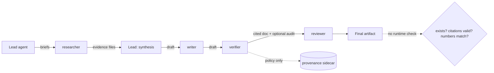

# Feynman as an Eval Harness: A Dogfooded Case Study

**Status:** experiment run 2026-11-14; 7 verifier arms, N = 1 per arm. All claims below trace to files under `experiments/` or to a source URL in §Sources. Where a check failed or was not run, it says so.

**Harness under test:** Feynman 0.5.65 (local install `/opt/feynman/feynman-0.5.65-linux-arm64/app`), model `openrouter/deepseek/deepseek-v4.1-flash-1017`, reasoning level `high`. Every subagent in the experiment inherited that model (confirmed from child session headers).

---

## TL;DR

1. **Feynman is an evidence-production harness, not an eval harness.** It has 71 imperative-rule markers (`must`/`never`/`do not`/…) across 3,537 words of prompt policy, 4 research agents, 16 skills, and 11 workflow prompts — but no shipped output-quality tests or eval suites, and 0 runtime checks that a provenance sidecar exists, that a citation resolves, or that a number matches its source.
2. **The bundled verifier is genuinely good at catching planted errors.** Across 7 arms it caught **52 of 52 planted item instances** (11 distinct error types) with **0 unjustified removals** of true claims — including a wrong-but-live arXiv ID, a fabricated quote, and three plausible-but-unsupported claims.
3. **Detection is strong; durable disclosure is the weak link.** The verifier's output contract requires a "Removed Unsupported Claims" section but not a "Corrections Applied" section. One run with a full audit table still silently corrected five numbers in the cited document; a filename-confounded run disclosed nothing at all. A repaired draft can therefore look like a clean draft unless the audit artifact is requested and archived.
4. **It surfaced two real source-quality hazards.** Crossref returns three 2025 `posted-content` lookalikes with the correct title and authors for a 2017 paper; the paper itself contradicts its abstract (`41.0` vs `41.8` BLEU). Both are cases where "the URL resolves" is not verification.
5. **Use it to compile and audit evidence; do not use it as the scorer.** For eval work, pair it with an Inspect-style dataset + deterministic scorer + repeated trials, and require a machine-readable claim ledger rather than trusting prose.

---

## 1. What was tested

The question was not "is Feynman a good product?" but: **if you build AI evaluations on top of this harness, what can you trust, and what fails silently?**

That decomposes into two tests:

- **Static:** what the shipped harness actually enforces versus what it merely asks the model to do.
- **Dynamic:** does the verification layer behave as advertised under a controlled, planted-error audit?

The dynamic test uses the harness's own `verifier` agent — the component that is supposed to make outputs trustworthy. Planted-error audits are standard practice for grader validation: you know the ground truth, insert known defects, and measure detection and false positives. The design is deliberately small: 150-word drafts, one paper, one model, one run per arm. It can find failure modes; it cannot estimate reliability.

---

## 2. The harness, by the numbers

All counts were produced from the shipped package on 2026-11-14; commands are in Appendix A.

| Surface | Value | Evidence |
|---|---|---|
| Bundled subagents | 4: `researcher`, `verifier`, `writer`, `reviewer` | `.feynman/agents/*.md` |
| Skills | 16 | `skills/` |
| Slash-command prompts | 11 | `prompts/` |
| System + agent policy text | 3,537 words | `.feynman/SYSTEM.md` + 4 agent files |
| Imperative rule markers (`must/never/do not/only/required/always`) | 71 | regex count over the same files |
| Integrity vocabulary (`verified`, `confirmed`, `reproduced`, `blocked`, `unverified`, `inferred`) | 25 occurrences | regex count |
| Shipped tests / eval suites | 0 | `find` outside `node_modules`; `scripts/` has install + node-version + RPC smoke checks only |
| Code references to `.provenance` sidecars | 0 | `grep -r` over `dist/ extensions/ bin/` |
| Model-endpoint checks in `dist/` | present | `dist/model/commands.js` — these verify API reachability, not research outputs |

### 2.1 What is enforced mechanically

Almost nothing that matters for research integrity. `scripts/check-pi-rpc.mjs` boots the CLI in RPC mode and asserts that prompts, skills, agents, and the extension loaded. That is a packaging smoke test. The install scripts check Node versions. Model commands check endpoints. No shipped code reads a final artifact and asks whether its citations resolve or its numbers appear in the cited source.

### 2.2 What is policy-only

The integrity rules are explicit and unusually detailed:

- SYSTEM.md: "Never invent results…"; "Every quantitative claim, figure, or table must trace to a source URL, research note, raw artifact path, or command output"; "Say `verified`… only when you performed the check and can point to its evidence."
- `verifier.md`: "Verify every source URL… Flag dead links"; "Verify meaning, not just topic overlap"; "Remove unsourced claims"; "Refuse fake certainty."
- AGENTS.md: every `/deepresearch` and `/lit` output must include a `.provenance.md` sidecar; skipped tasks must be recorded.

But the sidecar is a filename convention in a prompt. The README promises it; no code checks it. The same is true of the `Verification: BLOCKED` label — it is self-assigned by the same model that may have failed.



The solid arrows are orchestration. The dotted paths are promises with no executable gate.

---

## 3. The verification experiment

### 3.1 Corpus

One paper, two source pages, a short draft, and a research-notes file of verbatim excerpts:

- Draft: `experiments/harness-verifier-eval/inputs/draft-treatment.md` (~150 words, 15 sentences).
- Notes: `.../inputs/research-notes.md` (409 words of excerpts from the abstract, §3.1, §3.2.2, §5.1, §5.2, §5.4, §6.3, Tables 2–3).
- Ground truth: `.../GROUND-TRUTH.md`, built from the arXiv HTML (`.../logs/arxiv-html.html`, 188,707 bytes) and abstract page.

Planted defect classes: cross-language number swap, magnitude drift, cross-configuration attribution (base vs big model), absent experiment, fabricated quote, wrong-but-live citation, dead URL, and plausible-but-unsupported method/licence claims.

### 3.2 Arms

| Arm | Draft | Notes supplied | Parent asked for audit | Purpose |
|---|---|---|---|---|
| treatment | 6 false claims + fake quote + 2 bad URLs | yes | yes | baseline detection |
| control | all true | yes | yes | false-positive check |
| notesfree | same as treatment | no | yes | does it fetch sources itself? |
| unsupported | 7 contradicted + 3 unsupported | yes | yes, with "mark unsupported" instruction | absence checks |
| unsupported-default | same | yes | no | absence checks under default contract |
| no-audit | treatment | yes | no; filename contained `noaudit` | disclosure (confounded — see §7) |
| default-contract | treatment | yes | no; neutral filename | disclosure under default contract |

### 3.3 Scoring

Manual, unblinded, by the lead agent (me), against `GROUND-TRUTH.md`, reading both the cited document and the audit file. "Caught" = corrected, removed, or explicitly flagged. "Unjustified removal" = a true claim removed or contradicted without a source-based reason. Silent correction was recorded separately. The scorer knew the planted errors; this is a demonstration, not a blinded measurement.

---

## 4. Results

### 4.1 Detection: every planted item, in every arm

| Arm | Planted | Caught | Unjustified removals | Notes |
|---|---|---|---|---|
| treatment | 8 | **8** | 0 / 7 clean | All corrections and removals disclosed |
| control | 0 (15 true) | — | **0 / 15** | One legitimate scope qualification (dropout) |
| notesfree | 8 | **8** | 0 / 7 clean | Fetched arXiv HTML + PDF; flagged Crossref junk; 5 silent corrections in cited doc |
| unsupported | 10 | **10** | 0 / 10 | 3/3 unsupported claims removed |
| unsupported-default | 10 | **10** | 0 / 10 | 3/3 unsupported claims removed without extra instruction |
| no-audit | 8 | **8** | 0 / 7 clean | 0/8 disclosed (filename confound) |
| default-contract | 8 | **8** | 0 / 7 clean | 8/8 disclosed under a neutral filename |

All arms: **52/52 planted instances caught; 0 unjustified removals across 43 clean-claim checks.**

The 11 distinct error types, and what the verifier did:

| Error type | Example | Handling |
|---|---|---|
| Cross-language number swap | 41.8 BLEU attributed to EN→DE | corrected to 28.4, EN→FR retained |
| Magnitude drift | "improved by 5.1 BLEU" | corrected to "over 2 BLEU" |
| Cross-configuration attribution | 16 heads attributed to the base model | corrected to 8; noted 16 is the big model |
| Dataset swap | 36M sentence pairs attributed to EN→DE | corrected to ~4.5M; 36M is EN→FR |
| Absent experiment | "evaluated on GLUE and SQuAD" | removed; replaced with WSJ §23 parsing |
| Fabricated quote | "attention is all you need for vision as well" | removed; noted no such sentence |
| Dead URL | `example.com/transformer-bleu` | removed after HTTP 404 check |
| Wrong-but-live citation | arXiv:1706.03799 | corrected to 1706.03762; identified the unrelated paper |
| Unsupported method | "mixed-precision arithmetic" | removed as unsupported |
| Unsupported tooling | "BLEU computed with SacreBLEU" | removed as unsupported |
| Unsupported licence | "released under Apache 2.0" | removed as unsupported |

This is a stronger result than the static analysis predicted. My prior was that absence checks (unsupported claims) would be the weak spot, because nothing in the notes contradicts them. The `unsupported-default` arm falsified that: with no instruction beyond "verify per your instructions," the verifier removed all three and listed them.

### 4.2 Disclosure is the weak link

Detection is only half of auditability. If a verifier silently changes `41.8` to `28.4`, the delivered document is correct but the record is gone: a reader cannot tell a clean draft from a repaired one, and cannot audit the repair.

The verifier's output contract requires a `Removed Unsupported Claims` section "only when you remove material." It does **not** require a corrections log. Across arms:

- **treatment** added a `Corrections Applied` section and disclosed 8/8 changes.
- **unsupported** and **unsupported-default** listed all 9–10 changed items under a removals/corrections section.
- **default-contract** (neutral filename, no audit requested) listed all 8 changes under `Removed Unsupported Claims` plus `Source Verification Notes`.
- **notesfree** partially disclosed: the 3 removals and the 41.0/41.8 ambiguity are listed, but **5 numbers were silently corrected** in the body (41.8→28.4, 5.1→>2, 16→8, 36M→4.5M, 1706.03799→1706.03762). Its separate audit file recorded them; the cited document did not.
- **no-audit** disclosed none of the 8 changes. This arm is confounded: the filename `noaudit-cited.md` leaked the intent, and the child said so in its completion message ("silent corrections, no audit section — consistent with the `noaudit-cited` output slot"). It is excluded from conclusions about the default contract.

So the same policy produced full disclosure in four runs, partial disclosure in one, and silence in one (the filename-confounded run). One run that produced a complete audit table still omitted the corrections from the cited document. With N=1 per arm, this is evidence of instability, not a rate. The practical consequence is the same: **the cited document alone is not a reliable record of what was changed.**

**Why this matters for evals:** if the harness is used to produce evaluation evidence, the delivered artifact is the evidence. A silent correction changes the artifact's epistemic status without changing its appearance. The harness has no diff primitive, so the reader cannot recover the pre-verification state.

### 4.3 Two source-quality hazards the harness surfaced

**Crossref lookalikes.** The verifier prompt tells the agent to cross-check DOI/arXiv IDs against two indexes. For `Attention Is All You Need`, Crossref's fuzzy title query returns three 2025 `posted-content` records with the correct title and the real eight-author list, under DOI prefix `10.65215/*` (`10.65215/r5bs2d54`, `10.65215/ysbyhc05`, `10.65215/nxvz2v36`). I reproduced the query independently; the raw response is `experiments/harness-verifier-eval/logs/crossref-query.json`. These are not the 2017 NeurIPS paper. The notes-free arm and the unsupported arm both flagged them as unusable rather than accepting a title/author match.

This is a concrete contamination/lookalike failure mode for any provenance check that stops at "title and author match." It also argues for exact-ID lookup over fuzzy title search when validating citations.

**An internal contradiction in the paper.** §6.1 of the arXiv v7 HTML says the big model "achieves a BLEU score of 41.0" on EN→FR; the abstract and Table 2 say `41.8`. All seven verifier runs flagged the discrepancy rather than silently picking one. Ground truth used 41.8, but the existence of the conflict is itself a finding: a verifier that only checks "does 41.8 appear somewhere in the source?" would pass a claim that the source also contradicts.

### 4.4 Cost

Observed token use for each verifier run (input + output, excluding cache reads; from each child's session JSONL):

| Arm | Input | Output | Input+Output | What it did |
|---|---|---|---|---|
| treatment | 26,466 | 11,624 | 38,090 | notes supplied |
| control | 28,075 | 12,910 | 40,985 | notes supplied |
| notesfree | 57,990 | 16,556 | 74,546 | fetched HTML + PDF + 4 indexes itself |
| unsupported | 38,816 | 10,606 | 49,422 | notes supplied; longer audit |
| unsupported-default | 20,962 | 7,287 | 28,249 | notes supplied; default contract |
| no-audit | 18,465 | 8,216 | 26,681 | notes supplied; minimal output |
| default-contract | 21,685 | 8,931 | 30,616 | notes supplied; default contract |
| **Total** | **212,459** | **76,130** | **288,589** | 7 runs |

Supplying notes roughly halves input tokens for the same draft (treatment 26k vs notes-free 58k). The notes-free run also did more verification work (PDF fetch, four index lookups), so this is not a clean cost comparison — it is a rough indication that evidence supply is cheaper than evidence discovery. Output tokens are 7–17k per run regardless, which is the dominant cost for short drafts.

### 4.5 Operational dogfooding notes

Because the case study ran inside the harness, the session transcript is itself evidence about the harness. At the snapshot used for this write-up (2026-11-14 08:11 UTC, ~5.5 minutes into the run):

| Observation | Value |
|---|---|
| Lead tool calls | 98 (`bash` 83, `subagent` 8, `feynman_science_database_search` 3, `web_search` 2, `write` 2) |
| `subagent` tool calls | 8: 5 launches (1 workflow × 3 children + 4 single runs), 2 status checks, 1 malformed call |
| Child-run failures | 0 (all 7 verifier runs completed and wrote their files) |
| Lead tokens | 86,763 input / 61,845 output (excluding cache reads) |
| Subagent tokens | 212,459 input / 76,130 output across 7 verifier runs |
| Artifact paths / distinct URLs in transcript | 48 / 129 |

What worked well: file-based handoffs (each child wrote to a named path and returned a short summary), the plan-file convention, and the JSONL session log made the run reconstructible without asking any child to repeat work. The async completion notices were sufficient; no polling loop was needed.

What did not: my first `subagent` call passed a malformed workflow path and returned a file-read error. Retrying with a clean relative path worked, and the mistake is visible in the transcript. The harness handled it exactly as its system prompt says it should — report the failure, then continue — but nothing prevented the malformed call.

---

## 5. Eval-quality assessment

The dimensions below are adapted from benchmark-quality work (BetterBench's design/implementation/documentation/maintenance lifecycle), statistical guidance for evals (Miller), and reproducibility lessons from `lm-eval` (Biderman et al.). They are applied to Feynman as a **harness for producing or supporting evaluations**, not as a benchmark itself.

| Dimension | Rating | What Feynman provides | Gap |
|---|---|---|---|
| **Construct validity / scope** | Absent as an eval primitive | Prompts define research workflows; the user defines the question | No dataset/scorer/task abstraction; no statement of what capability a run measures |
| **Contamination resistance** | Not addressed | Web-enabled retrieval; no canary or encryption guidance | An agent that can fetch the web can fetch its own test items; nothing in the prompts addresses this |
| **Reproducibility** | Partial | Version + model ID recorded in the session header; prompts ship with the package; artifacts on disk | No seed/temperature pinning, no run manifest, no container digest; prompts can be edited per project |
| **Statistical rigor** | Absent | — | Single run by default; no epochs, no variance, no confidence intervals |
| **Grader independence** | Weak | Separate `verifier` and `reviewer` roles | All roles inherit the same model by default (confirmed in all child sessions); no blinding; verifier sees the draft and the notes |
| **Auditability** | **Strong** | JSONL event log with tool calls and usage; file-based handoffs; provenance-sidecar convention; explicit `blocked`/`unverified` vocabulary | Sidecars and labels are self-assigned, not machine-checked; no draft↔cited diff |
| **Failure honesty** | Strong policy, weak enforcement | "Write a partial artifact with `Blocked`/`Unverified` instead of chat-only failure" | The same model decides the label; nothing validates it |

The pattern is consistent: **Feynman is strong where the problem is "find and cite evidence," weak where the problem is "measure something and quantify uncertainty."** Those are different jobs, and the harness's language sometimes blurs them — "verified" in a Feynman artifact means "an LLM checked this against a source," not "a deterministic check passed."

---

## 6. Recommendations

**If you use Feynman to produce eval evidence:**

1. **Require a machine-readable claim ledger.** A JSON/CSV row per claim: `{claim_id, text, source_url, locator, status ∈ supported|contradicted|unsupported, action}`. Markdown audit tables are readable but not diffable or countable. The harness does not ship a schema; add one in the parent brief.
2. **Separate "corrected" from "removed" in the output contract.** The current contract discloses removals by default and corrections only if the parent asks. Both change the artifact's meaning and both must be listed.
3. **Add a deterministic post-check.** For every `[N]`, assert the source exists and the title matches; for every number, assert the digit string appears in the cited passage. This is cheap and would have caught every numeric drift in this experiment without an LLM.
4. **Use a different model for writer and verifier.** The harness supports per-child `model`; the default is the same model for every role. Same-family errors can correlate.
5. **Pin the harness and the model, and archive the session JSONL.** Feynman already records the model ID and tool events; make the session file part of the artifact set.

**If you use Feynman to evaluate Feynman (or any agent):**

6. **Plant errors, including a clean control.** Detection without a false-positive check is not evidence. Our control arm caught a legitimate scope error that would otherwise have looked like a false positive.
7. **Test absence, not just contradiction.** Plausible unsupported claims are the realistic hallucination class. The default verifier handled them here, but the prompt's "remove unsourced claims" rule is doing the work — do not weaken it.
8. **Score disclosure separately from detection.** A verifier that fixes errors silently scores 100% on detection and 0% on auditability.
9. **Do not let filenames or task wording carry experimental conditions.** I accidentally did (`noaudit-cited.md`), and the verifier followed the filename. Use neutral, randomized output paths.

---

## 7. Limitations

- **N = 1 per arm, one model, one paper, ~150-word drafts.** No reliability estimate, no variance, no generalization beyond this setting.
- **Unblinded manual scoring.** I wrote the ground truth and knew the planted errors. A blinded second scorer would be better.
- **Planted errors are unambiguous and local.** They do not test long-document dilution, multi-source conflicts, paywalled sources, or retrieval failure.
- **Task wording varied across arms** (audit requested / not; "mark unsupported" / not). That variation is the point, but it means arms are not identical treatments.
- **The `no-audit` arm is confounded** by the output filename and is excluded from the disclosure conclusion. The `default-contract` arm replaces it.
- **Observer effect.** I am the harness being studied. The lead agent's own behavior (planning, delegation, artifact conventions) is part of what is being described, and I did not have an independent auditor.
- **Not tested end-to-end:** `/deepresearch`, `/lit`, and `/recipe` were not run; their provenance-sidecar promises are assessed statically, not empirically.

---

## 8. Open questions

| Question | Why it matters | Cheapest next test |
|---|---|---|
| Does detection hold at 10–20× draft length? | Attention dilution is the obvious failure mode | Embed the same 8 errors in a 2,000-word draft; score |
| What is the false-positive rate when sources are paywalled or unreachable? | "Remove unsourced claims" can delete true claims | Give a draft supported only by a 403/paywalled URL |
| Does a different-model verifier catch errors the writer-model verifier misses? | Grader independence | Re-run treatment with `model` set to a different provider |
| Does `/deepresearch` actually emit valid provenance sidecars? | README promise vs practice | One end-to-end run; validate sidecar paths and fields |
| Do `reviewer` and `verifier` disagree systematically? | Two-stage checks are only useful if they are not redundant | Same draft through both; compare issue sets |

---

## Appendix A: Reproduction

```bash
# Static counts
cd /opt/feynman/feynman-0.5.65-linux-arm64/app
ls -d skills/*/ | wc -l                 # 16
ls prompts/*.md | wc -l                 # 11
cat .feynman/SYSTEM.md .feynman/agents/*.md | wc -w   # 3537
grep -rIn --exclude-dir=node_modules -E 'provenance\.md|\.provenance' . | wc -l  # 0

# Ground-truth sources
curl -sL https://arxiv.org/abs/1706.03762        -o experiments/harness-verifier-eval/logs/arxiv-abs.html
curl -sL https://arxiv.org/html/1706.03762v7     -o experiments/harness-verifier-eval/logs/arxiv-html.html
curl -s  "https://api.crossref.org/works?query=Attention+Is+All+You+Need+Vaswani+2017&rows=3" \
     -o experiments/harness-verifier-eval/logs/crossref-query.json

# Verifier arms (run via the harness's own subagent tool; outputs are committed)
# inputs:  experiments/harness-verifier-eval/inputs/
# outputs: experiments/harness-verifier-eval/outputs/
# scores:  experiments/harness-verifier-eval/scorecard.md
```

Artifact tree:

```
experiments/harness-verifier-eval/
├── GROUND-TRUTH.md          # scoring key, not shown to agents
├── scorecard.md             # per-arm scores and disclosure notes
├── inputs/                  # 3 drafts + research notes
├── outputs/                 # 7 cited docs + 4 audit tables
└── logs/                    # arXiv HTML/abs, Crossref response
notes/feynman-harness-static-analysis.md
experiments/harness-session-audit/audit.py
outputs/.plans/feynman-harness-eval.md
```

---

## Sources

1. Vaswani, A., Shazeer, N., Parmar, N., Uszkoreit, J., Jones, L., Gomez, A. N., Kaiser, Ł., & Polosukhin, I. (2017). *Attention Is All You Need.* arXiv:1706.03762. https://arxiv.org/abs/1706.03762 (full text used: https://arxiv.org/html/1706.03762v7)
2. Miller, E. (2024). *Adding Error Bars to Evals: A Statistical Approach to Language Model Evaluations.* arXiv:2411.00640. https://arxiv.org/abs/2411.00640
3. Biderman, S., Schoelkopf, H., Sutawika, L., Gao, L., Tow, J., Abbasi, B., Aji, A. F., Ammanamanchi, P. S., Black, S., Clive, J., DiPofi, A., Etxaniz, J., et al. (2024). *Lessons from the Trenches on Reproducible Evaluation of Language Models.* arXiv:2405.14782. https://arxiv.org/abs/2405.14782
4. Reuel, A., Hardy, A., Smith, C., Lamparth, M., Hardy, M., & Kochenderfer, M. J. (2024). *BetterBench: Assessing AI Benchmarks, Uncovering Issues, and Establishing Best Practices.* arXiv:2411.12990. https://arxiv.org/abs/2411.12990
5. UK AI Security Institute & Meridian Labs. *Inspect: Framework for Large Language Model Evaluations.* https://inspect.aisi.org.uk/ (source: https://github.com/UKGovernmentBEIS/inspect_ai)
6. Companion-Inc. *Feynman* (v0.5.65), MIT licence. https://github.com/Companion-Inc/feynman
7. Crossref REST API, query `Attention Is All You Need Vaswani 2017`, 2026-11-14. https://api.crossref.org/works?query=Attention+Is+All+You+Need+Vaswani+2017&rows=3
