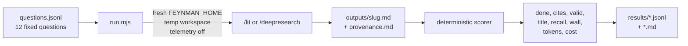

# Evaluating the evaluator: a dogfooded case study of the Feynman harness

**Date:** 2026-11-14  
**Auditor:** Feynman 0.5.65 auditing its own repository and evaluation code  
**Canonical artifact:** `outputs/feynman-harness-eval-quality.md`

## Bottom line

Feynman ships a genuinely useful evaluation scaffold: isolated homes and workspaces, a deterministic citation scorer with no LLM judge, per-question wall/token accounting, committed result files, and unusually candid release notes about refusals and known issues. That scaffolding is worth keeping.

But the eval is a **citation-hygiene smoke test, not a research-quality benchmark**. Committed results cover only four of its twelve questions, only `/lit` has results, and the typical run is one pass over four questions with no repeats or uncertainty estimates. Its four headline metrics measure filename existence (`done`), identifier resolvability (`valid`), a 60% title-token overlap heuristic (`title`), and string presence of one or two expected papers (`recall`). None measures whether a cited source supports the claim attached to it.

A short synthetic-artifact probe makes the gap concrete. A one-sentence hand-written report with a correct citation and a minimal provenance file scores **100% on `done`, `valid`, `title`, and `recall`** without running any research workflow. A report claiming a **1000% accuracy improvement** passes the same four metrics. A correct title attached to a fabricated arXiv ID still gets **100% recall**. A key paper listed only under "Rejected sources" also gets **100% recall**. These are not accusations that the committed model runs contain such errors; they show what the metric cannot distinguish.

No committed eval result exists after 2026-09-24, even though the eval's own rule says to run it before and after any prompt, tool, extension, or Pi-version change. In that window, 46 commits touched prompts, agents, skills, or extensions (including one merge); the other 64 are 63 package-only commits and one `SYSTEM.md`-only commit. That window includes a November 5 fix to the `/lit` prompt after a live workflow failure, and **zero commits touched `evals/`**. The rule is well written but not operationalized in CI.

**Verdict:** strong harness engineering, thin measurement, decayed operating discipline. The eval is a useful regression smoke test for citation formatting. It is not yet evidence that Feynman produces trustworthy research, and its 100% results should not be read as capability claims.

---

## 1. Scope and method

This case study has two objects:

1. **The evaluator:** Feynman's `evals/` directory — its question set, runner, scorer, and committed results.
2. **The harness as an evaluator:** the CLI/workflow contracts that are supposed to make research outputs auditable (artifact-on-disk rules, provenance sidecars, verifier/reviewer stages, telemetry).

| Item | Value | Evidence |
|---|---|---|
| Installed harness | Feynman 0.5.65; Node 24.21.0; Pi 1.5.0; pi-subagents 0.86.0; pi-web-access 0.47.0 | `feynman --version`, `node_modules/*/package.json` |
| Source snapshot | `Companion-Inc/feynman@11744290758648c2ecd7c0d6389cdca9ae580290`, package 0.5.69, 2026-11-13 | `git rev-parse HEAD`, `package.json` |
| Eval code last changed | commit `e2bcb84`, 2026-09-24 | `git log -- evals` |
| Committed eval results | 6 JSONL files, 22 rows, 4 distinct question ids | `evals/results/*.jsonl` |
| Models in committed evals | `ferrylane-openai/gpt-5.6-terra`, `ferrylane/claude-opus-5-5`, `ferrylane-openai/claude-sonnet-5` | result metadata |
| Model in this session | `openrouter/deepseek/deepseek-v4.1-flash-1017`; telemetry off; alphaXiv not configured | `feynman status` |
| Live probe | one-shot `--prompt` run wrote a 17-byte artifact and exited 0 | `experiments/feynman-harness-probe/probe-result.txt` |

What I did:

1. Read `evals/README.md`, `evals/run.mjs`, `evals/questions.jsonl`, all committed result files, the workflow prompts, and the verifier/researcher agent prompts.
2. Recomputed the release-note claims from the committed JSONL rather than trusting the summary table.
3. Ran the actual scorer against eight synthetic artifacts with `--rescore`, to test scorer sensitivity rather than model behavior.
4. Counted test/CI coverage and git history for the eval rule.
5. Ran one small live one-shot probe to observe the installed harness's artifact contract.
6. Ran an adversarial `reviewer` subagent over the draft; it caught an inflated commit count and a missing network-denominator caveat, both corrected here (review: `notes/feynman-eval-quality-review.md`).

What I did **not** do: rerun `/lit` end-to-end. The committed evals use a gateway and models this session cannot reproduce; the installed model is different; a four-question `/lit` run takes roughly 7–45 minutes per question and millions of tokens per run. Claims about model behavior below are therefore about the committed rows and the scorer, not a fresh run.

**Evidence labels used below:** `observed` = read from code/output; `recomputed` = derived from committed rows; `unverified` = cannot be checked from the repo; `judgment` = my assessment.

---

## 2. What the eval actually is



The runner gives each question its own `FEYNMAN_HOME`, workspace, and `TMPDIR`; it copies a provider `models.json` into the isolated home; it disables telemetry; and it kills the process group on timeout. It records `exit_code`, `timed_out`, wall time, token usage across parent and subagent sessions, git SHA, dirty flag, Feynman version, and the absolute workdir (`evals/run.mjs:246-249`, `:279`; `evals/README.md:13`).

The question set is 12 fixed items (`evals/questions.jsonl`):

| Source | Items | Count |
|---|---|---|
| Feynman's own paper-discovery search benchmark | q01–q06 | 6 |
| LitQA2 (`futurehouse/lab-bench`, CC-BY-SA-4.0), verbatim | q07–q09 | 3 |
| Hand-authored, outside ML/biology | q10–q12 | 3 |

Each question has one or two "key papers" with expected IDs/titles. That means recall is computed against a denominator of 1 or 2 per question, and the whole 12-question set contains only 18 key papers.

### The metrics, precisely

| Column | Code behavior | What it measures | What it does not measure |
|---|---|---|---|
| `done` | The largest `outputs/*.md` exists with a same-named `.provenance.md` (`run.mjs:87-94`) | Two filenames exist | Provenance content, workflow stages, claim quality |
| `cites` | Distinct arXiv IDs/DOIs extracted by regex (`run.mjs:96-106`) | Count of distinct identifiers in recognized formats | Inline citation instances; bare IDs; claims |
| `valid` | Identifier resolves via arXiv API, Crossref, or doi.org (`run.mjs:111-148`); failed lookups are dropped from the denominator | Identifier exists, conditional on lookup success | Relevance, support, correctness |
| `title` | Resolved title shares ≥60% of its word tokens with a line containing the ID, or first-author surname appears (`run.mjs:150-189`) | Title-ish text near the ID | Whether the *bracketed* title is right; whether the claim is right |
| `recall` | Key paper ID appears anywhere, or exact normalized title appears anywhere (`run.mjs:195-199`) | String presence | Use, relevance, whether the paper was rejected |
| `wall`/`tokens` | Summed over session files | Measured | — |
| `cost` | Sum of `usage.cost.total` | Measured only if the provider model entry has a `cost` block | All committed rows show `$0` |

### What is genuinely good

These are not consolation prizes; they are the parts a serious eval needs.

- **Isolation.** A fresh home and workspace per question means a run cannot read the developer's real `~/.feynman` or another question's artifacts.
- **Deterministic scoring logic.** The scorer is a readable ~300-line Node script with no LLM judge. Given the same artifact text and the same lookup outcomes, the score is the same. The caveat is `valid`: a failed arXiv/Crossref lookup is removed from both numerator and denominator (`run.mjs:183`; `README.md:48`), and the pre-wait result summaries note that q01 was re-scored after a transient lookup failure. Read `valid` as conditional on lookup success and check `citations` against `citations_checked`.
- **Failure accounting.** `exit_code`, `timed_out`, `completed`, `key_missing`, and error rows are recorded. A timed-out 45-minute run is not silently dropped.
- **Raw evidence design.** Each row points to a workdir intended to contain the full workspace, session JSONL, and `feynman.log`, and `--rescore` can re-score without rerunning the model.
- **Epistemic hygiene in the docs.** The README says "treat a single run as noisy," tells readers to inspect listed failures rather than only percentages, fixes the question set for comparability, and commits both before/after runs. The release notes disclose model refusals and known issues.
- **Privacy.** Eval homes are isolated, telemetry is disabled, and provider keys are read from the environment rather than written into the isolated home.

That is a better foundation than a leaderboard with an opaque judge. The problem is what was built on top of it.

---

## 3. Scorecard

Ratings are my judgment against the evidence in this report. "Strong" means implemented and checked here; "Adequate" means present with material caveats; "Weak" means present but insufficient for the claim; "Absent" means not implemented.

| Dimension | Rating | Evidence | Why it matters |
|---|---|---|---|
| Isolation | **Strong** | Fresh home/ws/tmp; telemetry off; fixed question ids and model rule (`README.md:9,13`; `run.mjs:63-79`) | Removes the largest sources of accidental variance |
| Scoring logic determinism | **Strong** | No LLM judge; same artifact text and lookup outcomes produce the same score (`run.mjs:165-199`) | The scorer is auditable and repeatable |
| Measurement stability | **Adequate** | `valid` drops network-failed lookups from the denominator (`run.mjs:183`; `README.md:48`); pre-wait q01 was manually re-scored after a transient lookup failure | `valid` is conditional on lookup success, not artifact-only |
| Scoring transparency | **Strong** | Scorer is open code; every metric has a named implementation | Readers can audit what the number means |
| Failure accounting | **Adequate** | Timeouts/exit codes/refusals recorded; but `done` conflates process with quality; the catch-all error row loses most fields (`run.mjs:285`) | Prevents silent success, but not silent degradation |
| Raw provenance | **Weak** | Metadata is good, but `workdir` is an absolute author-local path; no artifacts are committed; `--rescore` cannot work from a clone (`run.mjs:267-274`; result rows) | A result file is a receipt, not a reproduction |
| Construct validity | **Weak** | Metrics cover citation existence/title overlap/key-paper presence; no claim support, synthesis quality, source quality, or research decision | The measured construct is narrower than "research quality" |
| Statistical power | **Weak** | 2–4 questions per run (one Opus run has 2 after biology refusals), one run per condition, no repeats or intervals; 4/4 completion has a 95% Wilson interval of roughly [0.51, 1.0] | 100% on n=4 is not a 100% capability claim |
| Coverage | **Weak** | 4 of 12 questions have committed results; only `/lit` in committed results; `/deepresearch` wired but unused; `/audit`, `/review`, `/replicate`, `/recipe`, `/compare`, `/draft`, `/summarize` unmeasured | Most of the product's research surface is unevaluated |
| Contamination control | **Absent** | Questions use canonical papers (test-time compute, speculative decoding, CRISPR base editing, etc.); no no-tool baseline, no post-cutoff set, no perturbation control | Recall can measure memorization as much as retrieval |
| Meta-evaluation | **Weak** | No tests reference `evals/`; CI does not run it; no adversarial fixtures or human audit | The scorer's failure modes are unknown until someone probes them |
| Process adherence | **Weak** | Rule requires before/after runs for prompt/tool/Pi changes; since 2026-09-24, 46 commits touched prompts/agents/skills/extensions (including one merge), 63 touched only `package.json`, and 1 touched only `SYSTEM.md`; 0 commits touched `evals/`; no eval result after that date | A voluntary gate that is not run is not a gate |
| Cost and latency | **Adequate** | Wall time and tokens measured; all 22 rows show `cost_usd = 0`, and the documented example `models.json` has no `cost` block | Token counts are useful; dollar cost is not being measured |
| Privacy and ethics | **Strong** | Isolated homes; telemetry off; keys env-only; content-free telemetry in the product | Research artifacts can be sensitive; this is handled well |
| Documentation honesty | **Strong** | README caveats, known issues, refusal disclosures, explicit "single run is noisy" | Readers are warned about the main limitations |

**Overall:** the infrastructure is solid; the measurement is narrower than the claims; the operating discipline has decayed. A fair one-line summary is: *good smoke test, not yet a benchmark.*

---

## 4. Meta-eval: can the scorer be fooled?

I wrote eight synthetic artifacts for `q01` ("test-time compute scaling for LLM reasoning") and ran the repo's own scorer with `--rescore` (live arXiv/Crossref lookups were available). This tests the measurement instrument, not the model. The fixtures, command, and raw output are in `experiments/feynman-eval-audit/`.

Command:

```sh
git clone --depth 1 https://github.com/Companion-Inc/feynman.git /tmp/feynman-src
python3 experiments/feynman-eval-audit/make_fixtures.py
cd /tmp/feynman-src
node evals/run.mjs --rescore /work/experiments/feynman-eval-audit/fixtures.jsonl
```

### Results

| Case | Artifact content | `done` | `valid` | `title` | `recall` | Reading |
|---|---|---|---|---|---|---|
| f1-control | Correct claim + correct paper, URL, exact title | yes | 100% | 100% | 100% | All four surface metrics pass with no workflow |
| f2-fake-id | Exact title, fabricated ID `2408.99999` | yes | 0% | – | 100% | `recall` is title string presence, not resolvability |
| f3-irrelevant | Real paper, exact title, unrelated topic | yes | 100% | 100% | 0% | `valid`/`title` do not measure relevance |
| f4-absurd-number | "Improves MATH accuracy by 1000%" + correct citation | yes | 100% | 100% | 100% | No numeric or claim-support check |
| f5-wrong-title | Correct ID, wrong bracketed title, claim text repeats title words | yes | 100% | 100% | 100% | Title heuristic satisfied by surrounding prose (8/11 title tokens, 72.7%) |
| f6-no-provenance | Correct artifact, no sidecar | no | – | – | 0% | `done` is filename existence; process gate works |
| f7-bare-id | Bare `2408.03314`, no exact key-paper title | yes | – | – | 100% | `cites` misses bare IDs; `keyRecall`'s raw substring sees the ID |
| f8-rejected | Key paper only in a "Rejected sources" list | yes | 100% | 100% | 100% | Recall credits presence, not use |

Raw scores: `experiments/feynman-eval-audit/fixtures.jsonl`, `fixtures.md`, `rescore.log`.

Most of these results confirm limits the README already states (identifier resolution, title overlap, presence-based recall). The undocumented findings are the title-heuristic false positive (`f5`) and the `cites`/`recall` extraction inconsistency (`f7`).

### What the probe establishes

1. **A synthetic one-paragraph artifact scores 100%.** `f1-control` has one sentence and a minimal provenance file. It passes `done`, `valid`, `title`, and `recall`. The scorer cannot distinguish it from a six-stage `/lit` run. This is expected from an outcome-based eval, but it means a perfect score is compatible with no research process at all.
2. **The title check has a false-positive mode.** `f5-wrong-title` attaches the title "Scaling Laws for Neural Language Models" to the correct ID for the test-time-compute paper. The line also contains the claim "test-time compute can be scaled more effectively than model parameters." Because the scorer compares the resolved title to the whole line, 8 of 11 title tokens overlap (72.7% ≥ 60%), so `title` passes. The README warns about short-name citations missing; it does not warn about prose satisfying the check.
3. **Recall is presence, not use.** `f2-fake-id` gets 100% recall with a fabricated ID because the exact title is present. `f8-rejected` gets 100% recall because the paper appears in a rejected-sources list. A report could "recall" every key paper while excluding it from the synthesis.
4. **There is no claim-level check.** `f4-absurd-number` claims a 1000% accuracy improvement and cites the correct paper. All four metrics pass. Identifier resolution and title overlap say nothing about whether the cited paper supports the sentence.
5. **`done` is a process gate only.** `f6-no-provenance` fails because the sidecar is missing; `f1-control` passes with a minimal sidecar that contains no real provenance. The metric checks existence, not content.
6. **Extraction is format-sensitive.** `f7-bare-id` contains the bare ID `2408.03314` and no exact key-paper title. `cites` is 0 because `extractIds` requires a URL or `arxiv:` prefix, but `recall` is 100% because `keyRecall` does a raw substring match on the text. The same paper is simultaneously uncounted and counted.

These are not exotic adversarial cases. Wrong-but-resolvable citations, rejected sources, bare IDs, and unsupported numbers are ordinary failure modes in research writing. The eval's own README is honest that it measures citation resolution rather than truth; the risk is that the summary table and release prose invite a stronger reading.

---

## 5. Release-claim audit

The most specific public claim is in `RELEASES.md` for v0.5.3 (2026-09-24):

> "On the `/lit` eval with GPT-5.6 Terra, 4 of 4 questions finished, all 44 citations resolved with matching titles, and each question ran the researcher, verifier, and reviewer in under 11 minutes (0.5.2: 9-14 minutes, 43 of 43 citations)."

| Claim | Check | Result | Status |
|---|---|---|---|
| 4 of 4 questions finished | Read the 0.5.3 Terra JSONL | 4/4 `completed: true` | Recomputed, consistent |
| 44 citations | Sum `citations` across q01/q04/q07/q10 | 11 + 11 + 7 + 15 = 44 distinct identifiers | Recomputed, consistent |
| All 44 resolved | `citations_checked` = 44; all `citation_validity` = 1 | 44/44 | Recomputed, consistent |
| `valid` is artifact-only | Read `run.mjs:183` and the pre-wait summaries | Network-failed lookups are dropped from the denominator; q01 was manually re-scored after a transient failure | **Conditional on lookup success** |
| Matching titles | Every row's `title_match` = 1 | All rows pass the 60% heuristic; the denominator is resolved IDs with a known title, not necessarily all 44 | Recomputed, but heuristic-dependent |
| Under 11 minutes each | `wall_s` = 652, 628, 578, 650 | Max 652 s = 10.87 min | Recomputed, consistent |
| 0.5.2 baseline: 9–14 min, 43/43 | Find the 43-citation run | Only `2026-09-24-lit-ferrylane-openai_gpt-5.6-terra.jsonl` has 43 citations; it is labeled `feynman_version: 0.5.0` | **Metadata mismatch / unverified label** |
| "44 citations" means 44 claims | Read `extractIds` | Map dedupes by ID; 44 distinct IDs, not 44 inline citation instances | Clarified; release wording is broader than the metric |
| 0.5.3 runs are reproducible from a SHA | Read `git_dirty` | All six 0.5.3 rows (four Terra, two Opus) have `git_dirty: true`; 14/22 rows overall are dirty | **Not reproducible from the recorded SHA alone** |
| Cost | Read `usage.cost_usd` | All 22 rows are `$0`; no `cost` block in the example `models.json` | **Unmeasured** |
| Search benchmark: 7/9 vs 2/9 seminal papers | Look for the benchmark inputs/results in the repo | Inputs are in `evals/questions.jsonl` (q01–q06, 9 key papers); no committed result artifact for the 7/9 comparison | **Inputs present; comparison unverified** |

Two further facts matter for reading the claim:

- **The eval is not currently a gate.** Since the last eval commit (`e2bcb84`, 2026-09-24), 46 commits touched `prompts/`, `.feynman/agents/`, `skills/`, or `extensions/` (including one merge), one touched only `.feynman/SYSTEM.md`, and 63 touched only `package.json` (mostly version/release metadata); 6 of the 46 touch `prompts/`. `git log --since=2026-09-25 -- evals` returns 0 commits. No eval result after 2026-09-24 exists in the repo. Either the eval was not run, or it was run and not committed; both violate the README's rule.
- **A concrete missed regression.** Commit `278e9af` (2026-11-05) changed `prompts/lit.md` because a live run improvised `parallel()` and its first workflow call failed. The fix was covered by a prompt-example unit test, not by the research eval. A failed first tool call does not necessarily prevent a final artifact, so `done` would catch this only if the failure prevented the final output; an eval run would at least exercise the path. No post-fix eval result exists.

### What the 0.5.3 numbers do establish

They establish that, on one GPT-5.6 Terra run over four questions, in a dirty worktree, four `/lit` artifacts were produced with a provenance file, every extracted identifier in those four artifacts resolved, and every row's `title_match` was 1 under the 60% heuristic. The pre-wait summaries also record a manual q01 re-score after a transient lookup failure, so `valid` is not a single deterministic pass even in the committed data. That is a real citation-hygiene result. It is not evidence of claim-level accuracy, synthesis quality, or generalization to the other eight questions, other workflows, or other models.

### Statistical context

Treating the 44 identifiers as independent (optimistic, because they cluster within four reports), a 95% Wilson interval for 44/44 is roughly [0.92, 1.00]. Treating the four questions as the unit, 4/4 completion has a Wilson interval of roughly [0.51, 1.00]. The true uncertainty is wider than either because there is one run per condition and no repeated sampling. "100%" in the table is a point estimate, not a ceiling.

---

## 6. Dogfooding notes

I ran this audit from inside a Feynman session and also exercised the installed CLI as a subprocess.

**Live one-shot probe.** In a fresh workspace:

```sh
env -u PI_SESSION_ID -u PI_SESSION_FILE FEYNMAN_TELEMETRY=off timeout 240 \
  feynman --no-session --prompt \
  "Create the file outputs/probe-artifact.md with exactly one line: FEYNMAN_PROBE_OK. Use the write tool, then reply DONE."
```

Result: exit 0, stdout `DONE`, artifact `FEYNMAN_PROBE_OK` (17 bytes). The run also left `outputs/.plans/`, `outputs/.drafts/`, `notes/`, and `papers/` in the workspace. Log: `experiments/feynman-harness-probe/probe.log`; result summary: `probe-result.txt`. This is a small positive data point: the one-shot path exits, writes the requested artifact, and scaffolds the expected workspace.

**What helped the audit.**

- The system prompt's evidence/integrity rules are unusually explicit: separate observation from inference, label blocked/unverified work, verify artifacts on disk, never invent results. Those rules directly shaped this report.
- Shell access plus a source-first workflow made it possible to audit the evaluator's code, not just its marketing. Many agent products make this impossible because only a hosted API is exposed.
- The harness's own conventions (slugged artifacts, provenance sidecars, raw logs) are good habits for any eval.

**Frictions observed.**

- **The eval is not shipped.** `evals/` is absent from the npm package (`evals/README.md:5`); `tests/` is also absent from `package.json` `files`. An installed user cannot run the harness's own eval without cloning the repo. That is a transparency cost.
- **There is no `feynman eval` command.** Running the eval means building the repo, supplying a `models.json`, exporting a provider key, and choosing ids/workflow manually. That is developer-only, which helps explain why the rule decays.
- **`--rescore` depends on author-local state.** Every committed row stores an absolute `workdir` (`/Users/advaitpaliwal/.cache/...` or `/var/folders/...`). The artifacts are not committed. A fresh clone cannot rescore any published result.
- **Version and model skew.** The installed harness is 0.5.65; the source snapshot is 0.5.69. The committed evals use GPT-5.6 Terra / Claude Opus 5.5 / Claude Sonnet 5; this session runs DeepSeek v4.1 Flash. I can audit the scorer and the claims, but not reproduce the model behavior.
- **The summary row hides denominators.** `table()` takes the unweighted mean of per-question percentages, excluding nulls (`run.mjs:251-259`). A run with 3/4 completion can show `valid 100%` because the failed question is null and dropped, while `recall` includes the failure as 0 (see `2026-09-24-lit-0.5.3-pre-wait-ferrylane-openai_gpt-5.6-terra.jsonl`). The columns have different denominators. That is visible if you read carefully, but the "all" row encourages a single number.
- **Self-evaluation bias.** I am the harness. There is no independent human rater in this loop. The quantitative claims here trace to files and commands; the ratings are judgments and should be treated as such.

---

## 7. What would make this eval good

Prioritized, with acceptance criteria. The first three are cheap relative to another four-question model run.

### P0 — make the scorer trustworthy and the results reproducible

1. **Extract the scorer into an importable module and add `tests/eval-scorer.test.ts` with adversarial fixtures.** Encode the eight cases above. Assert current behavior explicitly, including known false positives, so a future scorer change cannot silently change their meaning. Add a `claim_support` column and make `f4-absurd-number` fail it.
   - *Acceptance:* `npm test` runs the scorer tests; CI fails if `f2` validity is not 0, `f3` recall is not 0, `f6` done is not false, or `f4` passes a claim-support check.
2. **Persist enough artifacts to rescore from a clone.** Commit a small tarball per run (final `.md`, provenance, extracted citation list) or make `workdir` a content-addressed relative path and publish the bundle. Do not commit full session logs by default; commit the scored artifact and a manifest.
   - *Acceptance:* `node evals/run.mjs --rescore evals/results/<file>.jsonl` works in a fresh clone with no author-local paths.
3. **Separate process compliance from output quality.** Replace the single `done` with `artifact_present`, `provenance_present`, `verifier_ran`, `reviewer_ran`, and `quality_metrics`. Derive the stage flags from the session JSONL (subagent roles/calls), not filenames.
   - *Acceptance:* a run that skips the verifier/reviewer cannot score the same as one that runs them.

### P1 — make the measurement valid and powered

4. **Add a claim-level audit sample.** For each run, sample a fixed number of numeric or causal claims (for example, 20) and check whether the cited source contains the number/claim. Report claim precision with a denominator and a human-readable list of failures. This would catch the `f4` class.
   - *Acceptance:* a run with a fabricated 1000% number has a non-zero failure list.
5. **Run repeats and report uncertainty.** Two or three seeds per condition, or at least two independent runs for a prompt change. Report mean/range and n. Use all 12 questions when the budget allows; otherwise state the selected ids as a fixed panel and do not generalize.
   - *Acceptance:* no "100%" claim appears without n and an interval or range.
6. **Enforce the rule or narrow it.** If the rule stays, add a PR checklist/CI check: changes to `prompts/`, `.feynman/agents/`, `.feynman/SYSTEM.md`, `skills/`, `extensions/`, or the Pi pin must include a new eval result file or a written `no-eval` justification. If full evals are too expensive for every change, define a cheap gate (one question, scorer tests) plus a release gate (four questions, two seeds).
   - *Acceptance:* the repository can show, for each prompt change, either a result file or an explicit waiver. For the November 5 change, it shows neither.
7. **Add contamination controls.** Include 3–5 post-cutoff questions; run a no-tools baseline; and run a "titles only" control to estimate how much recall comes from memorization. Keep the canonical questions for comparability, but do not treat them as retrieval evidence by themselves.

### P2 — extend coverage and accounting

8. **Measure cost.** Add a `cost` block to the example `models.json`; report dollars per completed question and per valid citation. The current `$0.00` is a missing value, not a cheap run.
9. **Cover the other workflows.** `/deepresearch` is already supported by the runner but has no committed result. Add at least one `/audit` case with a known paper–code discrepancy (the README already names SciCoQA's 92 discrepancies) and one `/review` case with a known flawed draft.
10. **Meta-metrics.** Report citation precision/recall against a human-labeled sample, inter-rater agreement for any human judgments, and the false-positive rate of the verifier. A benchmark of the benchmark.

---

## 8. General lessons for AI-eval quality

1. **Deterministic scorers buy reproducibility at the cost of construct validity.** That is a reasonable trade for a smoke test. The mistake is letting the metric's name do more work than its implementation.
2. **Meta-evaluate the scorer before trusting the score.** Eight hand-written fixtures confirmed several documented scope limits, found one undocumented title-heuristic false positive, and exposed an extraction inconsistency; scoring them took seconds. A scorer without adversarial fixtures is an untested measuring instrument.
3. **A rule that is not in CI decays.** The eval README's rule is well written and was followed during the initial Sept 23–24 burst. Then 46 substantive eval-relevant commits (plus 63 package-only and one SYSTEM-only commit) passed without an eval commit. Voluntary gates lose to release pressure.
4. **`done` is a process metric, not a quality metric.** Filename existence and provenance presence are useful checks; they are not evidence of research quality. Report them separately.
5. **Canonical-paper recall tests memory as much as retrieval.** Test-time compute, speculative decoding, CRISPR base editing, and mixture-of-experts are well-known topics. Add post-cutoff and no-tool controls before interpreting recall as search skill.
6. **Report n, repeats, failures, and denominators.** A 4/4 result is a point estimate with a wide interval, not a 100% capability claim. Columns with different denominators should not share an "all" row without a note.
7. **Store raw artifacts.** A JSONL row with an absolute local `workdir` is a receipt, not a reproduction. If the artifact is gone, the score is not independently checkable.
8. **Citation validity is not claim support.** A resolving DOI and a matching title are necessary but far from sufficient. The research-quality question is whether the source supports the sentence, and that needs a claim-level check.

These lessons generalize beyond Feynman: they apply to any agent harness that reports citation precision, "verified" labels, or benchmark scores from a handful of runs.

---

## 9. Open questions

- Was the eval run outside the repository after 2026-09-24? If so, where are the results, and why were they not committed as the README requires?
- Why did the Terra panel use q01, q04, q07, and q10? The Opus 2-question panel is explained by documented biology refusals; the Terra panel choice is not explained by the committed files.
- Where is the result artifact for the "7 of 9 vs 2 of 9" search-benchmark comparison? The inputs are in `evals/questions.jsonl` (q01–q06, nine key papers), but the comparison output is not committed.
- Are the `~/.cache/feynman-evals` workdirs retained? If so, can they be shared or archived so the 44 citations can be inspected?
- How do human experts score the same four artifacts? What is the correlation between `valid`/`title`/`recall` and expert judgments of claim support?
- Does the November 5 `/lit` workflow fix pass the eval? No post-fix result exists.
- What is the verifier agent's claim-level recall and false-positive rate? It is currently unmeasured.

---

## 10. Sources

**Primary repository (pinned commit):**

- Feynman repository at `11744290758648c2ecd7c0d6389cdca9ae580290`: <https://github.com/Companion-Inc/feynman/tree/11744290758648c2ecd7c0d6389cdca9ae580290>
- `evals/README.md` (eval design, rule, metric definitions): <https://github.com/Companion-Inc/feynman/blob/11744290758648c2ecd7c0d6389cdca9ae580290/evals/README.md>
- `evals/run.mjs` (scorer and runner): <https://github.com/Companion-Inc/feynman/blob/11744290758648c2ecd7c0d6389cdca9ae580290/evals/run.mjs>
- `evals/questions.jsonl` (12 fixed questions): <https://github.com/Companion-Inc/feynman/blob/11744290758648c2ecd7c0d6389cdca9ae580290/evals/questions.jsonl>
- 0.5.3 Terra result rows: <https://github.com/Companion-Inc/feynman/blob/11744290758648c2ecd7c0d6389cdca9ae580290/evals/results/2026-09-24-lit-0.5.3-ferrylane-openai_gpt-5.6-terra.jsonl>
- 43-citation baseline rows (labeled 0.5.0): <https://github.com/Companion-Inc/feynman/blob/11744290758648c2ecd7c0d6389cdca9ae580290/evals/results/2026-09-24-lit-ferrylane-openai_gpt-5.6-terra.jsonl>
- `/lit` prompt fix commit `278e9af` (2026-11-05): <https://github.com/Companion-Inc/feynman/commit/278e9afe4a5b34e42e774563c3f14d3af7346955>
- `RELEASES.md` v0.5.3 claim: <https://github.com/Companion-Inc/feynman/blob/11744290758648c2ecd7c0d6389cdca9ae580290/RELEASES.md>

**Related evaluation-methodology papers:**

- Bean et al., "Measuring what Matters: Construct Validity in Large Language Model Benchmarks," 2025. arXiv:2511.04703 — <https://arxiv.org/abs/2511.04703>
- Onweller et al., "Cited but Not Verified: Parsing and Evaluating Source Attribution in LLM Deep Research Agents," 2026. arXiv:2605.06635 — <https://arxiv.org/abs/2605.06635>
- Coelho et al., "DeepResearchGym: A Free, Transparent, and Reproducible Evaluation Sandbox for Deep Research," 2025. arXiv:2505.19253 — <https://arxiv.org/abs/2505.19253>

**Local artifacts produced by this audit:**

- `experiments/feynman-eval-audit/README.md` — fixture definitions and reproduction commands.
- `experiments/feynman-eval-audit/make_fixtures.py` — builds the eight synthetic workdirs.
- `experiments/feynman-eval-audit/fixtures.jsonl` — scored per-case output from `--rescore`.
- `experiments/feynman-eval-audit/fixtures.md` — generated summary table.
- `experiments/feynman-eval-audit/rescore.log` — raw scorer stdout.
- `experiments/feynman-eval-audit/git-stats.txt` — repository/eval counts used above.
- `experiments/feynman-eval-audit/release-claim-check.txt` — recomputation of the v0.5.3 claims.
- `experiments/feynman-eval-audit/verification.txt` — final numeric verification pass.
- `experiments/feynman-harness-probe/probe.log` and `probe-result.txt` — one-shot CLI probe.
- `notes/feynman-eval-quality-review.md` and `notes/feynman-eval-quality-review-2.md` — two adversarial reviewer passes and verification logs.

---

*Disclosure: this report was produced inside the harness it audits. The quantitative claims were checked against the files and commands listed above. The ratings and the "what would make this good" recommendations are judgments, not measurements.*
