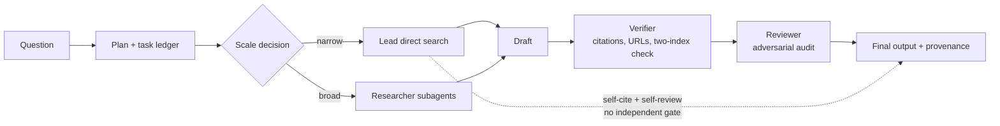

# Feynman Harness: An AI-Eval-Quality Case Study

**Thesis.** Feynman's product claim is *claim-level* verification: a verifier agent checks that each citation actually supports the sentence attached to it, cross-checks identifiers against two indexes, and removes unsupported material. Its public eval, however, measures *identifier-level attribution*: whether arXiv/DOI IDs resolve and whether the citing line contains enough title tokens. I tested the gap directly. The shipped scorer missed a correct-paper/false-claim document, a fabricated uncited number, a reference-section contradiction, and a PMID-only citation, while flagging a terse but correct citation as a title mismatch. A single verifier canary, by contrast, caught all five seeded defects and preserved the control. The harness's verification layer works better than its eval can see — which means the 100% scores in its release notes do not substantiate the quality claim they are used to support.

---

## 1. Scope and method

I examined the installed harness and its public evaluation artifacts, then ran two dogfood probes.

| Layer | What I inspected | Why |
|---|---|---|
| Operating contract | `.feynman/SYSTEM.md`, four agent definitions, 11 workflow prompts, 16 skills | Establishes what quality means to the harness |
| Shipped eval | `evals/README.md`, `questions.jsonl`, `run.mjs`, six committed result pairs | The public evidence for research quality |
| Release claims | `RELEASES.md`, `README.md`, `package.json` | Claims that the eval is supposed to support |
| Probe 1 | Ran the shipped scorer on 13 synthetic canary documents | Measures what the eval can and cannot detect |
| Probe 2 | Ran the `verifier` agent on a six-claim canary draft | Measures whether the product's verification layer catches what the scorer misses |

Environment: Feynman `0.5.65`, Node `v24.21.0`, session model `openrouter/deepseek/deepseek-v4.1-flash-1017`. Public eval files fetched from `Companion-Inc/feynman` `main` on 2026-11-14. The installed package does **not** include `evals/`; `package.json` `files` omits it, consistent with the eval README.

**What this study is not.** I did not run a full `/lit` or `/deepresearch` session, did not inspect the authors' retained workdirs, and did not measure real-world hallucination rates. The canaries are synthetic unit tests of the scorer and the verifier contract, not population estimates.

---

## 2. What the harness promises

The operating contract is unusually explicit about evidence integrity ([S7]):

- "Evidence over fluency"; separate observations from inferences; state uncertainty.
- "Never invent results, scores, datasets, sample sizes, ablations, tables, figures, or quantitative comparisons."
- Say `verified`, `confirmed`, `checked`, or `reproduced` only when the check was performed and can be pointed to.
- If a tool or source fails, write a `Blocked` or `Unverified` artifact rather than stopping with chat-only prose.

The verification architecture has four agents ([S8]):

| Agent | Role | Key constraint |
|---|---|---|
| `researcher` | Gather primary evidence | "URL or it didn't happen"; evidence table with numbered sources; minimum 5 entries |
| `verifier` | Add inline citations, verify every URL, remove unsourced claims | "Verify meaning, not just topic overlap"; cross-check DOI/arXiv ID against two indexes; refuse fake certainty |
| `reviewer` | Adversarial audit when framed as a verification pass | Every weakness references a passage; challenge citations that do not support the exact wording |
| `writer` | Draft from supplied evidence | No citations; verifier adds them; no aesthetic laundering |

`/deepresearch` makes the gate serial and artifact-bound ([S9]): plan → gather → draft → **verifier** → **reviewer** → deliver, with a mandatory `provenance.md` sidecar recording sources consulted/accepted/rejected and `Verification: PASS / PASS WITH NOTES / BLOCKED`. The prompt forbids running verifier and reviewer in parallel and requires waiting for the verifier's completion, not just its launch receipt.

There is an important assurance gradient. For narrow questions, `/deepresearch` uses "direct search" and explicitly says: *"Do not spawn the `verifier` subagent for simple direct-search runs"* and *"Do not spawn the `reviewer` subagent for simple direct-search runs"* ([S9]). The lead self-cites and self-reviews. The mode with the least independent checking is the mode used for the smallest tasks.



This is a reasonable cost/latency tradeoff, but it means "Feynman verified this" is not a uniform property of outputs. The eval does not distinguish the two paths.

---

## 3. What the public eval actually measures

`evals/README.md` calls this "A small fixed eval for Feynman's research workflows" ([S1]). It is honest about being small: 12 fixed questions, deterministic checks, no LLM judge, isolated `FEYNMAN_HOME` and workspace per question, and the instruction to "treat a single run as noisy."

### 3.1 Metrics, as implemented

| Column | Implementation in `run.mjs` ([S2]) | What it establishes |
|---|---|---|
| `done` | An `outputs/<slug>.md` exists **and** a matching `.provenance.md` exists | Workflow bookkeeping completed |
| `cites` | Distinct arXiv IDs and DOIs extracted by regex | How many machine-recognizable identifiers appear |
| `valid` | Share of extracted IDs that resolve via arXiv API, Crossref, or doi.org handle | Identifier existence |
| `title` | Among resolved IDs with a known title, share whose title tokens are ≥60% present on the citing line (or first-author surname present) | Loose title/ID co-location |
| `recall` | Share of the question's expected key papers present by ID substring or exact normalized title | Whether the expected paper is mentioned |
| `wall`, `tokens`, `cost` | Summed from Pi session JSONL | Cost/latency |

The code reveals four scope limits that the summary table does not surface:

1. **`extractIds` only recognizes arXiv IDs and DOIs.** PMIDs, PMCIDs, web URLs, books, reports, and datasets without a DOI are invisible. A report citing only web sources has `cites = 0`.
2. **Network failures are dropped from the denominator.** `checked = rows.filter(r => r.resolves !== undefined)`. The README says "Lookups that fail on the network are left out." A bad network can thus *raise* `valid`.
3. **Non-Crossref DOIs resolve but have no title.** `resolveDoi` falls back to the doi.org handle API, which returns `title: undefined`; those rows count in `valid` but are excluded from `title`.
4. **`title` is context-blind and lexical.** It checks token overlap between the resolved title and the line containing the ID, not whether the sentence's claim is supported. A correct paper with a contradictory claim passes; a correct paper cited tersely can fail.

### 3.2 What the committed results cover

I parsed all six result pairs in `evals/results/` ([S3]). There are 22 question rows.

| Result file | Version / SHA | Model | IDs | Done | Citations | Tokens | Wall |
|---|---|---|---|---|---|---|---|
| `2026-09-23-lit-...claude-sonnet-5` | 0.5.0 / `dbf1f6c` clean | claude-sonnet-5 | q01,q04,q07,q10 | 75% | 51 | 72,190,181 | 7,895s |
| `2026-09-24-lit-...gpt-5.6-terra` | 0.5.0 / `d926547` clean | gpt-5.6-terra | q01,q04,q07,q10 | 100% | 43 | 14,053,916 | 2,806s |
| `2026-09-24-lit-0.5.3-...gpt-5.6-terra` | 0.5.3 / `c1e0b29` **dirty** | gpt-5.6-terra | q01,q04,q07,q10 | 100% | 44 | 13,353,797 | 2,508s |
| `2026-09-24-lit-0.5.3-...claude-opus-5-5` | 0.5.3 / `c1e0b29` **dirty** | claude-opus-5-5 | q01,q10 | 100% | 85 | 10,953,040 | 2,199s |
| `2026-09-24-lit-0.5.3-pre-wait-...terra` | 0.5.2 / `7c5fc51` **dirty** | gpt-5.6-terra | q01,q04,q07,q10 | 75% | 28 | 14,073,816 | 2,724s |
| `2026-09-24-lit-0.5.3-pre-wait-...opus` | 0.5.2 / `7c5fc51` **dirty** | claude-opus-5-5 | q01,q04,q07,q10 | 50% | 54 | 13,039,960 | 2,459s |

Key observations:

- **Coverage is 4 of 12 questions (33%).** Only q01, q04, q07, q10 appear in any result row. q02, q03, q05, q06, q08, q09, q11, q12 have no committed run.
- **All 14 rows from the 0.5.2/0.5.3 runs record `git_dirty: true`.** The eight 0.5.0 baseline rows are clean. The headline 0.5.3 result is therefore not tied to a clean commit.
- **The `cost` column is `$0` in every row** because the provider entry used for the run had no `cost` block, which the README names as the condition for `$0`. The table still prints `$0.00`, which reads like a measured cost.
- **The model changes between baseline and treatment.** The first baseline used claude-sonnet-5 because the gateway's GPT quota was exhausted; other runs use gpt-5.6-terra or claude-opus-5-5. The README discloses the quota reason. It still confounds cross-file comparisons.
- **Refusals are scored as research failures.** Opus 5.5 refused q04/q07 on `/lit CRISPR base editing`; those rows are `done: false`, `recall: 0%`. A safety refusal, a timeout, a crash, and a missing provenance file all collapse into the same `done: false`.
- **Version labels do not line up.** The files named `0.5.3-pre-wait` record `feynman_version: 0.5.2`. The release note's "0.5.2: 9–14 minutes, 43 of 43 citations" matches the clean file recorded as **0.5.0** (`d926547`, 43 citations, 566–816s), not either 0.5.2-labelled pre-wait file (28 or 54 citations). This may be a labelling lag or a typo; either way, the prose cannot be mapped to a single result file without inference.
- **The public ledger is stale relative to the release cadence.** The newest result file is dated 2026-09-24; the installed version is 0.5.65, released 2026-11-06 ([S6]). The eval README's rule is to run before and after prompt/tool/Pi changes. No public result file records a run after 2026-09-24.

### 3.3 The headline claim, examined

Release note v0.5.3 says: "On the `/lit` eval with GPT-5.6 Terra, 4 of 4 questions finished, all 44 citations resolved with matching titles" ([S4]). This is traceable to the committed 0.5.3 file: 44 citations, `valid = 100%`, `title = 100%`, 4 rows. That traceability is a genuine strength.

But the claim is narrower than it sounds. "44 citations resolved with matching titles" means 44 machine-recognized IDs resolved and their title tokens appeared on the citing line. It does **not** mean 44 claims were checked against their sources. The eval has no mechanism to establish that. The same release note says the prompt trim preserved "same research quality" — a claim the four-question, all-100% run cannot discriminate, because the run has no headroom.

---

## 4. Dogfood 1: canaries against the shipped scorer

I built 12 minimal final outputs, each with one known defect, plus a verifier-corrected output, and ran the shipped scorer via its own `--rescore` path. The full generator is at `/work/experiments/feynman-eval-audit/make_canaries.py`; the scorer is the unmodified `evals/run.mjs`.

### 4.1 Results

| Canary | Seeded defect | `cites` | `valid` | `title` | `recall` | Scorer verdict |
|---|---|---|---|---|---|---|
| c0 correct | none (control) | 1 | 100% | 100% | 100% | clean |
| c1 wrong title, real ID | resolvable ID attached to another paper's title | 1 | 100% | **0%** | 100% | **caught** (overlap 0.27) |
| c2 fabricated ID | `arXiv:2499.99999` (deliberately fake) | 1 | **0%** | – | 100% | **caught** (`unresolved`) |
| c3 right paper, false claim | correct title/ID; claim contradicted by paper | 1 | 100% | 100% | 100% | **missed** |
| c4 uncited number | fabricated 400% number, no citation | 0 | – | – | 100% | **missed** |
| c5 web-only | book URL only, no arXiv/DOI | 0 | – | – | 0% | **invisible** (and recall conflates with missing key paper) |
| c6 PMID-only | key paper cited as `PMID 27096365` | 0 | – | – | 100% | **missed**; `recall` and `cites` disagree |
| c7 terse correct citation | correct ID, no title on the line | 1 | 100% | **0%** | 100% | **false positive** (overlap 0.00) |
| c8 reference-only contradiction | body contradicts paper; title/ID only in References | 1 | 100% | 100% | 100% | **missed** |
| c9 DOI correct | none (DOI control) | 1 | 100% | 100% | 100% | clean |
| c10 DOI wrong title | resolvable DOI attached to another paper's title | 1 | 100% | **0%** | 100% | **caught** (overlap 0.11) |
| c11 DataCite DOI | resolves via handle, no Crossref title | 1 | 100% | – | 0% | **title denominator silently excludes it** |
| c12 verifier output | honest disclosure of the removed fake ID | 4 | **75%** | 100% | 100% | **penalized for disclosure** |

### 4.2 Interpretation

- **The scorer catches identifier fraud, not claim fraud.** Fabricated IDs (c2) and wrong-paper IDs (c1, c10) are detected. A correct paper attached to a false claim (c3) or a reference-section contradiction (c8) passes every metric at 100%.
- **Uncited quantitative claims are invisible.** c4 has `cites = 0` and `recall = 100%`; nothing in the table marks it as a failure. A reader who only looks at `done`/`recall` sees a successful run.
- **Source-type coverage is narrow.** c5 (web/book) and c6 (PMID) produce `cites = 0`. For c6, `recall = 100%` because `keyRecall` substring-matches the PMID in the question file, while `cites = 0` because `extractIds` does not recognize PMIDs. The two metrics disagree about whether the key paper was cited.
- **The title metric has both false negatives and false positives.** It misses c3/c8 because the title is correct; it flags c7 because a correct citation is terse. The README acknowledges short-name misses, but not that a correct, terse citation is scored as a mismatch.
- **Honest disclosure is penalized.** c12 is the verifier's corrected draft. It cites three real papers and lists the removed fake ID in a "Removed Unsupported Claims" section. The scorer extracts that fake ID as a citation and marks `valid = 75%`. The eval rewards silence about removed errors.
- **`done` is not a quality gate.** All 13 canaries, including the zero-citation and false-claim documents, have a final output and provenance sidecar, so `done = yes`. The metric measures file existence, not content.

A single catch-rate summary would hide this: **3 of the 9 defect canaries were flagged by `valid`/`title` (c1, c2, c10); 6 were not (c3, c4, c5, c6, c8, c11).** The missed class is exactly the class the verifier agent is designed to catch.

---

## 5. Dogfood 2: the verifier canary

To test whether the product's verification layer closes the gap, I wrote a six-claim draft and a research-notes file, then ran the harness's own `verifier` agent on it. The draft contained five defects and one control:

1. "400% accuracy improvement on GSM8K" attached to arXiv:2408.03314.
2. "10x speedup on every model tested" and "default decoding strategy" attached to arXiv:2211.17192.
3. A fabricated sparse-autoencoder paper at a deliberately fake arXiv ID.
4. A dead `example.com` URL for a RAG claim.
5. A control: the Transformer paper, correctly cited.
6. An uncited "90% inference-cost reduction" claim.

### 5.1 Results

| Claim | Verifier action | Evidence |
|---|---|---|
| 1. Test-time compute | **WEAKENED** | Replaced 400%/GSM8K with the abstract's actual findings: >4× efficiency vs best-of-N, 14× larger model in a FLOPs-matched evaluation; added conditionality |
| 2. Speculative decoding | **WEAKENED** | Replaced 10× with 2×–3× on T5-XXL; removed the "default strategy" claim |
| 3. Sparse autoencoders | **REMOVED** | arXiv ID does not resolve; no source supplied; left a TODO |
| 4. RAG eliminates hallucination | **REMOVED** | URL is the IANA example domain; no source supplied; left a TODO |
| 5. Transformer control | **SUPPORTED** | arXiv:1706.03762 resolves; abstract supports the claim |
| 6. MoE 90% | **REMOVED** | No source supplied |

All five seeded defects were addressed; the control survived. The verifier also produced a per-claim verification log and a link table.

**I checked the verifier's own replacement numbers against the primary source.** The arXiv abstract for 2408.03314 contains "more than 4x compared to a best-of-N baseline" and "outperform a 14x larger model" in a FLOPs-matched evaluation ([S10]). The 2×–3× T5-XXL figure is in the 2211.17192 abstract ([S11]). The verifier did not fix one fabrication by introducing another.

Run metadata: `verifier`, model `deepseek-v4.1-flash:medium`, 59,718 input + 6,414 output + 62,464 cache-read tokens, 8 turns, 13 tool calls, 72.4s, reported cost `$0.0085` ([E2]).

### 5.2 What this does and does not show

It shows the verifier contract is operational and can catch blatant claim-level and citation-level errors at low cost. It does **not** estimate a catch rate:

- n = 1 run, one model, one short draft.
- The defects were blatant, and the research notes explicitly flagged two of them as unverified.
- The verifier and the lead share a model family, so their errors are not independent.
- The draft was 103 words; a real `/lit` output is thousands of words with dozens of citations, where attention dilution is a different problem.

The result is a smoke test, not a benchmark. Its value is contrast: the layer the eval cannot see is the layer that works.

---

## 6. Eval hygiene audit

| Dimension | Observation | Consequence |
|---|---|---|
| Question coverage | 4 of 12 questions run (33%) | Headline scores describe a subset; q02/q03/q05/q06/q08/q09/q11/q12 are unmeasured |
| Runs per condition | 1 | No variance estimate, no confidence interval; README says "treat a single run as noisy" |
| Tree state | 14/14 non-baseline rows `git_dirty: true` | Results cannot be tied to a commit; prompt/tool changes may be uncommitted |
| Model confound | Baseline sonnet-5, treatment gpt-5.6-terra | Cross-file improvement claims are confounded by model |
| Cost accounting | `$0` in all rows (no cost block) | Cost column is non-informative; no cost-normalized comparison |
| Network denominator | Failed lookups excluded from `valid` | A bad network can inflate validity; q01 was manually re-scored after a transient failure |
| Refusals | Scored as `done: false`, `recall: 0%` | Safety behavior is misclassified as research-quality failure |
| Version labels | `0.5.3-pre-wait` files record 0.5.2; release-note "0.5.2" 43/43 matches a 0.5.0-labelled file | Prose-to-artifact mapping requires inference |
| Ledger freshness | Newest result 2026-09-24; installed 0.5.65 released 2026-11-06 | No public eval evidence for the last ~6 weeks of releases |
| Package inclusion | `evals/` excluded from npm `files` | Users cannot run the eval from the installed artifact; only repo users can |

These are not fatal. The eval is explicitly small, and the README names three unbuilt lanes (ScholarQA-CS2/AstaBench, DeepResearch Bench FACT, SciCoQA). The problem is the gap between those caveats and the way the results are used in release notes.

---

## 7. Assessment

### 7.1 Strengths

- **The eval exists and is public.** Many agent products ship no quality eval at all. This one has fixed questions, a deterministic scorer, isolated homes, `--rescore`, failure lists (`unresolved`, `title_mismatch`), and committed result files with SHA/version/usage.
- **The questions are partly externally sourced.** q07–q09 are verbatim LitQA2 items with CC-BY-SA-4.0 attribution and known key papers ([S2]). q01–q06 are a fixed paper-discovery set with nine key papers. This is better than hand-picked demo prompts.
- **The verifier contract is concrete and testable.** "Verify meaning, not just topic overlap," two-index ID cross-checks, dead-link handling, and a result-provenance audit are specific enough to audit — as the canary shows.
- **The harness's artifact discipline is strong.** Provenance sidecars, explicit `PASS / PASS WITH NOTES / BLOCKED`, and a rule against chat-only output make runs inspectable in a way most agents are not.

### 7.2 The central weakness: construct validity

The eval is named "Research-quality evals," but it measures **citation integrity**, not research quality. The canary suite makes the gap concrete:

- A report can score `done = yes`, `valid = 100%`, `title = 100%`, `recall = 100%` while asserting the opposite of what its cited paper says (c3, c8).
- A report can score `recall = 100%` with `cites = 0` by naming a PMID (c6).
- A report can be penalized for honestly disclosing a removed fake ID (c12).
- A report can be flagged for a correct, terse citation (c7).

This is a **construct-validity** problem, not a missing column. The metric operationalizes "the citation points at a real paper with a matching title," while the product's claim is "the citation supports the sentence." Those are different constructs. A 100% score on the former is compatible with a high rate of unsupported claims on the latter.

The release note's phrasing — "44 citations resolved with matching titles" — is technically accurate but rhetorically stronger than the evidence. It invites the reader to infer claim-level verification that was not performed.

### 7.3 Perverse incentives

The scorer's blind spots create incentives that run against the harness's stated integrity rules:

- **Disclose less.** Mentioning a removed fake ID in a transparency section lowers `valid` (c12).
- **Cite tersely or not at all.** A correct terse citation can be flagged (c7); an uncited number is invisible (c4).
- **Prefer arXiv/DOI over PMID/web.** Only machine-recognized identifiers count (c5, c6), even when the PMID is the canonical record.
- **Avoid refusals, not errors.** A refusal is scored as a total quality failure, while a confident false claim with a real citation scores 100%.

None of these is intentional. They follow from a lexical, context-blind scorer. But an eval that rewards the wrong behavior is worse than no eval, because it produces false assurance.

### 7.4 What the evidence does and does not support

**Supported by the evidence in this study:**

- The shipped scorer cannot detect claim-level contradictions, uncited numbers, reference-only contradictions, PMID-only citations, or non-arXiv/DOI sources. (Direct canary result, reproducible.)
- The verifier agent can catch blatant claim-level defects in a short draft at low cost. (Single canary, verified replacement numbers.)
- The public eval covers 4 of 12 questions, has no repeated runs, and records dirty trees for all non-baseline rows. (Parsed result files.)
- The release note's 44/44 claim traces to the committed 0.5.3 file but means identifier/title validity, not claim support. (Code + result file.)

**Not supported / unverified:**

- Real-world hallucination or unsupported-claim rates for `/lit` or `/deepresearch`. The canaries are synthetic.
- The verifier's catch rate on long, real reports. n = 1.
- Whether the dirty-tree runs differ from clean-tree runs. `git_dirty` is metadata, not proof of a behavioral difference.
- Whether the eval has been run privately after 2026-09-24. The public ledger is stale; private runs may exist.

---

## 8. Recommendations

### P0 — close the construct gap

1. **Add a claim-level entailment lane.** For each inline citation, retrieve the cited passage and judge whether it supports the specific sentence, number, or conclusion. Report claim precision/recall and an unsupported-claim rate. Calibrate on a small human-labeled subset; report inter-rater agreement.
2. **Report denominators, not just ratios.** `citations_checked / citations_total`, `titled / resolved`, `questions_run / questions_defined`. Never let network failures silently leave the denominator; mark them `unverified` and count them.
3. **Separate failure statuses.** `refused`, `timeout`, `crash`, `missing_provenance`, `no_citations`, `unsupported_claim`. Do not map a safety refusal to `recall = 0%`.
4. **Require a clean tree or a patch digest.** All 14 non-baseline rows are `git_dirty: true`; a result that cannot be tied to a commit is not a reproducible result.

### P1 — harden the harness

5. **Adopt the 13-canary suite as a CI unit test of the scorer.** Add assertions that c3, c4, c6, c8 must be flagged (they currently are not), that c7 must not be a false positive, and that c12's disclosure must not lower `valid`. The generator is at `/work/experiments/feynman-eval-audit/make_canaries.py`.
6. **Run all 12 questions per release, or state coverage in the release note.** If only 4 are run, say "4 of 12" next to the score. Repeat runs for confidence intervals before claiming "same research quality."
7. **Fix or drop the cost column.** Add a `cost` block to the eval `models.json`, or remove `$0.00` from summaries.
8. **Count or scope non-arXiv/DOI citations.** At minimum, report PMID/PMC/web citations separately so `cites = 0` is not ambiguous.
9. **Add a completeness metric.** Count TODOs and removed claims, so an honest but hollow report does not pass as a complete one.

### P2 — improve assurance

10. **Use an independent model for verifier/reviewer**, or measure correlated errors. Same-family agents are not independent judges.
11. **Measure the reviewer separately.** The current eval does not test whether the reviewer catches what the verifier misses.
12. **Add a negative-control question** with genuinely ambiguous literature, to test whether the report preserves disagreement instead of forcing consensus.

---

## 9. Limitations and open questions

**Limitations.**

- The canary documents are synthetic and authored by me. They test the scorer's mechanics, not the distribution of real Feynman outputs.
- The verifier canary is one run of one model on a 103-word draft with blatant defects. It is a contract smoke test, not a catch-rate estimate.
- I did not run a full `/lit` or `/deepresearch` session; cost/time and the absence of the authors' retained workdirs made that impractical.
- The public `evals/` tree may have changed after the committed results; I fetched `main` on 2026-11-14 and did not pin a commit for the eval files.
- `git_dirty` is metadata. A dirty tree can still produce a valid run; the finding is about provenance, not behavior.
- Cost figures are provider-reported; `$0` means an absent cost block, not a free run.

**Open questions.**

- What is the claim-level error rate on real `/lit` outputs? A labeled sample of 30–50 citations would answer this; the canary suite does not.
- How often does the verifier introduce a new error while fixing one? The one canary did not, but that is n = 1.
- Does the reviewer catch claim-level errors the verifier misses, or are they correlated?
- How much does the direct-search bypass (no verifier/reviewer) increase error rates on narrow questions?
- What is the human inter-rater agreement on "the source supports this sentence"? A judge-based metric is only as good as its label definition.

---

## 10. Reproduction

All commands ran on 2026-11-14 in `/work`.

```sh
# 1. Fetch the public eval artifacts
mkdir -p notes/feynman-evals
curl -sSL https://raw.githubusercontent.com/Companion-Inc/feynman/main/evals/README.md -o notes/feynman-evals/README.md
curl -sSL https://raw.githubusercontent.com/Companion-Inc/feynman/main/evals/questions.jsonl -o notes/feynman-evals/questions.jsonl
curl -sSL https://raw.githubusercontent.com/Companion-Inc/feynman/main/evals/run.mjs -o notes/feynman-evals/run.mjs
# result files: https://github.com/Companion-Inc/feynman/tree/main/evals/results

# 2. Build the 13 canaries and run the shipped scorer
cd experiments/feynman-eval-audit
python3 make_canaries.py
cp seed.jsonl seed-input.jsonl
node evals/run.mjs --rescore seed.jsonl

# 3. Run the verifier canary (used the harness's own verifier agent)
#    draft:      experiments/feynman-verifier-canary/draft.md
#    notes:      experiments/feynman-verifier-canary/research-notes.md
#    output:     experiments/feynman-verifier-canary/cited.md
#    log:        experiments/feynman-verifier-canary/verification-log.md
```

Artifacts:

- `notes/feynman-evals/` — downloaded eval files and all six result pairs.
- `experiments/feynman-eval-audit/` — `make_canaries.py`, canary workdirs, `seed.jsonl` (scored output), `rescore-stdout.txt`.
- `experiments/feynman-verifier-canary/` — draft, research notes, verifier output, verification log.

The canary workdirs are synthetic; the `arXiv:2499.99999` identifier in c2/c12 is deliberately fabricated and is not a source. Any future eval run that extracts it will flag it, which is the intended behavior.

---

## Sources

- **[S1]** Feynman, *Research-quality evals* (`evals/README.md`). https://github.com/Companion-Inc/feynman/blob/main/evals/README.md
- **[S2]** Feynman, `evals/run.mjs` and `evals/questions.jsonl`. https://github.com/Companion-Inc/feynman/blob/main/evals/run.mjs · https://github.com/Companion-Inc/feynman/blob/main/evals/questions.jsonl
- **[S3]** Feynman, `evals/results/` (six result pairs, 2026-09-23/24). https://github.com/Companion-Inc/feynman/tree/main/evals/results
- **[S4]** Feynman, *Release Notes* v0.5.3 (2026-09-24), "Leaner prompts, same research quality." `/opt/feynman/feynman-0.5.65-linux-arm64/app/RELEASES.md`, line 454; https://github.com/Companion-Inc/feynman/blob/main/RELEASES.md
- **[S5]** Feynman, result file `2026-09-24-lit-ferrylane-openai_gpt-5.6-terra.jsonl` (recorded `feynman_version: 0.5.0`, 43 citations). https://github.com/Companion-Inc/feynman/blob/main/evals/results/2026-09-24-lit-ferrylane-openai_gpt-5.6-terra.jsonl
- **[S6]** Feynman, `package.json` v0.5.65 and release date 2026-11-06. `/opt/feynman/feynman-0.5.65-linux-arm64/app/package.json`; `RELEASES.md` line 7.
- **[S7]** Feynman, system contract. `/opt/feynman/feynman-0.5.65-linux-arm64/app/.feynman/SYSTEM.md`
- **[S8]** Feynman, agent definitions. `/opt/feynman/feynman-0.5.65-linux-arm64/app/.feynman/agents/{researcher,verifier,reviewer,writer}.md`
- **[S9]** Feynman, `/deepresearch` workflow. `/opt/feynman/feynman-0.5.65-linux-arm64/app/prompts/deepresearch.md`
- **[S10]** Snell et al., *Scaling LLM Test-Time Compute Optimally can be More Effective than Scaling Model Parameters* (2024). https://arxiv.org/abs/2408.03314
- **[S11]** Leviathan et al., *Fast Inference from Transformers via Speculative Decoding* (2022/ICML 2023). https://arxiv.org/abs/2211.17192
- **[S12]** Vaswani et al., *Attention Is All You Need* (2017). https://arxiv.org/abs/1706.03762
- **[E1]** Canary experiment: `/work/experiments/feynman-eval-audit/` (`make_canaries.py`, `seed.jsonl`, `rescore-stdout.txt`).
- **[E2]** Verifier canary: `/work/experiments/feynman-verifier-canary/`; run metadata `ca2880e3-..._verifier_0_meta.json` (model, usage, 72.4s, 13 tools).
