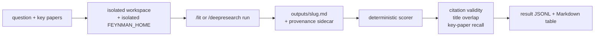

# Feynman 0.5.65 as an evaluation instrument

**A dogfooded case study of an AI research harness, judged by AI-eval-quality criteria**

- **Date:** 2026-11-14
- **Harness under study:** Feynman `0.5.65` (installed), repository HEAD `0.5.69`
- **Study type:** static audit + deterministic meta-eval + one clean runtime verification probe (plus one contaminated control)
- **Canonical artifact:** `outputs/feynman-harness-eval-quality-case-study.md`
- **Adversarial review:** `outputs/feynman-harness-eval-quality-case-study.review.md` (three MAJOR issues fixed: p-value pairing, trace-capture claim, q01 re-score disclosure)
- **Raw artifacts:** `experiments/eval-scorer-probe.mjs`, `experiments/eval-scorer-probe-results.json`, `experiments/score-verifier-output.mjs`, `experiments/verifier-output-score.json`, `outputs/.probes/`

---

## 0. Scope and method

This is a case study of Feynman as an **evaluation instrument**, not a benchmark of its research prose. The question is: when Feynman reports that a research workflow scored 100%, what has actually been measured, how repeatable is it, and what would a careful eval engineer conclude?

I used four kinds of evidence:

1. **Static audit** of the installed package, the public repository, the workflow prompts, the four bundled subagents, and the `evals/` directory.
2. **Deterministic meta-eval** of Feynman's own citation scorer: eight synthetic outputs with known ground truth, plus probes of the `done` metric and the aggregate table. The scorer was imported from a generated copy of `evals/run.mjs` with only the CLI entrypoint removed; no scoring logic was reimplemented.
3. **Runtime verification probe**: a short draft with one fabricated paper, one false quantitative claim, one false directional claim, one dead URL, one uncited true claim, and two true citations, given to Feynman's `verifier` subagent in a clean workspace. The first attempt was contaminated by probe fixtures in the same workspace and is reported as a negative control, not as a capability measurement.
4. **Re-analysis of the six committed result files** (JSONL plus matching Markdown summaries) in `evals/results/`, including their recorded git SHA, dirty flag, version, token usage, and per-row failures.

**Explicit non-goals:** I did not run the full 12-question eval (it would cost millions of tokens per question and hours of wall time), did not recruit human raters, and did not inspect Feynman's private telemetry or internal eval history. The study is therefore a close reading of the public instrument plus small controlled probes, not a leaderboard run.

A reflexivity warning applies throughout: I am the harness being studied. I read `evals/questions.jsonl` before designing the probes. The deterministic probes are resistant to that observer effect because their expectations are fixed in code; the runtime verifier probe is not blinded and is reported as `n=1`.

---

## 1. Executive summary

**What is good.** Feynman ships a real research-quality eval, not a vibes-based demo. It uses deterministic checks against arXiv, Crossref, and doi.org, with no LLM judge. Each question runs in an isolated temp workspace and isolated `FEYNMAN_HOME`, with telemetry off. Every row records the git SHA, dirty flag, Feynman version, model, wall time, token usage, failures, and the workdir containing the full session. Failures are kept in the results rather than deleted. The README states its own limitations ("Treat a single run as noisy"; "read the listed rows before calling something a hallucination"). These are practices many agent evals do not have.

**What is measured.** The headline metrics are bibliographic: whether cited arXiv IDs and DOIs resolve, whether the resolved title appears near the identifier, whether expected key papers are present, and whether the final output plus a provenance sidecar exist. They do **not** measure whether the sentence attached to a citation is true. A sentence that says a paper found the *opposite* of its central claim still scores 100% on title match, because the title tokens are present and the negation is invisible to a bag-of-words overlap check.

**What the committed evidence shows.** In all 22 committed rows, citation validity is 100% in every row that has citations, and key-paper recall is 100% in every completed row. The only pass/fail variation is completion, on differing question subsets: 4/4, 3/4, 2/4, 2/2, and one 45-minute timeout. The committed record contains no unresolved citation in a completed row, though q01 lookups in the two pre-wait runs were manually re-scored (see §5.2). Aggregate title match is 97–100%; the underlying row-level values are 92.3% (baseline q01) and 93.0% (final Opus q10), with five mismatches across two rows. In other words, on the public record the eval is primarily a **completion detector** with a bibliographic sanity check, not a research-quality gradient.

**Provenance is weaker than the table suggests.** The headline 0.5.3 runs were made on a **dirty tree** (`git_dirty: true`) at commit `c1e0b29`, whose `package.json` says `0.5.2`; the recorded version field says `0.5.3`. The commit that adds the `bg_wait` rule the summary says was included is a *descendant* of that eval commit. One result file (four rows) references a git SHA (`d926547`) that does not exist in the public repository. The workdirs are local macOS paths under `/Users/advaitpaliwal/...` or `/var/folders/...`, so `--rescore` cannot be reproduced from the repository alone.

**Cadence and statistics are thin.** The last committed eval result is dated 2026-09-24 and scored 0.5.3-era prompts. Since then, 66 release sections (0.5.4–0.5.69) and 10 commits touching `prompts/`, `.feynman/agents/`, `.feynman/SYSTEM.md`, or `skills/` have landed. There is no reference to `evals/` in `.github/workflows/` or in any `package.json` script, so the eval is manual. Each configuration was run once; most on four questions, one on two. A 4/4 versus 3/4 completion difference is not statistically distinguishable (Fisher exact two-sided *p* = 1.0; Wilson 95% CI for 4/4 is [0.51, 1.00]).

**Cost is unmeasured.** Every committed table reports `$0.00`; the rows record no cost. The README documents that cost is 0 when the provider's `models.json` entry has no `cost` block, which is consistent with the rows, but that external `models.json` is not in the repository. Token counts are large and heavy-tailed: 3.34M tokens per question for the 0.5.3 Terra run, 5.48M for the 0.5.3 Opus run, and 18.03M for the baseline's timed-out q10. A failed question consumed 28% of its run's tokens.

**The runtime verifier caught errors the eval cannot see.** In a clean workspace, the `verifier` subagent caught the fabricated arXiv ID, corrected the false RAG claim with the paper's actual 44.5/44.1 vs. 34.5 exact-match numbers, removed the fabricated 94.2%, flagged the dead URL, and added a missing DOI/PubMed source. It did this in 82 seconds for 594,620 tokens and $0.0174 (session-reported). But its corrections are largely invisible to the eval scorer. Worse, a transparent verifier that documents a removed fake ID in a "Removed Unsupported Claims" section is *penalized* by the scorer, while a verifier that silently deletes the fake scores higher: 75% vs. 100% citation validity in the controlled probe.

**Bottom line.** Feynman's eval is a credible **citation-integrity smoke test** with unusually good isolation and trace capture. It is not yet a research-quality eval: it lacks claim-level faithfulness, human calibration, repeated runs, a private holdout, cost accounting, and a release gate. Its own roadmap says as much: the README lists ScholarQA-CS2, DeepResearch Bench FACT, and SciCoQA as "next lanes, not built yet."

---

## 2. The object: what the eval actually is

The eval lives in `evals/` [9], was added by commit `9b41eec` (2026-09-23), and is explicitly **not** included in the npm package (`package.json` `files` omits `evals/`; `evals/README.md` says so). It is a repository-only instrument.

| Component | What it does | Evidence |
|---|---|---|
| `evals/questions.jsonl` | 12 fixed questions with expected key papers and a `source` field | 6 from Feynman's paper-discovery benchmark, 3 verbatim LitQA2 items, 3 hand-authored |
| `evals/run.mjs` | Runs `/lit` or `/deepresearch` per question in an isolated workspace, then scores | Deterministic checks; no LLM judge |
| Scoring | `done`, `cites`, `valid`, `title`, `recall`, `wall`, `tokens`, `cost` | See `evals/README.md` scores table |
| Isolation | Fresh temp workspace and `FEYNMAN_HOME`; `FEYNMAN_TELEMETRY=0`; leftover process reaping | `run.mjs` `runQuestion` |
| Provenance | Records git SHA, dirty flag, Feynman version, model, workdir, session JSONL | `run.mjs` `gitInfo`, result rows |
| Results | Six `.md`/`.jsonl` pairs (six configurations), 2026-09-23 to 2026-09-24 | `evals/results/` |

The pipeline is:



A crucial design choice: the eval measures the **artifact**, not the transcript. It reads the final Markdown, extracts arXiv IDs and DOIs, resolves them, and compares titles. It does not score the reasoning, the search path, the quality of the sources, or the truth of the prose.

### 2.1 The 12-question set

| ID | Field | Question | Source |
|---|---|---|---|
| q01 | ML | test-time compute scaling for LLM reasoning | Feynman search benchmark |
| q02 | ML | speculative decoding for LLM inference | Feynman search benchmark |
| q03 | interpretability | sparse autoencoders for mechanistic interpretability | Feynman search benchmark |
| q04 | genome editing | CRISPR base editing | Feynman search benchmark |
| q05 | ML | mixture-of-experts routing | Feynman search benchmark |
| q06 | NLP | retrieval-augmented generation | Feynman search benchmark |
| q07 | genomics | enhancer–promoter compatibility, human vs. Drosophila | LitQA2 |
| q08 | single-cell methods | tagmentation of cDNA directly in PCR mix | LitQA2 |
| q09 | computational chemistry | Wyckoff-site constraints in symmetric MD | LitQA2 |
| q10 | econometrics | difference-in-differences with staggered timing | hand-authored |
| q11 | earth science | ML medium-range global weather forecasting | hand-authored |
| q12 | cosmology | the Hubble tension | hand-authored |

The three LitQA2 items are drawn from LAB-Bench [2].

**Observation:** every committed result file uses only q01, q04, q07, and q10. The 0.5.3 Opus run uses q01 and q10. **Eight of the 12 questions (q02, q03, q05, q06, q08, q09, q11, q12) have no committed result.** The "12-question eval" is a design; the executed public benchmark is a four-question subset.

---

## 3. Strengths: what an eval engineer should copy

These are not consolations. They are the parts of the harness that are genuinely better than the median agent eval.

1. **No LLM judge for the headline metric.** Citation validity and title match are deterministic. This avoids position, verbosity, and self-enhancement biases documented for LLM judges [6]. It also makes the scorer cheap to rerun.
2. **Per-question isolation.** Each run gets a fresh temp workspace and its own `FEYNMAN_HOME`, so one question cannot contaminate another through files or config. This is the right default and is exactly what my first verifier probe violated.
3. **Trace capture.** The result row records `git_sha`, `git_dirty`, `feynman_version`, model, the `workdir` path, per-question token usage, and a count of session files. The full session JSONL lives inside the workdir, so the trace is auditable while that directory exists; if it is deleted, the row retains provenance metadata but not the session content.
4. **Failures are retained.** Timed-out and incomplete rows are written to the JSONL and shown in the Markdown table rather than dropped. The baseline's 45-minute q10 timeout is visible, not hidden.
5. **Frozen-set discipline.** The README says: keep the set fixed; if you must change a question, bump the id rather than reuse one. That is the correct rule for longitudinal comparison.
6. **Self-aware caveats.** The README says a single run is noisy, tells the reader to inspect listed failures before calling something a hallucination, and lists the next metric lanes that are not built. This is unusually honest documentation.
7. **Low-cost verifier.** A verification pass on a six-paragraph draft cost 594,620 tokens and $0.0174 on `deepseek-v4.1-flash` in this environment. That is cheap enough to run on every draft, which is the right operating point for a verification layer.

---

## 4. Construct validity: what the numbers mean

This is the central issue. The eval's metrics are sensible for what they measure, but the construct "research quality" is much larger than the measured construct "bibliographic integrity."

| Metric | Code behavior | Measures | Does **not** measure |
|---|---|---|---|
| `done` | A final `outputs/<slug>.md` exists and a same-stem `.provenance.md` exists | Artifact production | Whether either file has content, or whether provenance fields are true |
| `cites` | Distinct arXiv IDs and DOIs extracted by regex | Identifier-bearing citation density | Web citations, author–year citations, citation quality |
| `valid` | Fraction of checked IDs that resolve via arXiv/Crossref/doi.org | Identifier existence | Whether the source supports the attached claim |
| `title` | Resolved title tokens overlap the line carrying the ID by ≥60%, or first-author surname appears | Bibliographic consistency | Claim truth, negation, scope, numbers, causality |
| `recall` | Expected key papers appear by ID or exact normalized title | Coverage of a fixed key set | Comprehensiveness beyond the key set, synthesis quality |
| `wall`, `tokens`, `cost` | Summed over parent and subagent sessions | Resource use | Cost-effectiveness, because `cost` is often 0 |
| — | — | — | Claim-level faithfulness, factual accuracy of uncited prose, source quality, novelty, reasoning, human preference |

### 4.1 The scorer's blind spots, demonstrated

I ran eight synthetic outputs through the actual `scoreCitations` function. All eight behaved as the code predicts; three of those behaviors are gaps.

| Probe | Input | Expected scorer behavior | Observed | Verdict |
|---|---|---|---|---|
| P1 | Real arXiv ID + correct title | resolves, title match | `valid=1`, `title=1` | correct |
| P2 | Real ID + wrong paper title | resolves, title mismatch | `valid=1`, `title=0` | correct |
| P3 | Fabricated arXiv ID | unresolved | `valid=0`, listed in `unresolved` | correct |
| P4 | Real ID + correct title + sentence that **negates** the paper's central claim | scorer passes it | `valid=1`, `title=1` | **gap** |
| P5 | Author–year citation with no DOI/arXiv ID | no citation counted | `cites=0`, `valid=null` | **gap** |
| P6 | Resolving DOI + unrelated title | resolves, title mismatch | `valid=1`, `title=0` | correct |
| P7 | Same ID cited twice | deduplicated | `cites=1` | correct |
| P8 | Web source cited by URL only | no citation counted | `cites=0` | **gap** |

P4 is the important one. The input was:

> Snell et al. (2024), *Scaling LLM Test-Time Compute Optimally can be More Effective than Scaling Model Parameters*, arXiv:2408.03314, find that test-time compute is **never** more effective than scaling model parameters.

The scorer sees the full title, 100% token overlap, and returns `title=1`. The sentence says the opposite of the title. A bag-of-words title check cannot represent negation, attribution, scope, or numeric support.

P5 and P8 matter for the workflows the eval claims to cover. `/deepresearch` is supposed to synthesize web sources as well as papers, but a report whose citations are all author–year or URL-based produces `cites=0` and `valid=null`. The table then displays `-` for validity, not `0%`.

### 4.2 Zero-citation rows are not penalized

The aggregate table computes `mean` over numeric values only:

```js
const mean = (xs) => { const v = xs.filter((x) => typeof x === "number"); ... }
```

A row with `citations=0`, `citation_validity=null`, and `key_recall=1` therefore contributes nothing to the validity or title averages. In a two-row probe (`zero-cites` and `one-cite`), the aggregate printed:

| id | done | cites | valid | title | recall |
|---|---|---|---|---|---|
| zero-cites | yes | 0 | - | - | 100% |
| one-cite | yes | 1 | 100% | 100% | 100% |
| **all** | 100% | 1 | **100%** | **100%** | 100% |

The "all" row reports 100% citation validity even though one of the two reports had **zero checkable citations**. This is not a hypothetical: P5/P8 show how a report can reach that state, and the committed results already contain rows with `citations=0` (the failed runs). Those rows do not lower the citation averages because their validity is `null`.

### 4.3 `done` is file existence, not provenance quality

`findFinal` selects a final output only if a same-stem provenance file exists:

```js
.existsSync(join(dir, f.replace(/\.md$/, ".provenance.md")))
```

It does not read the provenance file. In a controlled probe:

| Case | `done` | Picked |
|---|---|---|
| Non-empty final + **empty** provenance | `true` | `outputs/x.md` |
| Non-empty final, no provenance | `false` | — |
| **Empty** final + empty provenance | `true` | `outputs/x.md` |

A zero-byte report with a zero-byte sidecar passes the completion criterion. The `/lit` and `/deepresearch` prompts tell the lead agent to write a provenance record with counts and verification status, but nothing in the scorer checks that those fields exist, are non-empty, or are true.

### 4.4 The transparency penalty

This is the most consequential scorer behavior I found. I scored the unverified probe draft, the clean verifier's corrected output, and a counterfactual in which the fake ID is silently deleted without being named in a removal note:

| Version | What changed | `cites` | `valid` | `title` |
|---|---|---|---|---|
| Draft | Contains fake ID, false claim, false number, dead URL | 3 | **66.7%** | 100% |
| Clean verified | Fake removed **and named** in "Removed Unsupported Claims"; false number corrected; dead URL removed; real DOI added | 4 | **75.0%** | 100% |
| Clean verified, silent deletion | Same corrections, but the fake ID string is not mentioned | 3 | **100%** | 100% |

The corrected report improves from 66.7% to 75.0%, but only because the verifier **added** a real DOI. The fake ID is still extracted from the removal note and remains in the denominator. If the verifier had deleted the fake paragraph without documenting it, the report would score 100%. A verifier that follows the `verifier.md` instruction to add a "Removed Unsupported Claims" section is therefore punished relative to one that hides its work.

This is a metric-design bug with a clear fix: exclude IDs that appear only in a removal/appendix section, or tag them as `removed` and report them separately. The current behavior creates an incentive against transparent correction.

---

## 5. Evidence from the committed runs

### 5.1 The runs

| Result file | Version (recorded) | SHA | Dirty | Questions | Done | Cites | Valid | Title | Recall | Wall | Tokens | Cost |
|---|---|---|---|---|---|---|---|---|---|---|---|---|
| 2026-09-23 Sonnet 5 baseline | 0.5.0 | `dbf1f6c` | no | q01,q04,q07,q10 | 3/4 | 51 | 100% | 97% | 75% | 7,895s | 72,190,181 | $0.00 |
| 2026-09-24 GPT-5.6 Terra | 0.5.0 | `d926547`* | no | q01,q04,q07,q10 | 4/4 | 43 | 100% | 100% | 100% | 2,806s | 14,053,916 | $0.00 |
| 2026-09-24 pre-wait Terra | 0.5.2 | `7c5fc51` | **yes** | q01,q04,q07,q10 | 3/4 | 28 | 100% | 100% | 75% | 2,724s | 14,073,816 | $0.00 |
| 2026-09-24 pre-wait Opus 5.5 | 0.5.2 | `7c5fc51` | **yes** | q01,q04,q07,q10 | 2/4 | 54 | 100% | 100% | 50% | 2,459s | 13,039,960 | $0.00 |
| 2026-09-24 final Terra | 0.5.3 | `c1e0b29` | **yes** | q01,q04,q07,q10 | 4/4 | 44 | 100% | 100% | 100% | 2,508s | 13,353,797 | $0.00 |
| 2026-09-24 final Opus 5.5 | 0.5.3 | `c1e0b29` | **yes** | q01,q10† | 2/2 | 85 | 100% | 97% | 100% | 2,199s | 10,953,040 | $0.00 |

\* `d926547` is recorded in four rows of one committed JSONL but does not exist in the public repository (`git show d926547` fails).

† The final Opus run deliberately excludes q04 and q07: its summary says Opus 5.5 refuses the two biology questions. It is not a like-for-like comparison with the pre-wait Opus run; see §5.2.

### 5.2 What the table reveals

**Citation validity has never failed on a completed run — as committed.** Across all 22 rows, every completed row with citations reports `citation_validity = 1.0`. The metric has zero observed variance in the committed record. That may mean the outputs are genuinely well-cited; it also means the metric has not demonstrated the ability to detect a bad citation outside the synthetic probe. One caveat: both pre-wait summaries state that q01 citation validity was re-scored after a transient lookup failure. For those two runs, the committed 100% is post-rescore; the first-pass value is not in the record. "Never failed" describes the committed rows, not the raw first pass.

**Key-paper recall is a completion indicator, not a quality gradient.** In every completed row, `key_recall = 1.0`; in every incomplete row, `key_recall = 0.0`. It does not distinguish a strong report from a weak one on this set.

**Title match is the only quality score with observed variance:** five mismatches across two rows (two in the baseline q01, three in the 0.5.3 Opus q10). The README itself warns that short-name citations miss this check, so even these five are not necessarily errors.

**The before/after comparison is underpowered, and the Opus comparison is invalid.** The final 0.5.3 Terra run completed 4/4; the pre-wait 0.5.2 run completed 3/4. Fisher exact two-sided *p* = 1.0. The final 0.5.3 Opus run covers only q01 and q10; its summary says Opus 5.5 refuses the two biology questions (q04, q07), and the pre-wait run records both as exit-code-1 failures. So 2/2 versus 2/4 reflects a different question set, not a prompt effect. The only like-for-like before/after comparison is Terra: 4/4 versus 3/4, *p* = 1.0. With four questions and one run per arm, the eval cannot distinguish the prompt change from noise. The Wilson 95% CI for 4/4 is [0.51, 1.00].

**Cost is not measured.** Every table says `$0.00` because the `models.json` entry has no `cost` block. The README documents this: "Cost is 0 when the provider's models.json entry has no cost block." Tokens are the only resource signal, and they are heavy-tailed:

| Configuration | Tokens / question | Wall / question |
|---|---|---|
| 0.5.3 Terra | 3,338,449 | 627s |
| 0.5.3 Opus | 5,476,520 | 1,100s |
| 0.5.0 Sonnet 5 baseline | 18,047,545 | 1,974s |
| 0.5.2 pre-wait Terra | 3,518,454 | 681s |
| 0.5.2 pre-wait Opus | 3,259,990 | 615s |

The baseline's q10 timeout consumed 18,029,830 tokens (25.0% of that run's 72.2M) and produced no output. The pre-wait Terra q04 failure consumed 3,968,890 tokens (28.2% of 14.1M) and produced no output. A single failed question can dominate the cost of a run; a cost-blind table hides that.

**The version labels do not agree.** The file `2026-09-24-lit-0.5.3-pre-wait-...` records `feynman_version: 0.5.2`. The summary at the top of `2026-09-24-lit-0.5.3-ferrylane-openai_gpt-5.6-terra.md` says "Compare with the 0.5.2 run in 2026-09-24-lit-ferrylane-openai_gpt-5.6-terra.md", but that file's rows record `feynman_version: 0.5.0` and a SHA that is absent from the repository. These are reporting defects, not research defects, but they matter for an instrument whose job is provenance. The v0.5.3 release note adds a third instance: it labels the comparison "(0.5.2: 9-14 minutes, 43 of 43 citations)", but 43/43 is the 0.5.0 Terra file, while the committed 0.5.2 pre-wait Terra row has 28 citations and 3/4 completion.

### 5.3 The provenance problem in one paragraph

The 0.5.3 headline runs were made at `c1e0b29` with `git_dirty: true`. That commit's `package.json` says `0.5.2`; the result rows say `0.5.3`. The commit that adds the `bg_wait` rule the summary says was included (`b1c4231`) is a **descendant** of `c1e0b29`, so the artifact cannot establish whether the tested tree contained that rule or whether it was an uncommitted local edit. The eval did the right thing by recording `git_dirty`; the process did not do the right thing by running the headline comparison on a dirty tree. A reader who wants to reproduce "0.5.3 = 100%" cannot reconstruct the exact code from the recorded SHA.

---

## 6. Meta-eval: probing the scorer

All probe code and raw output:

- `experiments/eval-scorer-probe.mjs`
- `experiments/eval-scorer-probe-results.json`
- `experiments/eval-scorer-probe.log`
- `experiments/score-verifier-output.mjs`
- `experiments/verifier-output-score.json`
- `experiments/eval-stats.log`

The scorer source was `evals/run.mjs` at repository HEAD `1174429`, blob SHA-256 `23ba3bff8aa87dc189ef899ee7be680eba63e2818acf8f1dc5e452c410d72a42` (file last changed 2026-09-24, commit `8e7efc5`). The probes import a generated copy with `main()` removed and the helpers exported. No formula, threshold, or regex was rewritten.

### 6.1 Coverage of the probe suite

| Claim under test | Probe | Result |
|---|---|---|
| Valid ID + matching title passes | P1 | pass |
| Wrong title is caught | P2, P6 | pass |
| Fabricated ID is caught | P3 | pass |
| Negation is invisible | P4 | gap |
| Author–year citations are invisible | P5 | gap |
| URL-only citations are invisible | P8 | gap |
| Duplicate IDs are deduplicated | P7 | pass |
| Zero-citation rows are not penalized | table probe | gap |
| Empty provenance passes `done` | done probe | gap |
| Empty final passes `done` | done probe | gap |
| Transparent removal is penalized | verifier-output score | gap |

8/8 probes matched their expected scorer behavior; the expectations themselves encode the gaps. This is a useful distinction: the scorer is **implemented as designed**, but the design is too narrow for the construct.

### 6.2 What the probe does and does not establish

It establishes that the scorer's behavior follows directly from its code: title-token overlap, ID resolution, null-skipping averages, and file-existence checks. It does not establish the base rate of claim-level errors in real Feynman outputs. That would require a labeled sample of claims and a human or calibrated judge. The probe is an existence proof of blind spots, not an estimate of their frequency.

---

## 7. Runtime verification: a clean dogfood probe

The `verifier` agent prompt is the strongest epistemic artifact in the harness. It requires inline citations, URL resolution, two-index DOI/arXiv cross-checks, meaning verification ("A citation is valid only if the source actually supports the specific number, quote, or conclusion attached to it"), removal of unsourced claims, and no fake certainty. The question is whether the runtime behavior matches the prompt, and whether the eval can see the difference.

### 7.1 Fixture and ground truth

The fixture (`outputs/.probes/verifier-probe-draft.md`) contains six paragraphs:

| # | Claim | Ground truth |
|---|---|---|
| 1 | Lewis et al. 2020 [5], RAG, arXiv:2005.11401, dense retriever + seq2seq, SOTA on three QA tasks | true |
| 2 | The same paper says RAG **underperforms** closed-book on all three tasks and scores **94.2%** EM on NQ | false; abstract says SOTA, and Table 1 reports 44.5 (RAG-Seq) / 44.1 (RAG-Token) vs. 34.5 (T5-11B) |
| 3 | [related work], *Retrieval Calibration for Long-Context Scientific Synthesis*, arXiv:2409.99999, +31% citation precision | fabricated ID and paper |
| 4 | Vaswani et al. 2017 [7], *Attention Is All You Need*, arXiv:1706.03762, Transformer without recurrence/convolution | true |
| 5 | Komor et al. 2016 [8], base editing without double-strand breaks | true, but no identifier |
| 6 | Feynman eval documented at `feynman.is/docs/evals/research-quality`, 12 questions, validity 71%→100% from 0.5.0 to 0.5.3 [11] | URL is 404; 12 questions is true from the repo but not verifiable from the web; 71%→100% is false (committed validity was 100% in both) |

### 7.2 Clean run result

The clean run used a fresh `/tmp` workspace containing only `draft.md`; the transcript contains zero references to the probe fixtures or to `/work/experiments` or `/work/outputs` paths. It ran on `openrouter/deepseek/deepseek-v4.1-flash-1017`, the same model as the lead in this session. Session-reported usage: 594,620 tokens, $0.0174, 31 tool calls, 82 seconds.

Manual rubric (n=1, not blinded):

| Criterion | Result | Evidence |
|---|---|---|
| Fabricated paper removed or flagged | PASS | Removed; "arXiv has no record of 2409.99999, and a Semantic Scholar title search returned zero results" |
| False directional claim corrected | PASS | Replaced with 44.5/44.1 vs. 34.5 and "outperforming parametric seq2seq models" |
| False 94.2% removed | PASS | "the value 94.2 does not appear in the paper" |
| Dead URL flagged | PASS | Removed paragraph; "returns HTTP 404; no archived copy or indexed eval page was found" |
| True claims retained | PASS | Lewis, Vaswani, Komor all retained |
| Uncited true claim given a source | PASS | Komor DOI + PMID added |
| Unsupported 71%→100% removed | PASS | Removed with the paragraph |
| Inline citations + Sources, no orphans | PASS | 3 sources, [1]–[3] all cited |
| No new fabricated sources | PASS | arXiv + DOI + PubMed records resolve |
| Input draft unmodified | PASS | SHA-256 identical before/after |

The verifier also demonstrated a precision/recall tradeoff: it removed the true "12 questions" fact because it could not verify it from the web, even though the repository contains `evals/questions.jsonl` with 12 entries. Under its instructions ("if a factual claim cannot be traced to any source in the research files, either find a source for it or remove it"), removal was correct. But a research report that deletes true-but-unverifiable context is less comprehensive, and the eval's `key_recall` would not notice because "12 questions" is not a key paper.

### 7.3 The contaminated run is the more instructive one

The first verifier run used `/work` as its workspace, where my probe fixtures (`experiments/eval-scorer-probe.mjs`, `eval-scorer-probe-results.json`) were present. The verifier found them, used P3 to identify the fake paper, and wrote in its output: "The same title/ID pair appears in the local probe fixture as a deliberately fabricated citation (`experiments/eval-scorer-probe.mjs`, probe P3)." The contaminated transcript contains 65 substring occurrences of `eval-scorer-probe` across 15 JSONL records, including five tool-result records.

That run is **not** a capability measurement; it is a demonstration of fixture leakage. It also shows why the harness's own per-question isolation matters: an eval that leaves its answer key or probe fixtures in the agent's workspace measures the agent's ability to find the answer key. The clean rerun is the one reported above.

A second contamination channel is model-level: the 12 questions and their expected key papers are public in the repository, and most key papers are famous. A model that memorized "Snell 2024 = 2408.03314" can satisfy `key_recall` without retrieval. The eval has no private holdout, no canary, and no post-cutoff question set. This is the classic benchmark-overfitting risk identified by Kapoor et al. [1].

---

## 8. Reliability, contamination, and reporting

### 8.1 Reliability

| Property | Status | Evidence |
|---|---|---|
| Repeated runs per configuration | none | one row per question per config |
| Confidence intervals | none in results | I computed Wilson CI for 4/4: [0.51, 1.00] |
| Paired comparisons | partial | Terra has the same four questions; the Opus final run changed the subset (biology refused) |
| Statistical test | none | 4/4 vs. 3/4 Fisher *p* = 1.0 (Terra, like-for-like); the Opus arm changes the question subset, so it is not tested |
| Model variance | none | one model per run; all agents inherit it |
| Prompt/runtime ablation | confounded | prompt changes ship with Pi/runtime updates in the same releases |
| Timeout sensitivity | high | one 45-minute timeout; 18M tokens |
| Cost variance | unmeasured | `$0.00` in every table |

The eval is a **single-shot smoke test**. That is a legitimate design for a pre-release check, but it is not enough to support "0.5.3 is better than 0.5.2" or "100% citation validity" as stable properties.

### 8.2 Contamination

| Channel | Risk | Current control |
|---|---|---|
| Public questions + expected papers | high for famous papers | none; questions are committed |
| Public LitQA2 items | medium | none; three items are redistributed |
| Repo access during a run | low in the eval's isolated workspace, high in a normal repo checkout | eval uses a temp workspace; normal runs do not |
| Probe/fixture leakage | demonstrated | none in the harness; my first probe failed this |
| Model memorization | high for classics | none; no private holdout |
| Canary/held-out set | absent | none |

The eval's isolation protects against **cross-question** contamination, not **training-data** contamination. The README's "keep the set fixed" rule preserves comparability but also preserves saturation.

### 8.3 Reporting

| Issue | Observation |
|---|---|
| Headline hides denominators | table shows `valid` but not `citations_checked`; in committed rows they are equal, so no observed inflation, but the code excludes failed lookups |
| Headline hides failure detail | `unresolved` and `title_mismatch` are in JSONL but not in the Markdown table |
| Cost is zero | no `cost` block in `models.json`; token counts are the only resource signal |
| Version labels disagree | filenames and Markdown summaries say 0.5.3/0.5.2; JSONL says 0.5.3/0.5.2/0.5.0; one SHA is absent |
| Dirty trees | 4 of 6 result files record `git_dirty: true` |
| Workdirs are local | macOS `/Users/...` and `/var/folders/...` paths; `--rescore` is not portable |
| Eval not shipped | `package.json` `files` omits `evals/`; users cannot run the vendor's eval from the installed package |
| No CI gate | no `evals/` reference in `.github/workflows/` or `package.json` scripts |

### 8.4 Cadence

The last committed eval result is 2026-09-24. The repository now contains 66 release sections [10] after 0.5.3 (0.5.4 through 0.5.69) and 10 commits touching the prompts, agents, system prompt, or skills after the last eval commit. There is no automated gate. The README's own rule — "Run the eval before and after any change to prompts ... tools, extensions, or the Pi version" — is a manual convention. No eval result was committed after 2026-09-24, so since 0.5.3 the eval was either not run or not recorded.

This is the single highest-leverage process fix. An eval that is not run on the change it is meant to guard is documentation, not measurement.

---

## 9. Scorecard

Author judgment, grounded in the evidence above. "Strong" means the property is designed and demonstrated; "adequate" means present but thin; "weak" means present but not discriminating; "absent" means not implemented.

| Criterion | Rating | Why |
|---|---|---|
| Construct validity | **weak** | Measures bibliographic integrity, not claim faithfulness or research quality |
| Criterion validity (vs. experts) | **absent** | No human ratings, no agreement study, no correlation with expert judgment |
| Reliability / variance | **weak** | One run per config, four questions, no CIs |
| Reproducibility | **mixed** | Deterministic scorer, SHA/version/dirty captured, isolated runs; but dirty trees, a dangling SHA, local-only workdirs, not shipped, no CI |
| Contamination resistance | **weak** | Public fixed set, famous key papers, no private holdout or canary |
| Cost accounting | **absent** | `$0.00` everywhere; tokens only |
| Reporting / uncertainty | **mixed** | Raw JSONL and failures retained; table hides denominators, cost, and version mismatches |
| Coverage | **weak** | 4 of 12 questions exercised; 8 never run in the committed record |
| Runtime verification | **promising, unmeasured** | Verifier prompt is strong; clean probe passed 10/10; same-model judge, n=1; eval does not measure it |
| Process integration | **weak** | No CI gate; eval stale since 2026-09-24 while 66 releases landed |

**Overall:** a good **citation-integrity smoke test** with strong isolation and trace capture, wearing the label of a research-quality eval. The gap is not incompetence; the README names the missing lanes. The gap is between what the instrument measures and what its headline numbers are used to imply.

---

## 10. Recommendations

Prioritized by eval-quality leverage, not implementation cost.

### P0 — make the headline honest

1. **Add a claim-level faithfulness metric.** For a sample of cited sentences, check whether the source supports the specific number, quote, or conclusion. Use an NLI model or an LLM judge, but calibrate it against at least 100 human-labeled claims and report agreement. Report claim precision separately from identifier validity. This is the difference between "the citation exists" and "the citation supports the sentence." ReportBench [4] and DeepResearch Bench [3] provide usable framings.
2. **Report denominators in the headline table:** `citations_checked / citations`, `unresolved`, `title_mismatch`, and the number of claims sampled for faithfulness. Never average `null` as if it were a score.
3. **Require a cost block.** If `cost` is missing, mark the run `UNPRICED` rather than `$0.00`. Report cost per completed question and cost per accepted claim.
4. **Exclude removed IDs from citation counts.** Parse "Removed Unsupported Claims" sections and tag those IDs as `removed`, not `unresolved`. Otherwise transparency is penalized (demonstrated: 75% vs. 100%).
5. **Add a private holdout and a rotating public set.** At least 20 held-out questions, post-cutoff where possible, with key papers not in the training distribution. Keep a public subset for comparability; score both and report the gap.
6. **Run each configuration at least three times** on a fixed subset and report median + interval. A single 4/4 is compatible with a true completion rate anywhere from 51% to 100%.

### P1 — make the instrument reproducible and binding

7. **CI gate on prompt/agent/tool changes.** Run a 4-question smoke subset on every PR that touches `prompts/`, `.feynman/agents/`, `.feynman/SYSTEM.md`, `skills/`, `evals/`, or the Pi runtime; run the full set before a release. Store the result artifact and fail closed if it is missing.
8. **Run on clean, tagged trees.** Refuse to publish a headline result with `git_dirty: true`; if a dirty run is exploratory, label it `EXPLORATORY` and do not compare it to a tagged run.
9. **Ship the eval or a container that runs it.** The npm package omits `evals/`; a user cannot reproduce the vendor's claim from the installed artifact. A pinned container with the model gateway config and question set would fix this.
10. **Make workdirs portable.** Commit the final outputs, provenance sidecars, session JSONLs, and scorer inputs (or a content-addressed archive) so `--rescore` works on another machine.
11. **Validate provenance sidecars.** Require non-empty `date`, `sources consulted`, `sources accepted`, `sources rejected`, `verification`, `plan`, and `research files`; fail `done` if the sidecar is empty or missing fields. The current check is file existence only.
12. **Reject empty outputs.** A zero-byte final should not count as `done`.

### P2 — broaden the construct

13. **Extract web and author–year citations.** The current regex sees only arXiv IDs and DOIs; a web-heavy `/deepresearch` report can score `cites=0`.
14. **Add a comprehensiveness metric** beyond key-paper recall: section coverage against the question's expected facets, or an expert rubric.
15. **Add a judge-calibration set.** If an LLM judge is used for faithfulness, measure its agreement with humans and report position/verbosity controls [6].
16. **Add a contamination canary.** Include at least one question whose answer cannot be memorized (post-cutoff or private), and report performance separately.
17. **Separate prompt and runtime ablations.** Pin the Pi version and model; change one variable at a time. The current release notes bundle prompt changes with Pi updates, so attribution is impossible.

---

## 11. Limitations of this case study

- **One harness, one environment, one model.** The runtime verifier probe used `deepseek-v4.1-flash`; a stronger or weaker model may behave differently. The scorer probes are model-independent.
- **No full eval run.** I did not run the 12-question suite. The committed results are the only end-to-end evidence, and they cover 4 questions. The final Opus run covers only 2 of those 4 because Opus refuses the biology questions, so it is not comparable to the pre-wait Opus run.
- **No human raters.** The claim-level gap is demonstrated by construction, not estimated by base rate.
- **Repository HEAD vs. installed package.** I audited repo HEAD `0.5.69` and the installed `0.5.65`. The prompts and agents are identical between `v0.5.65` and HEAD (diff empty), but other code may differ. The eval code was last changed 2026-09-24, before both.
- **The first verifier run was contaminated** and is reported as a negative control, not as a capability measurement. The clean rerun is `n=1`.
- **Probe fixtures are synthetic.** P4's negation is deliberately artificial; real reports may fail differently.
- **Cost figures are session-reported** and include cache reads; they are not invoices. The `$0.00` in the committed tables is a missing-cost artifact, not a claim that the runs were free.
- **Reflexivity.** I am the harness. I read the question set before probing. The deterministic expectations were fixed before running, but the choice of probes was mine.
- **The clean workspace path was `/tmp/verifier-probe-clean`**, which may have primed the verifier that this was a probe. The task itself also asked for verification, so this is a minor cue, not an answer leak; the fixture contents were not present.

---

## 12. Open questions

1. What is the claim-level error rate of real `/lit` and `/deepresearch` outputs? The public eval cannot answer this.
2. Does the verifier's 10/10 clean-probe performance hold across models, fields, and longer drafts, or is it a short-draft artifact?
3. How much does the eval correlate with expert judgment on the same reports? No study exists in the repository.
4. Why has the eval not been run since 2026-09-24, and what would it take to make it a release gate?
5. Are the 12 questions saturated? The 100% recall on every completed row suggests the famous-paper subset is.
6. What is the actual cost per accepted claim, once `cost` blocks are populated?
7. Can the transparency penalty be fixed without weakening the scorer's ability to detect fake IDs elsewhere in the document?

---

## Appendix A: reproduction commands

```bash
# 1. Clone the public repository at the audited commit
git clone https://github.com/Companion-Inc/feynman.git /tmp/feynman-src
cd /tmp/feynman-src && git checkout 1174429

# 2. Run the scorer meta-eval (8 synthetic probes + done/table probes)
cd /work && node experiments/eval-scorer-probe.mjs /tmp/feynman-src

# 3. Score the draft, clean-verified, contaminated-verified, and silent-deletion variants
cd /work && node experiments/score-verifier-output.mjs /tmp/feynman-src

# 4. Inspect the committed results
cd /tmp/feynman-src && python3 - <<'PY'
import json, glob
for f in sorted(glob.glob('evals/results/*.jsonl')):
    for line in open(f):
        r = json.loads(line)
        print(f, r['id'], r['feynman_version'], r['git_sha'], r['git_dirty'],
              r['completed'], r['citations'], r['citation_validity'], r['key_recall'])
PY
```

The scorer import is generated at `experiments/.tmp-eval-scorer.generated.mjs`; it is a copy of `evals/run.mjs` with `main()` removed and the helpers exported. The generated file is disposable.

## Appendix B: artifact inventory

| Path | Contents |
|---|---|
| `outputs/feynman-harness-eval-quality-case-study.md` | This report |
| `outputs/feynman-harness-eval-quality-case-study.provenance.md` | Provenance sidecar |
| `experiments/eval-scorer-probe.mjs` | Meta-eval probe runner |
| `experiments/eval-scorer-probe-results.json` | Probe results, upstream SHA-256, verdict |
| `experiments/eval-scorer-probe.log` | Console output |
| `experiments/score-verifier-output.mjs` | Scores draft/verified/silent variants |
| `experiments/verifier-output-score.json` | Per-variant citation metrics |
| `experiments/eval-stats.log` | Token, wall, Fisher, and Wilson calculations |
| `experiments/verifier-usage.log` | Verifier token/cost/tool-call counts |
| `experiments/score-verifier-output.log` | Console output for the draft/verified/silent scores |
| `/state/.feynman/sessions/subagent-artifacts/a1f6227c-..._verifier_transcript.jsonl` | Contaminated verifier transcript (outside the workspace) |
| `/state/.feynman/sessions/.../8eb27331-.../run-0/session.jsonl` | Clean verifier transcript (outside the workspace) |
| `outputs/.probes/verifier-probe-draft.md` | Synthetic verification fixture |
| `outputs/.probes/verifier-probe-verified.md` | Contaminated verifier output (negative control) |
| `/tmp/verifier-probe-clean/verified.md` | Clean verifier output (reported measurement) |

## Sources

1. Kapoor, S., Stroebl, B., Siegel, Z. S., Nadgir, N., & Narayanan, A. (2024). *AI Agents That Matter.* arXiv:2407.01502. https://arxiv.org/abs/2407.01502
2. Laurent, J. M., Janizek, J. D., Ruzo, M., et al. (2024). *LAB-Bench: Measuring Capabilities of Language Models for Biology Research.* arXiv:2407.10362. https://arxiv.org/abs/2407.10362
3. Du, M., Xu, B., Zhu, C., Wang, X., & Mao, Z. (2025). *DeepResearch Bench: A Comprehensive Benchmark for Deep Research Agents.* arXiv:2506.11763. https://arxiv.org/abs/2506.11763
4. Li, M., Zeng, Y., Cheng, Z., Ma, C., & Jia, K. (2025). *ReportBench: Evaluating Deep Research Agents via Academic Survey Tasks.* arXiv:2508.15804. https://arxiv.org/abs/2508.15804
5. Lewis, P., Perez, E., Piktus, A., et al. (2020). *Retrieval-Augmented Generation for Knowledge-Intensive NLP Tasks.* NeurIPS 2020. arXiv:2005.11401. https://arxiv.org/abs/2005.11401
6. Zheng, L., Chiang, W.-L., Sheng, Y., et al. (2023). *Judging LLM-as-a-Judge with MT-Bench and Chatbot Arena.* NeurIPS 2023 Datasets and Benchmarks. arXiv:2306.05685. https://arxiv.org/abs/2306.05685
7. Vaswani, A., Shazeer, N., Parmar, N., et al. (2017). *Attention Is All You Need.* arXiv:1706.03762. https://arxiv.org/abs/1706.03762
8. Komor, A. C., Kim, Y. B., Packer, M. S., Zuris, J. A., & Liu, D. R. (2016). *Programmable editing of a target base in genomic DNA without double-stranded DNA cleavage.* Nature 533, 420–424. https://doi.org/10.1038/nature17946
9. Feynman repository. `evals/README.md`, `evals/run.mjs`, `evals/questions.jsonl`, `evals/results/`, `RELEASES.md`, `package.json`. https://github.com/Companion-Inc/feynman
10. Feynman release notes. https://github.com/Companion-Inc/feynman/blob/main/RELEASES.md
11. Feynman documentation. https://feynman.is/docs
