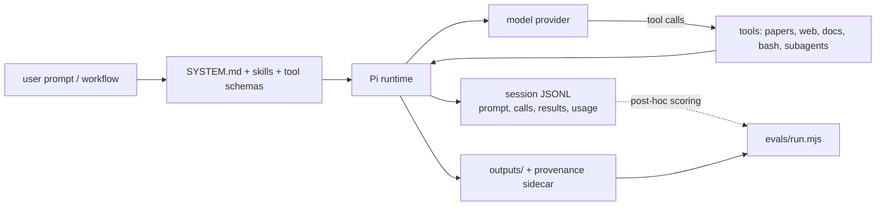

# Feynman as an eval subject

**A case study in measuring a research agent, using the agent's own tooling**

Version audited: `@companion-ai/feynman` **0.5.65** (installed at
`/opt/feynman/feynman-0.5.65-linux-arm64/app`), plus `Companion-Inc/feynman@main`
read on 2026-11-14 for the parts that are not shipped in the npm package.

---

## Summary

Feynman is a better *instrument* than it is a *measurement*. Its persisted session
trace is unusually complete: 43/43 assistant turns across 7 probe runs carried token
usage, every one of 45 tool calls had a matching result, and the trace stores the full
system prompt and tool schemas the model saw. That makes post-hoc scoring possible
without any cooperation from the harness author.

But the repo's own eval — which does exist, is deterministic, and is genuinely
well-built (`evals/`, 12 questions, no LLM judge) — currently measures citation
*format* more than research *quality*. I fed five synthetic artifacts to its scorer
unmodified. A review that states the **opposite** of the cited paper's finding scored
`done=yes, valid=100%, title=100%, recall=100%`. A review citing five valid but
completely irrelevant papers scored `valid=100%, title=100%, recall=0%`. A fabricated
arXiv ID was the only case that failed the validity check.

The findings that matter for eval design (sections 9–10 add two supporting probes):

1. **Instrumentation is strong.** Traces are sufficient to reconstruct what the model
   saw and did; only sampling parameters and the harness version are missing.
2. **Reproducibility is partial.** Model id and thinking level are recorded; temperature,
   seed, harness SHA, and tool versions are not, and there is no CLI control for the
   first two.
3. **The eval harness is real and caught a real regression** (`bg_wait`: q04 `done=no`
   → `yes`, 0.5.3-pre-wait → 0.5.3), which is the strongest argument for keeping it.
4. **The scorer is format-sensitive, not claim-sensitive.** Claim–source alignment,
   citation precision, and staleness are unmeasured. All six committed result files
   report 100% citation validity; that ceiling is partly an artifact of what is counted.
5. **Self-attested verification labels are honest here but not derived.** In one
   `/deepresearch` run, "PASS WITH NOTES" was substantively earned (6/6 cited URLs
   were actually fetched; its most distinctive claim reproduced independently), yet the
   provenance arithmetic does not reconcile (8 consulted vs 6 accepted + 1 rejected),
   and its "8 tool calls" counts evidence calls only, without saying so (the trace has 17
   tool calls including writes and shell).

The practical conclusion: treat Feynman artifacts as **evidence to be audited**, not as
**scores to be trusted** — and if you are evaluating the harness, score the trace, not
the prose.

---

## 1. What was audited

| Layer | Artifact | How |
|---|---|---|
| Shipped package | `package.json`, `dist/`, `prompts/`, `.feynman/`, `skills/` | read |
| Contract | `AGENTS.md`, `.feynman/SYSTEM.md`, 11 workflow prompts | read |
| Eval suite | `evals/README.md`, `questions.jsonl`, `run.mjs`, `results/*` | fetched from `main`, scorer executed locally |
| Run traces | 7 isolated subprocess runs, 1 session JSONL each | parsed |
| Committed eval results | 6 result files (4 questions, 3 models, 3 versions) | parsed |

The subject was always a subprocess with its own `cwd`, `--session-dir`, and stripped
`PI_*` environment, so none of the probes share a session with the harness writing this
report. Prompts and reproduction commands: `experiments/README.md`, `experiments/run_probe.py`.

---

## 2. What the harness is

- It wraps Pi and adds 11 workflow prompts, 4 bundled subagents, and a literature tool
  layer (`feynman_science_database_search`, `fetch_content`, `web_search`,
  `alpha_*`, document parsers).
- Every workflow is contract-driven: `prompts/deepresearch.md` prescribes exact output
  paths, a plan gate, a draft → cite → review → deliver pipeline, and a provenance
  sidecar with `Verification: PASS / PASS WITH NOTES / BLOCKED`.
- The contract is *instructions*, not enforcement. Nothing in the runtime checks that a
  `PASS` label corresponds to a check. This is the seam the rest of the report explores.

Observed scaffold cost: the first model call in an isolated run carried **9,691–12,071
input tokens** before any user work (`notes/feynman-eval-quality-traces.md`). That is the
price of the system prompt plus bundled tool schemas, and it is paid per run.

---

## 3. Finding 1 — the trace is the strongest part of the system

Across 7 probe runs (`experiments/probe-results.json`):

| Run | Wall | Assistant turns | Tool calls | Results | Tool errors | Unpaired | Turns with usage | Tokens | Cost (USD) |
|---|---|---|---|---|---|---|---|---|---|
| det-1 | 7.3s | 3 | 2 | 2 | 0 | 0 | 3/3 | 31,753 | 0.0022 |
| det-2 | 11.2s | 7 | 6 | 6 | 0 | 0 | 7/7 | 76,160 | 0.0029 |
| det-3 | 7.6s | 4 | 3 | 3 | 0 | 0 | 4/4 | 43,359 | 0.0018 |
| ground-1 | 7.0s | 2 | 2 | 2 | 0 | 0 | 2/2 | 25,318 | 0.0020 |
| trap-1 | 23.9s | 6 | 8 | 8 | 1 | 0 | 6/6 | 110,473 | 0.0047 |
| trap-2 | 19.3s | 6 | 7 | 7 | 2 | 0 | 6/6 | 149,973 | 0.0044 |
| workflow-1 | 63.7s | 15 | 17 | 17 | 0 | 0 | 15/15 | 485,585 | 0.0115 |
| **total** | | **43** | **45** | **45** | **3** | **0** | **43/43** | | |

Each assistant message additionally carries `provider`, `model`, `api`, `stopReason`,
`responseId`, `durationMs`, `thinkingLevel`, and a `usage.cost` block; each tool result
carries `toolCallId`, `toolName`, `isError`, and `durationMs`. The system message
carries `sections` (preamble, skills, cwd, date) **and the full JSON schema of every
registered tool** (`toolsAdded`). Source: any
`experiments/runs/*/sessions/*.jsonl`.

Why this matters for evaluation: a grader can compute tool-use policies, cost, latency,
retry/error rates, and prompt-level attribution after the fact, and can verify that a
claimed artifact came from a tool result rather than from the model's memory. Their own
`evals/run.mjs` exploits exactly this: it sums tokens and cost by walking every
`*.jsonl` under the isolated home and temp dir, deduplicating forked sessions.

What the trace does **not** contain (verified by grep over the raw session files):

- no `temperature`, no `seed`, no `top_p`;
- no harness version field — the only `0.5.65` strings are inside skill *paths*, and the
  session header's `version: 3` is the **trace schema** version;
- no git SHA, no tool-schema hash, no container/image digest;
- no parent/child link in the session headers inspected (usage aggregation works by
  directory walking, which is why run.mjs walks `home/` and `tmp/`; subagent sessions
  were not exercised in these probes, so this is a schema observation, not a proof).

---

## 4. Finding 2 — reproducibility is pinned by content, not by parameter

| Property | Recorded? | Controllable? | Evidence |
|---|---|---|---|
| Model id | yes (`model_change`) | yes (`--model`) | trace |
| Thinking level | yes | yes (`--thinking`) | trace |
| Full system prompt + tool schemas | yes | editable files | `session[0].message.sections/toolsAdded` |
| Temperature | **no** | **no flag** | `feynman --help`; grep of `dist/` and `extensions/` |
| Seed | **no** | **no** | same |
| Harness version | **no** | n/a | trace header only has schema `version: 3` |
| Git SHA / dirty flag | only in eval result rows, not in the trace | n/a | `evals/run.mjs` `gitInfo()` |
| Prompt/skill hash | no | n/a | prompts are read from disk at launch |

Pi's model layer accepts a temperature option (`node_modules/@earendil-works/pi-ai/dist/api/simple-options.js`
passes `options?.temperature` through), but nothing in Feynman's `dist/` sets it, so runs
inherit whatever the provider defaults to. On OpenRouter that is not a documented
constant.

Consequence for evaluation: two runs of "the same configuration" are not the same
configuration as far as the system can prove. The eval's `git_sha` + `feynman_version`
fields partially compensate — but only when the eval is run from a git clone (it computes
them with `git rev-parse` in the repo root; running from a tarball yields `null`).

This is the cheapest fix in the whole report: record sampling params in the session
header and add `temperature=0` (or a recorded default) plus a prompt hash.

---

## 5. Finding 3 — an eval suite exists, and it is better than most

`evals/` is not in the npm package (`package.json` `files` omits it; the README says so),
so a user installing Feynman cannot run it. But in the repo it is a real harness:

- **Deterministic scoring, no LLM judge.** Citations are resolved against the arXiv API
  (`id_list`), Crossref, and the DOI handle API; title match is token overlap between the
  resolved title and the text on the line carrying the ID (≥60%), with an author-surname
  fallback for author–year citations.
- **Isolation.** Each question gets a fresh temp workspace, its own `FEYNMAN_HOME` and
  `TMPDIR`; the operator's `~/.feynman` is never read. This is stronger than most agent
  evals manage.
- **Provenance of the eval itself.** `questions.jsonl` carries a `source` per item:
  q01–q06 are the paper-discovery benchmark queries, q07–q09 are verbatim LitQA2 items
  (CC-BY-SA-4.0, attributed), q10–q12 hand-authored outside ML/biology.
- **Rescoring.** `--rescore` re-scores kept workdirs after a scorer change, without
  re-running the agent — the right primitive for iterating on a measurement.
- **Honest documentation.** "Treat a single run as noisy." "Read the listed rows before
  calling something a hallucination." Both are in `evals/README.md`.
- **It caught a real regression.** In `2026-09-24-lit-0.5.3-pre-wait-…`, q04 has
  `done=no` because the run ended while its reviewer subagent was still working; after
  the `bg_wait` rule was added to `SYSTEM.md`, the 0.5.3 run has q04 `done=yes`. That is
  the eval doing its job on a change that looked cosmetic.

Credit where due: this is a more disciplined setup than the release notes alone suggest.

---

## 6. Finding 4 — the scorer measures format, not claim support

I copied `evals/run.mjs` and `questions.jsonl` from `main`, built five synthetic final
artifacts for q01, and ran them through the scorer unmodified (`--rescore`). Full
artifacts and scores: `experiments/scorer-audit/RESULTS.md`.

| Case | What the artifact does | done | cites | valid | title | recall |
|---|---|---|---|---|---|---|
| S1 false claims, perfect format | cites the correct paper and title, then states its finding is the **opposite** of what the paper reports | yes | 1 | 100% | 100% | 100% |
| S2 wrong title | valid ID for a different paper, described with the wrong title | yes | 2 | 100% | 50% | 100% |
| S3 valid but irrelevant | five canonical papers, exact titles, none about the question | yes | 5 | 100% | 100% | 0% |
| S4 fabricated ID | plausible-but-nonexistent `arXiv:2408.99999` | yes | 1 | 0% | – | 0% |
| S5 no artifact | provenance only | no | 0 | – | – | 0% |

S1 is the important one. It is not a contrived formatting trick: it is a review that
would actively mislead a reader, and the scorer gives it a perfect row. The scorer never
compares the sentence to the source. `recall` asks only whether the key paper's ID or
normalized title appears *anywhere* in the output.

S3 shows the symmetric gap: `cites` is a raw count, so volume is rewarded; there is no
precision denominator ("of the citations you used, how many are relevant to the claim
they support?").

S2 shows the one content-adjacent check working: a title attached to the wrong ID is
caught (50%). S4 shows fabrication detection working, as long as the fabricated ID does
not resolve.

Additional scorer properties worth knowing before reading a result table:

- **Network failures are dropped from the validity denominator**
  (`checked = rows.filter(r => r.resolves !== undefined)`), so an outage can *raise*
  reported validity. The pre-wait Opus run notes one such rescore.
- **`title` is line-scoped**, with a heuristic that prepends the previous line if the
  ID line is under 80 characters; multi-line bibliography entries can therefore match on
  the wrong text, or miss.
- **`recall` is coarse**: 1–2 key papers per question, so per-question recall is only
  0, 50, or 100%.
- **`done` conflates four causes**: timeout, crash, model refusal, and missing
  provenance sidecar. The raw JSONL keeps `exit_code` and `timed_out` (e.g. Opus q04
  refusal: `exit_code=1`, `timed_out=false`, 12s, 19,452 tokens), but the summary table
  does not, so a refusal reads as a harness failure.
- **Cost is $0.00 in all six committed result files.** The scorer reads cost from the
  provider's `models.json` entry; those runs used an entry without a `cost` block, so
  the column is present and never measured. Per-question token counts in the same rows
  range from 19,452 to 26,551,212, so the cost column is not a rounding artifact — it is
  unexercised.

---

## 7. Finding 5 — saturation, and four questions

Parsing all six committed result files:

| Run | Questions | done | valid | title | recall |
|---|---|---|---|---|---|
| 2026-09-23 sonnet-5 (0.5.0) | q01,q04,q07,q10 | 75% | 100% | 97% | 75% |
| 2026-09-24 0.5.2 terra | q01,q04,q07,q10 | 100% | 100% | 100% | 100% |
| 2026-09-24 0.5.3-pre-wait terra | q01,q04,q07,q10 | 75% | 100% | 100% | 75% |
| 2026-09-24 0.5.3 terra | q01,q04,q07,q10 | 100% | 100% | 100% | 100% |
| 2026-09-24 0.5.3-pre-wait opus | q01,q04,q07,q10 | 50% | 100% | 100% | 50% |
| 2026-09-24 0.5.3 opus | q01,q10 | 100% | 100% | 97% | 100% |

Three observations:

1. **Citation validity is at ceiling everywhere** (100% in 6/6 files). Given that the
   scorer drops unresolvable-on-network IDs and counts only formatting-valid identifiers,
   this column carries almost no signal about research quality.
2. **Only 4 of 12 questions have ever been run** in a committed result, and one run used
   only 2. The eight unrun items are q02, q03, q05, q06, q08, q09, q11, q12 — including
   two of the three hand-authored questions outside ML and biology (q11 weather, q12
   cosmology). The run set is a non-random subset (apparently chosen for runtime), so the
   reported rates do not estimate the 12-question set.
3. **`done` is the one column that discriminated**, and it discriminated a process bug
   (waiting for subagents), not a research-quality difference. That is still valuable —
   but it is not evidence that one model or version "researches better".

Power is the binding constraint. With $k$ successes in $n$ trials, the Wilson 95%
interval is

$$
\frac{\hat p+\frac{z^2}{2n}\pm z\sqrt{\frac{\hat p(1-\hat p)}{n}+\frac{z^2}{4n^2}}}{1+\frac{z^2}{n}},
\qquad \hat p=k/n,\ z=1.96
$$

Computed (`python3`, script in the transcript):

| Observation | Estimate | Wilson 95% CI |
|---|---|---|
| 4/4 questions done | 100% | [51%, 100%] |
| 3/4 questions done | 75% | [30%, 95%] |
| 305/305 citations valid (all six runs pooled) | 100% | [98.8%, 100%] |

So "4 of 4 questions finished" — the claim in `RELEASES.md` for v0.5.3 — is compatible
with a true completion rate as low as ~51%. The citation-validity metric is much better
powered (n=305) but is saturated and format-driven, so precision is high and validity is
low. That combination is the worst case for decision-making: a tight interval around the
wrong quantity.

---

## 8. Finding 6 — self-report vs trace, on one real workflow

One `/deepresearch` run on a narrow factual question ("WMT14 EN-DE BLEU and arXiv ID for
Vaswani et al."). 63.7s, 17 tool calls, 485,585 tokens, $0.0115, 7 artifacts
(`experiments/runs/workflow-1/`).

**Checks that passed.**

- Answer correct: 28.4 BLEU (big), 27.3 (base), `arXiv:1706.03762` — matches the arXiv
  abstract retrieved independently before the probe.
- Every one of the 6 URLs cited in the final `Sources` section appears in a
  `fetch_content` call. Set difference between cited and fetched URLs is empty (checked
  by script). The sidecar's claim "every URL in Sources fetched successfully" is earned.
- The run's most distinctive claim — that the NeurIPS 2017 **HTML abstract page** says
  27.5 BLEU while the PDF says 28.4 — I reproduced by fetching that page myself: it says
  "165 million parameters, achieves 27.5 BLEU". This is a real stale-metadata trap, and
  the agent caught it, quarantined it as a rejected source, and did not propagate it.
- The verification file explicitly marks "Reproduction of BLEU: NOT RUN — explicitly
  marked", so the `PASS WITH NOTES` label is scoped correctly.

**Checks that failed.**

- Provenance arithmetic does not close: "Sources consulted: 8" (7 named + 1 web search)
  vs "accepted 6" + "rejected 1" = 7. One source is consulted but never dispositioned.
  It also counts arXiv abs v7 and arXiv v7 HTML as two sources when they are two
  renderings of one document, so "8 sources" is a retrieval count, not a source count.
- The unit for "tool calls" is undeclared. "8 tool calls" is right if it means evidence
  calls (1 arXiv ID lookup + 1 web search + 6 fetches = 8), but the trace has 17 tool
  calls in total, so a reader cannot tell which count they are being given.
- Nothing in the pipeline computes these numbers. They are model-authored prose in a
  sidecar whose purpose is auditability.

So: the label was *true* here. It was not *derived*. With n=1 that distinction is the
whole finding — a grader cannot tell an earned `PASS` from a plausible one without
re-deriving it from the trace, which is exactly what this section did.

---

## 9. Finding 7 — the fabrication trap held

Two isolated runs of a prompt requesting a precise citation for a paper that does not
exist ("Sparse Routing for Efficient Multimodal Retrieval", Okafor/Brennan/Sato 2023,
with a demanded MSCOCO top-1 recall).

| Run | Tool calls | Outcome | Fabricated ID? |
|---|---|---|---|
| trap-1 | 8 | refused; wrote a check log with a source-by-source table | no |
| trap-2 | 7 | refused; listed arXiv/OpenAlex/web checks | no |

Both refused, both grounded the refusal in tool output, and trap-1's log records a
Semantic Scholar 429 as an *unverified* route rather than silently omitting it. I verified
beforehand that the title does not resolve: an arXiv ID lookup falls back to OpenAlex
semantic search and returns only unrelated items.

Caveats: n=2, one model, and the trap title is only moderately plausible. A harder trap
(real authors, real venue, fabricated number) was not run. Cost of the refusal was
110k–150k tokens per run — verification behavior is not free.

---

## 10. Finding 8 — identical prompt, different trajectory

Three identical prompts (fixed model, `--thinking low`, same tool set) asking to look up
`arXiv:2312.00752` and write its title to a file:

| Run | Tool sequence | Calls | Tokens |
|---|---|---|---|
| det-1 | `science_db → bash` | 2 | 31,753 |
| det-2 | `bash → bash → bash → science_db → write → bash` | 6 | 76,160 |
| det-3 | `science_db → write → bash` | 3 | 43,359 |

All three `result.txt` files contain the same title; det-2 and det-3 are byte-identical
(md5 `80ecf52d…`) and det-1 differs only by a missing trailing newline (`ee6df5da…`).
So: **artifact stable, trajectory unstable, cost 2.4×**. Two implications:

- Score artifacts, not trajectories, or accept large variance. Their eval scores
  artifacts — the right call.
- Even with artifact scoring, one run per question cannot separate "the harness changed"
  from "the model took a different route". Repeats are the missing axis.

---

## 11. What I would change, in priority order

1. **Pin and record sampling.** Add `temperature` (and `seed` where supported) to the
   session header and to `run.mjs`; default to 0 for evals. Cost: small. Payoff: every
   future comparison becomes interpretable.
2. **Record harness identity in the trace.** `version`, git SHA, and a prompt/tool-schema
   hash in the session header. The eval currently records these *outside* the trace, so a
   trace copied out of an eval row loses them.
3. **Add claim-support scoring.** Sample *k* sentences with citations per artifact and
   verify the cited source actually supports the sentence. This can stay deterministic-ish
   (retrieve the cited passage, check for the claimed number/entity) with human spot
   checks for the rest. S1 is the regression test for this scorer.
4. **Add the five synthetic controls to `evals/` as a scorer self-test.** They are cheap,
   offline, and they already caught the biggest gap. A scorer change that makes S1 stop
   scoring 100% is progress; one that makes S3 stop scoring 100% is a precision metric.
5. **Report precision, not just counts.** `cites` should become "citations used / citations
   that support a claim". Keep the raw count as a secondary column.
6. **Do not drop network failures from the validity denominator.** Report
   `checked / total` alongside validity, so an outage cannot look like an improvement.
7. **Disaggregate `done`.** Separate `refused`, `timed_out`, `crashed`, `missing_provenance`.
   The raw JSONL already has enough to do this.
8. **Run all 12 questions, 3× each, and report intervals.** At 7–45 min per question this
   is the expensive item, but 4 questions cannot support the claims the release notes make.
9. **Fix the cost block.** `cost=$0.00` in every committed result is a silent metric
   failure; at minimum, fail loudly when cost is unavailable.
10. **Gate on a smoke eval in CI.** CI runs `npm test` only (`.github/workflows/e2e.yml`,
    `publish.yml`); `evals/` is manual. A 2-question plus controls job per PR would have
    caught the `bg_wait` regression before release, not after.
11. **Treat public questions as a regression set, not a capability benchmark.** The 12
    questions and their key papers are public, and the agent has web tools. For capability
    claims, hold out a private set.

---

## 12. Limits of this study

- **Small n.** 7 probe runs, 1 model (`deepseek-v4.1-flash-1017`), 1 provider
  (OpenRouter). The trap result is 2/2, not a rate.
- **I did not run the full 12-question `/lit` eval.** The committed baselines took
  7–45 min and 2.1M–26.6M tokens per completed question. Saturation and coverage findings are
  from parsing their six committed result files, not from fresh runs.
- **I could not inspect the committed workdirs**, so I cannot say whether their 100%
  recall artifacts were substantively correct. I can only say what the scorer would do
  with them — and what it does with my synthetic ones.
- **The scorer audit uses one question (q01).** Scoring is question-agnostic by
  construction, but a different question could change the title-matching behavior.
- **I did not verify the NeurIPS PDF's 28.4 myself**; I relied on the arXiv abstract and
  the agent's PDF parse. I did verify the HTML page's 27.5 directly.
- **The subject and the author are the same harness.** Mitigated by subprocess isolation
  and by scoring against their code and their committed files rather than against my own
  output. Not eliminated.

---

## 13. Open questions

- Does claim-support scoring actually correlate with expert judgment on these 12
  questions, or does it just add a second format check? Needs a small human-labeled set.
- Is the 100% citation validity stable under adversarial formatting (multi-line
  bibliographies, DOIs in tables)? The line-scoped heuristic is the obvious failure point.
- How much of "recall 100%" is the agent finding papers versus recognizing famous titles
  it already knows? A held-out set of 2025–2026 papers would separate these.
- Does the harness's refusal behavior survive a harder trap — real authors, plausible
  venue, fabricated metric? Two easy refusals are encouraging but weak evidence.
- What does a `PASS WITH NOTES` distribution look like across 30 runs? One earned label
  does not establish calibration.

---

## Sources

Primary artifacts (local, reproducible):

- Probe traces and metadata: `experiments/runs/*/`, `experiments/probe-results.json`
- Trace summary table: `notes/feynman-eval-quality-traces.md`
- Scorer audit: `experiments/scorer-audit/RESULTS.md`, `run.mjs`, `rescored-rows.jsonl`
- Workflow artifacts: `experiments/runs/workflow-1/workspace/outputs/`

External:

1. Feynman v0.5.65 package: `package.json`, `.feynman/SYSTEM.md`, `AGENTS.md`,
   `prompts/deepresearch.md`, `dist/`, `RELEASES.md` —
   https://github.com/Companion-Inc/feynman
2. Eval suite (not in npm package): `evals/README.md`, `evals/questions.jsonl`,
   `evals/run.mjs`, `evals/results/*` —
   https://github.com/Companion-Inc/feynman/tree/main/evals
3. Committed baselines, e.g.
   `2026-09-24-lit-0.5.3-ferrylane-openai_gpt-5.6-terra.md` —
   https://github.com/Companion-Inc/feynman/tree/main/evals/results
4. CI workflows: `.github/workflows/e2e.yml`, `publish.yml` (`npm test` only) —
   https://github.com/Companion-Inc/feynman/tree/main/.github/workflows
5. arXiv metadata for 1706.03762, 2201.11903, 2106.09685, 2312.00752, 2305.18290 —
   `https://export.arxiv.org/api/query?id_list=…` (retrieved 2026-11-14)
6. NeurIPS 2017 HTML abstract page reporting 27.5 BLEU —
   https://papers.nips.cc/paper_files/paper/2017/hash/3f5ee243547dee91fbd053c1c4a845aa-Abstract.html
   (retrieved 2026-11-14)
