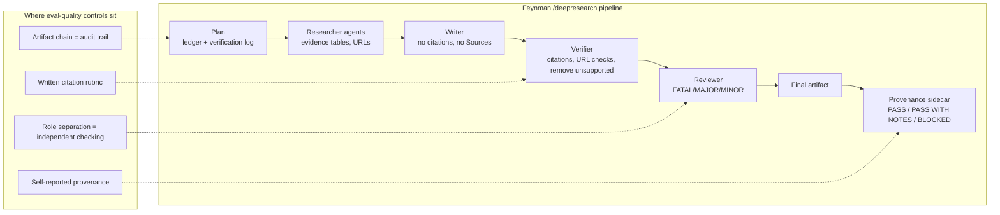

# Feynman 0.5.65 as an Evaluation Instrument: A Dogfooded Case Study

**Date:** 2026-11-14 · **Subject:** `@companion-ai/feynman` 0.5.65 · **Status:** probes run; single-model, single-run; reviewer untested

## Summary

I studied the Feynman research harness as if it were itself an AI evaluation system, using the harness to do the study. The question was not "is Feynman good?" but the sharper one an eval auditor would ask: **what does this harness actually measure, what does it merely assert, and could it tell whether its own integrity layer failed?**

The short answer:

1. **The harness has an unusually explicit integrity contract.** Four role-separated agents, a mandatory artifact chain (plan → draft → cited draft → review → final + provenance), written citation rules (two-index DOI/arXiv cross-checks, title/year/author match, no orphan citations or sources), and an honest-label vocabulary (`verified` / `unverified` / `blocked` / `inferred`). This is more process discipline than most research agents expose. It maps well onto the "process-based metrics" and "reporting validity" half of the Agentic Benchmark Checklist [5].
2. **The contract is largely unvalidated.** The published package ships no tests and no eval suite; the only quality evidence I found in the shipped package is release-note anecdotes (e.g. "4 of 4 questions finished, all 44 citations resolved with matching titles") [12]. Those measure **completion and citation resolution**, not whether citations support claims, and not whether the pipeline can detect a wrong claim.
3. **On a seeded-defect probe, the verifier did much better than I expected.** Two probes: 10/10 and 6/6 planted defects removed or corrected, 5/5 and 4/4 controls preserved, zero false removals. In the harder probe it repaired a dead identifier to the correct paper rather than deleting the claim. Costs were $0.03 and $0.01, under a minute each. This is real evidence that the written rules are executable, not just decorative.
4. **The result is still not an eval.** One model, one run per probe, dense synthetic defects, and an oracle I wrote unblinded. The first probe was confounded because I had pre-loaded the answers into the research file; I ran a second, harder probe to fix that. The honest reading is "the reconciliation behaviour works under favorable conditions," not "the verifier is reliable."
5. **The biggest structural gap is that silent failure leaves no trace.** If the verifier passes a bad claim, the provenance sidecar still says `PASS`. Provenance is free text written by the same agent being evaluated; it records model identity, cost, seeds, and judge agreement nowhere. The harness can report that verification ran, but not that it worked.

The rest of this document gives the rubric, the mechanism audit, the probes, and a prioritized set of fixes.

---

## 1. Scope, method, and what "dogfooding" means here

This is a **case study of one harness version**, not a benchmark. I did five things:

| Step | What I did | Artifact |
|---|---|---|
| S1 | Extracted the harness's eval-relevant mechanisms from its prompts, agent contracts, and tool schemas | this brief §3 |
| S2 | Built an 8-dimension rubric from the evaluation-science literature | this brief §2 |
| S3 | Ran a seeded-defect probe against the bundled `verifier` agent, twice | `experiments/verifier-probe/` |
| S4 | Measured the default literature-search tool's precision/recall on five fixed queries | `experiments/retrieval-probe/results.md` |
| S5 | Recorded process observations from running this study inside the harness | §6 |

I deliberately did **not** run `/deepresearch` end-to-end. That would test a different construct (workflow conformance) and would have made the study about one generated document rather than about the harness's evaluation properties. It is listed as the top next step.

**The unit of analysis is the mechanism, not the prose.** A harness that says "never fabricate a source" has a *policy*. A harness that requires a second agent to resolve every URL against two indexes has a *control*. The case study tries to keep those separate.

---

## 2. The rubric: eight properties an eval-quality auditor should check

The evaluation literature converges on a small set of failure modes: measuring a proxy instead of the construct, scoring outcomes with flawed oracles, ignoring variance, leaking test data, and letting an unvalidated judge decide. I consolidated them into eight dimensions and used them as the audit grid.

| # | Dimension | What it demands | Anchor |
|---|---|---|---|
| D1 | **Construct validity** | The measure must represent the phenomenon, not a convenient proxy; define the phenomenon and justify the operationalisation | Bean et al. 2025 [4] |
| D2 | **Task and outcome validity** | A task should be solvable iff the target capability is present; the scoring oracle must correctly indicate success | Zhu et al. 2025 (ABC) [5] |
| D3 | **Statistical reliability** | Report uncertainty, repeat runs, and consistency (e.g. `pass^k`), not a single point estimate | Miller 2024 [14]; Madaan et al. 2024 [3]; Yao et al. 2024 [10] |
| D4 | **Reproducibility and provenance** | Frozen environment, pinned versions, recorded model/seed/temperature, auditable artifacts and raw traces | CORE-Bench 2024 [6]; Deep Research Bench 2025 [9]; HELM 2022 [1] |
| D5 | **Contamination and holdout** | Test items must not be recoverable from training data or the scaffold; keep holdouts and check leakage | Kapoor et al. 2024 [2]; ScienceAgentBench 2024 [8]; MLE-bench 2024 [13] |
| D6 | **Judge validity** | If an LLM judges, the judge itself must be benchmarked; report agreement and bias | PaperBench 2025 [7]; ABC [5] |
| D7 | **Cost and effort accounting** | Report accuracy jointly with tokens, dollars, and latency | Kapoor et al. 2024 [2]; ScienceAgentBench [8] |
| D8 | **Adversarial / negative controls** | Include known-bad items that must fail; verify the oracle can detect failure | ABC [5]; CiteAudit 2026 [15]; Rao et al. 2026 [16] |

Two dimensions deserve emphasis because research-agent evaluations usually skip them:

- **D6 is not optional for this harness.** Its quality gate is two LLM agents (`verifier`, `reviewer`) applying rubrics. That is an LLM-as-a-judge system. PaperBench's lesson is that the judge must be evaluated against a separate judge benchmark [7]; ABC recommends benchmarking the judge reproducibly [5]. Feynman does neither publicly.
- **D8 is the difference between an assertion and a test.** A citation checker that has never been shown a fabricated citation is an untested oracle. The citation-integrity literature now has both a benchmark (CiteAudit [15]) and a large-scale URL-validity measurement (3–13% of citation URLs hallucinated; 5–18% non-resolving) [16]. That is the right negative-control distribution to test against.

---

## 3. What the harness actually implements

I read the shipped artifacts at `/opt/feynman/feynman-0.5.65-linux-arm64/app`. The package reports version 0.5.65; the runtime was Node v24.21.0 on 2026-11-14. It ships **4 agent definitions**, **11 workflow prompts**, **16 skills**, and **13 extension registrars** (counted from `prompts/*.md`, `.feynman/agents/*.md`, `skills/**/SKILL.md`, and `extensions/research-tools.ts`).

| Mechanism | Where | What it enforces | Dimension served |
|---|---|---|---|
| Role-separated pipeline | `.feynman/agents/{researcher,writer,verifier,reviewer}.md` | The writer is forbidden to add citations; the verifier owns citations and Sources; the reviewer audits the cited draft | D2, D6 (partially) |
| Mandatory artifact chain | `prompts/deepresearch.md`, `prompts/lit.md` | Plan, draft, cited draft, verification, final, and provenance must exist on disk; no chat-only delivery | D4 |
| Citation rules | `.feynman/agents/verifier.md` | Every factual claim cited; no orphan citations; no orphan sources; dead links replaced or removed; **"Verify meaning, not just topic overlap"** | D1, D2 |
| Two-index metadata cross-check | `.feynman/agents/verifier.md`; `extensions/research-tools/science-databases.ts` | DOI/arXiv ID checked against two indexes; title, year, first author must match; mismatches flagged | D4 |
| Honest-label vocabulary | `SYSTEM.md`, `AGENTS.md`, agent files | `verified` / `unverified` / `blocked` / `inferred`; `Verification: BLOCKED` when checks fail | D4 |
| "Removed Unsupported Claims" section | `.feynman/agents/verifier.md` | Removals are logged, not silent | D4 |
| Plan as working memory | `AGENTS.md`, `prompts/deepresearch.md` | Ledger, verification log, decision log updated as the run evolves | D4 |
| Fallback with provenance | `extensions/research-tools/science-databases.ts` | When Semantic Scholar fails, OpenAlex answers and a `fallbackNote` records the index change | D4 |
| Reviewer contamination check | `.feynman/agents/reviewer.md` | Reviewer is told to look for "benchmark leakage or contamination risks" in the artifact under review | D5 (for reviewed papers, not for the harness) |

The verifier file is the strongest single artifact. Its rules are specific enough to be testable, which is why the probes below could be designed at all. Three examples, quoted:

> "Verify meaning, not just topic overlap. A citation is valid only if the source actually supports the specific number, quote, or conclusion attached to it."

> "For each cited paper, cross-check its DOI or arXiv ID against two indexes ... Confirm that the title, year, and first author match the citation. Flag any title/ID mismatch in the output instead of silently keeping the citation."

> "Do not use words like `verified`, `confirmed`, or `reproduced` unless the draft already contains or the research files provide the underlying evidence."

That last rule is unusually well-posed. It turns a vague norm ("don't overclaim") into a checkable condition on the artifact.

### What is absent

| Gap | Evidence | Consequence |
|---|---|---|
| No shipped eval suite or gold set | `package.json` `files` contains no tests; `npm test` exists in the repo but tests are not in the published tarball | Users cannot reproduce the maintainers' quality claims |
| No repeated-run reliability | Workflows run once per stage; no `pass^k` or variance reporting | A single lucky verifier pass looks like a reliable verifier |
| No judge calibration | No agreement metric between `verifier`/`reviewer` and human labels | D6 unmet; the gate is an unvalidated LLM judge |
| No machine-checkable provenance | Provenance is free text (`PASS`, counts); no model/seed/temperature/cost field | The artifact cannot prove which model or settings produced it |
| No built-in negative controls | No seeded-defect canary in CI or in the workflow | A silent verifier failure is indistinguishable from success |
| No retraction check | OpenAlex returns `isRetracted`, but no prompt requires checking it | Retracted sources can pass a "verified" URL check |
| No per-run cost accounting | `RELEASES.md` mentions timings informally; provenance does not include cost | D7 unmet |

A note on the "no tests" claim: the published package's `files` list contains no test paths, and the shipped tarball is what a user runs. The upstream repository may well have tests (the README shows `npm test`). The gap is **distribution and reproducibility of the eval**, not the existence of any test code.

---

## 4. Behavioral probe: can the verifier catch planted defects?

### 4.1 Design

I built two short drafts (14 and 10 numbered findings) with a mix of clean claims and planted defects: wrong year, wrong number, misstated statistic, semantic misattribution, fabricated DOI, dead URL, title/ID mismatch, unsupported quantitative claim, semantic inversion, and orphan source. I wrote an oracle **before** running the agent, with a mechanical rule: a defect is detected if it does not survive as an asserted fact in the output.

I used the harness's own `verifier` agent, with the prompt shape the `/deepresearch` workflow uses, and asked it to write the corrected document to a fixed path. Both runs used `openrouter/deepseek/deepseek-v4.1-flash-1017`.

**Probe 1** gave the verifier a research file that contained the correct values for most defects. That was a design error on my part: it tested *reconciliation against a correct research file*, not independent verification. I kept it and ran **Probe 2** with a deliberately empty research file, forcing the agent to fetch sources to decide.

### 4.2 Results

| Probe | Defects detected | Controls preserved | False removals | Cost | Wall clock |
|---|---|---|---|---|---|
| 1 — reconciliation | **10/10** | **5/5** | 0 | $0.02959 | 43.3 s |
| 2 — independent | **6/6** | **4/4** | 0 | $0.01057 | 52.7 s |

Selected outcomes from Probe 2:

- Corrected SWE-bench's problem count from 2,942 to 2,294 by reading the abstract.
- Detected that a 16.0% statistic attributed to HELM actually belongs to Bean et al., added the correct source, and tightened the wording to "used uncertainty estimates or statistical tests."
- Replaced a fabricated DOI (`10.9999/abc.2025.001`, HTTP 404) with arXiv 2507.02825, and cross-checked the NeurIPS venue record `W7197047848`.
- **Repaired** a dead URL (`arXiv:2406.99999`) to the real Deep Research Bench paper (2506.06287) rather than deleting the claim, after confirming the abstract supports it.
- Removed an unsupported "94%" statistic and logged it under "Removed Unsupported Claims."
- Preserved all five controls, including a hedged opinion that needed no citation.

I then re-ran the verifier's own checks rather than trusting its summary: all eight final arXiv URLs returned HTTP 200, and both OpenAlex records it cited match its descriptions. Its one residual caveat — that "7 metrics across 16 core scenarios" omits HELM's "when possible (87.5% of the time)" — is accurate.

### 4.3 Interpretation, with the confounds stated

This is a **positive result for reconciliation and repair**, and a weak result for reliability:

- **Detection is not the same as calibration.** 10/10 on a dense synthetic set does not imply a low false-negative rate on natural drafts, where errors are sparser and subtler.
- **The defects were answerable.** Probe 2 forced fetching, but the draft's Sources section still named real papers for most items. A claim supported by a real paper that *does not contain the cited number* is a harder case; Probe 2's misattributed-statistic item is the closest, and it was caught because HELM's abstract makes the mismatch obvious.
- **Single run, single model.** No estimate of run-to-run variance. A 6/6 and a 10/10 are consistent with a good agent and also with an easy test.
- **The oracle was not blinded.** I wrote both the defects and the pass criteria. Mechanical scoring limits, but does not eliminate, bias.
- **The repair behaviour is a genuine strength.** Deleting a claim is safe; finding the correct replacement and verifying it is better. Probe 2 did the latter.

The honest summary: **the verifier's written contract is executable under favorable conditions.** Whether it is reliable is untested.

---

## 5. Retrieval probe: the quality of the evidence input

A research harness's output can only be as good as the evidence it retrieves. I ran five fixed queries through `feynman_science_database_search` with the default `semanticscholar` source (citation-count sort, limit 5) and scored relevance from returned titles and abstracts.

| Query | Records | Relevant | Note |
|---|---|---|---|
| `construct validity large language model benchmarks` | 5 | 1 | Only Bean et al.; NER, KG construction, an unrelated "Conference Papers" record, and TRAIL filled the rest |
| `LLM-as-a-judge reliability human agreement` | 5 | 5 | Semantic Scholar was rate-limited; OpenAlex fallback answered, with a `fallbackNote` |
| `benchmark contamination holdout machine learning evaluation` | 0 | 0 | Zero records, though relevant papers exist in the index |
| `variance error bars language model evaluation statistics` | 0 | 0 | Zero records, though Madaan et al. 2024 [3] is in the index |
| `citation hallucination fabricated references large language models` | 5 | 4 | One off-topic clinical paper |

**Semantic Scholar-only aggregate:** 5 relevant of 10 returned records (50% precision), 5 of 15 requested slots (33%), and 2 of 4 queries produced any relevant record. Including the OpenAlex fallback: 10 of 20 returned records relevant, 3 of 5 queries productive.

Two observations matter for eval quality:

1. **The failure mode is query shape, not ranking.** The two zero-result queries each combine three to five concepts. Short or single-concept queries did well. A researcher using the default without rephrasing would silently get an empty evidence base — and the workflow's "minimum 3 distinct queries" rule mitigates but does not eliminate this.
2. **The fallback is well-behaved.** When Semantic Scholar returned HTTP 429, the tool switched to OpenAlex, said so in `fallbackNote`, and emitted endpoint provenance. That is the correct behaviour for reproducibility: the instrument changed and the change is visible. OpenAlex also returned `isRetracted`, ORCIDs, and OA status — more verification primitives than any prompt currently uses.

Caveat: this is 5 queries, one run, judged by one unblinded rater. It is a smoke test, not a retrieval benchmark. The maintainers' own 9-paper search benchmark [12] is a better instrument; mine tests queries it does not cover.

---

## 6. Process observations from dogfooding

These are things I could only see by running the study inside the harness:

| Observation | Status | Why it matters |
|---|---|---|
| The `verifier` wrote to the exact requested path (`experiments/verifier-probe/verified.md`) | **worked** | The 0.5.16 release note says about 1 in 7 installs previously lost subagent outputs to a session-artifacts directory [12]. The fix held here |
| Subagent outputs return a one-line summary plus a file path, not the full artifact | **worked** | Keeps parent context small; matches the file-handoff contract |
| Model identity, cost, and latency were **not** in the artifact | **gap** | I recovered them from `session.jsonl` (`openrouter/deepseek/deepseek-v4.1-flash-1017`, $0.0296 / $0.0106) |
| A `subagent` call with no `task` still spawned a running child | **minor robustness gap** | It had to be steered with the task afterward. This is the Pi subagent layer, not Feynman's research logic |
| The workflow did not create `CHANGELOG.md` automatically | **expected** | `AGENTS.md` says not to create it for one-shot tasks; this run was multi-step, so I created one manually |
| The provenance sidecar is hand-written free text | **structural gap** | `PASS` is an assertion by the agent being evaluated, not a machine-checked result |

The last row is the one I would fix first. A provenance file that cannot independently attest to model, settings, cost, and check outcomes is a lab notebook, not an audit log.

---

## 7. Verdict against the eight dimensions

| Dimension | Assessment | Basis |
|---|---|---|
| D1 Construct validity | **Partial** | The stated construct ("evidence over fluency," auditable artifacts) is clear, but success is operationalised as artifact existence + citation resolution, not claim correctness |
| D2 Task/outcome validity | **Partial, with positive probe evidence** | The verifier's outcome rule is well-posed; the probe shows it can execute; no task-validity argument that the test set represents real drafts |
| D3 Statistical reliability | **Absent** | Single pass per stage; no variance, `pass^k`, or repeated-run reporting |
| D4 Reproducibility/provenance | **Strong artifacts, weak metadata** | Mandatory artifact chain and two-index checks are real; model/seed/temperature/cost are unrecorded |
| D5 Contamination/holdout | **Weak for the harness itself** | Reviewer checks papers for leakage; no holdout or contamination control for the harness's own eval |
| D6 Judge validity | **Absent** | Verifier and reviewer are uncalibrated LLM judges; no agreement benchmark |
| D7 Cost/effort | **Absent from artifacts** | Recoverable from session logs, not reported in provenance |
| D8 Adversarial controls | **Absent as a built-in** | No seeded-defect suite in CI; this study's probes are ad hoc and not shipped |

**Overall:** a harness with an unusually strong *policy* layer and a thin *measurement* layer. It is good at producing artifacts that look auditable; it is not yet set up to prove that its audits work.

---

## 8. Recommendations

Ordered by expected value per unit of engineering effort.

1. **Ship a seeded-defect regression suite.** Use the two probes in `experiments/verifier-probe/` (14 and 10 findings) as a starting point. Run it on every model, prompt, or agent-contract change. Report defect detection and control preservation separately, so a verifier that deletes everything cannot score well.
2. **Make provenance machine-checkable.** Add a structured block: model/provider, temperature, seed, token counts, cost, tool endpoints, artifact SHA-256, and the result of each named check. Today all of this is recoverable from `session.jsonl`; none of it is in the deliverable.
3. **Add repeated-run reliability.** Run the verifier and reviewer 3–5 times on the same draft and report agreement. A single pass cannot distinguish a reliable gate from a lucky one.
4. **Calibrate the judges.** Build a small human-labelled set of claim–source pairs (supported / unsupported / ambiguous) and report the verifier's precision, recall, and agreement. CiteAudit [15] is a public starting point.
5. **Add retraction and correction checks.** OpenAlex already returns `isRetracted`; Crossref exposes update relations. A "verified" citation to a retracted paper is a false pass.
6. **Separate "resolves" from "supports" in the `/lit` metric.** The release note's "44 of 44 citations resolved with matching titles" [12] is a URL/metadata metric. Add a claim-support metric, even if it is sampled and human-audited.
7. **Add a per-run canary.** Plant one known-false claim in a scratch file on every run and confirm the pipeline removes it. This is cheap continuous assurance that the gate is live.
8. **Report retrieval quality per run.** Record which index answered, whether a fallback occurred, and how many queries returned zero records. A zero-result query is a silent evidence gap, not a neutral event.

---

## 9. Threats to validity and what would change my mind

- **n=1 everywhere.** One harness version, one model, one run per probe. The probe results are not a reliability estimate.
- **Unblinded oracle.** I designed the defects and the pass criteria. A blinded, independently authored defect set would be stronger.
- **Synthetic defect density.** Probe 1 packed 10 defects into 14 findings plus 10 sources; that is far denser than real drafts, which likely inflates detection.
- **Probe 1 was confounded.** I fixed it with Probe 2 rather than hiding it; the pair should be read together.
- **The retrieval probe changed instruments mid-run.** Query 2 fell back from Semantic Scholar to OpenAlex. I report it separately rather than pooling.
- **Only the verifier was behaviourally tested.** The reviewer, writer, and researcher were read, not probed.
- **Short documents.** Long drafts may trigger context effects that these probes cannot see.

What would change the verdict: a blinded, multi-model, multi-run evaluation with natural error distributions showing a materially lower detection rate, or a high false-removal rate on legitimate but unusual claims. Either would move the verifier from "promising" to "unreliable."

---

## 10. Open questions

1. How much does verifier detection vary across model providers and thinking levels?
2. Does detection degrade when the research file is wrong in the same direction as the draft (correlated error)?
3. Does the reviewer catch defects the verifier misses, or do they share blind spots?
4. What is the false-removal rate on claims that are true but under-cited?
5. Does the default citation-sorted retrieval hurt real research outcomes, or do multi-query strategies compensate?
6. Can provenance be made tamper-evident without adding a second agent to attest to the first?

---

## Sources

1. Liang et al., "Holistic Evaluation of Language Models," 2022. https://arxiv.org/abs/2211.09110
2. Kapoor et al., "AI Agents That Matter," 2024. https://arxiv.org/abs/2407.01502
3. Madaan et al., "Quantifying Variance in Evaluation Benchmarks," 2024. https://arxiv.org/abs/2406.10229
4. Bean et al., "Measuring what Matters: Construct Validity in Large Language Model Benchmarks," NeurIPS 2025. https://arxiv.org/abs/2511.04703
5. Zhu et al., "Establishing Best Practices for Building Rigorous Agentic Benchmarks," 2025. https://arxiv.org/abs/2507.02825
6. Siegel et al., "CORE-Bench: Fostering the Credibility of Published Research Through a Computational Reproducibility Agent Benchmark," 2024. https://arxiv.org/abs/2409.11363
7. Starace et al., "PaperBench: Evaluating AI's Ability to Replicate AI Research," 2025. https://arxiv.org/abs/2504.01848
8. Chen et al., "ScienceAgentBench: Toward Rigorous Assessment of Language Agents for Data-Driven Scientific Discovery," ICLR 2025. https://arxiv.org/abs/2410.05080
9. Bosse et al. / FutureSearch, "Deep Research Bench: Evaluating AI Web Research Agents," 2025. https://arxiv.org/abs/2506.06287
10. Yao et al., "τ-bench: A Benchmark for Tool-Agent-User Interaction in Real-World Domains," 2024. https://arxiv.org/abs/2406.12045
11. Mialon et al., "GAIA: a benchmark for General AI Assistants," 2023. https://arxiv.org/abs/2311.12983
12. Feynman release notes, `RELEASES.md` in `@companion-ai/feynman` 0.5.65 (v0.5.3 `/lit` eval and search benchmark; v0.5.16 subagent path fix). Local path: `/opt/feynman/feynman-0.5.65-linux-arm64/app/RELEASES.md`
13. Chan et al., "MLE-bench: Evaluating Machine Learning Agents on Machine Learning Engineering," 2024. https://arxiv.org/abs/2410.07095
14. Miller, "Adding Error Bars to Evals: A Statistical Approach to Language Model Evaluations," 2024. https://arxiv.org/abs/2411.00640
15. Shi et al., "CiteAudit: You Cited It, But Did You Read It? A Benchmark for Verifying Scientific References in the LLM Era," 2026. https://arxiv.org/abs/2602.23452
16. Rao, Wong, Callison-Burch, "Detecting and Correcting Reference Hallucinations in Commercial LLMs and Deep Research Agents," 2026. https://arxiv.org/abs/2604.03173
17. Jimenez et al., "SWE-bench: Can Language Models Resolve Real-World GitHub Issues?", ICLR 2024. https://arxiv.org/abs/2310.06770

### Local evidence

- Harness source: `/opt/feynman/feynman-0.5.65-linux-arm64/app/`
  (`SYSTEM.md`, `.feynman/agents/*.md`, `prompts/*.md`, `extensions/research-tools/*.ts`, `package.json`, `RELEASES.md`)
- Plan: `outputs/.plans/feynman-harness-eval-quality.md`
- Verifier probes: `experiments/verifier-probe/` (`draft.md`, `draft2.md`, `verified.md`, `verified2.md`, `results.md`) and oracles `experiments/verifier-probe-oracle*.md`
- Retrieval probe: `experiments/retrieval-probe/results.md`
- Provenance: `outputs/feynman-harness-eval-quality.provenance.md`
