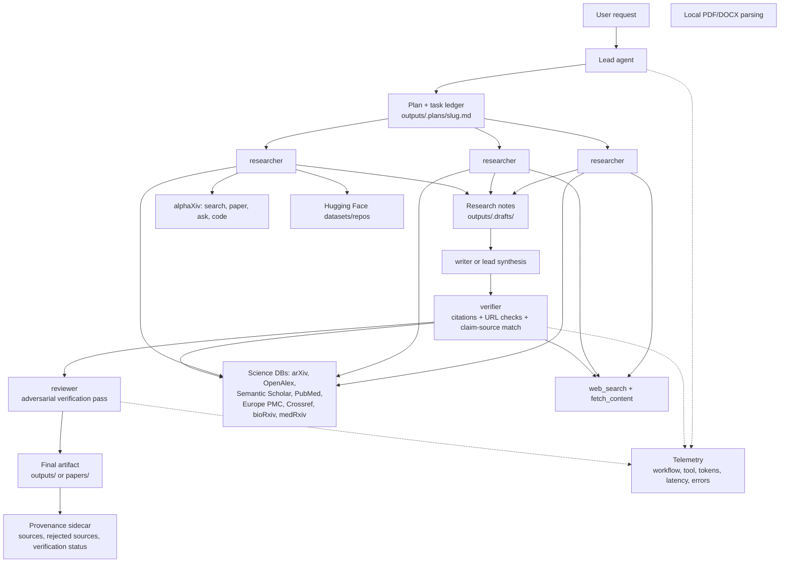

# Feynman as a case study in AI-eval quality

**Subject:** Feynman 0.5.65 (`@companion-ai/feynman`), an open-source research agent built on Pi
**Method:** static audit of the shipped harness + two controlled canary runs of its own verifier
**Date:** 2026-11-14
**Model used for dogfood runs:** `deepseek/deepseek-v4.1-flash-1017` via OpenRouter
**Status:** mechanism test, not an end-to-end benchmark. See [Limitations](#9-limitations).

---

## 1. Executive summary

Feynman is a well-engineered **research-hygiene harness**. It has an unusually explicit
provenance contract: plans, task ledgers, numbered evidence tables, inline citations,
provenance sidecars, and a dedicated `verifier` stage that is instructed to check URLs,
cross-check identifiers, and refuse fake certainty. In a blind canary, its verifier caught
**6 of 6** planted citation and claim defects, preserved a correct control claim, and left
**zero orphan citations or orphan sources**. That is a real mechanism result with saved
inputs, outputs, and execution traces.

It is not yet an **evaluation-grade harness**. Its own quality claims rest on tiny internal
evals: a 4-question `/lit` run scored by completion and citation resolution, and a 9-paper
retrieval probe. I found no eval code or task set in the installed package that would let a
reader rerun either one. The prompts contain almost no
guidance on statistical power, human-judge calibration, contamination, or repeated runs:
across the system prompt, four agent prompts, and eleven workflow prompts, “contamination”
appears once, “statistical” once, and “confidence interval”, “held-out”, “inter-rater”, and
“effect size” never appear. The harness is good at making research *auditable*; it is not
yet good at making evaluations *valid*.

The sharpest lesson came from my own dogfooding. The first canary looked perfect partly
because the evidence file told the verifier which items were fake. Removing those hints
(blind run) preserved the 6/6 detection but required 1.6× the tool calls and 5.6× the
non-cached input tokens. That is a miniature of benchmark leakage: an eval that looks clean
because the answer key is in the prompt.

**Verdict:** strong provenance engineering, weak evaluation science. The gap is fixable, and
most of the fixes are cheap.

---

## 2. What the harness is

Feynman wraps the Pi coding agent [10] and adds a research layer: 11 workflow prompts, 4
subagents, 16 skills, and a research-tools extension. The shipped package is ~335 MB with
`node_modules`; the prompt surface is compact: 42 lines of system prompt, 306 lines across
four agents, and 630 lines across eleven workflows (978 lines total before skills).

### Control surfaces that matter for eval quality

| Surface | What it provides | Where |
|---|---|---|
| System prompt | Evidence-over-fluency, uncertainty labels, artifact conventions, integrity rules | `.feynman/SYSTEM.md` |
| Agent prompts | Role separation: gather, write, verify, review | `.feynman/agents/*.md` |
| Workflow prompts | Required artifacts, stage order, blocked/degraded modes | `prompts/*.md` |
| Provenance sidecar | Date, sources consulted/accepted/rejected, verification status | `outputs/<slug>.provenance.md` |
| Telemetry | Workflow start/end, tool errors, token counts, latency, HTTP status, `output_written` | `extensions/research-tools/telemetry.ts` |
| Output conventions | Slugged filenames, plans, drafts, cited drafts, verification notes | `AGENTS.md` |

Two design choices are notable. First, the verifier is a **separate agent** with a different
prompt and a narrower tool set; it is not the writer grading itself. Second, the workflow
prompts mandate a **degraded mode**: if a capability fails, the run must still write a
blocked or partial artifact and provenance sidecar rather than ending in chat. Both choices
are good eval hygiene because they make failure visible.

---

## 3. An eval-quality rubric for a research agent

I use ten criteria, drawn from the deep-research and agentic-benchmark literature. They are
not independent; construct validity is the root, and the rest are ways it fails.

| # | Criterion | Why it matters for a research agent | Key source |
|---|---|---|---|
| 1 | Construct validity | Does the task measure research quality, or just fluent report generation? | [6], [7] |
| 2 | Task representativeness | Realistic, unambiguous, search-intensive, multi-domain tasks; not one lab’s favorite papers | [3], [8] |
| 3 | Grading validity | Does the judge score correctness and citation support, not style? Is it calibrated to humans? | [2], [4] |
| 4 | Contamination control | Held-out or post-cutoff tasks; otherwise the eval measures memorized papers | [5], [6] |
| 5 | Reproducibility | Pinned versions, seeds/temperature, frozen evidence, repeated runs, cost accounting | [1], [5] |
| 6 | Statistical power | Enough tasks and runs; variance, confidence intervals, not a single favorable setting | [1], [6] |
| 7 | Failure-mode coverage | Negative controls: fabricated citations, dead links, subtle mismatches, abstention | [2], [9] |
| 8 | Observability | Traces, tool errors, tokens, latency, artifacts; enough to diagnose a failure | [1] |
| 9 | Provenance / auditability | Claim-to-source traceability; labels for verified/unverified/blocked | [4] |
| 10 | Operational honesty | Process claims are not presented as quality claims; limitations are surfaced | [1], [6] |

The relevant literature is blunt about the failure modes. DeepResearch Bench separates report
quality (RACE) from citation accuracy (FACT) and reports citation accuracy as low as 39% for
some search-tool systems [2]. ResearchRubrics finds leading deep-research systems under 68%
average rubric compliance [4]. The agentic-benchmark best-practices paper formalizes task
validity and outcome validity and warns that environments must isolate agents from ground
truth and freeze dynamic resources [1]. Construct-validity audits find moderate cross-benchmark
correlations and ranking inversions, arguing that a single “agent ability” score is misleading
[6], [7].

---

## 4. Static audit: where Feynman stands

Scores are my judgment from the shipped artifacts, not from an external eval.

| Criterion | Score | Evidence |
|---|---|---|
| 1. Construct validity | **Partial** | Workflows target real research jobs (discovery, reading, synthesis, verification, replication), but the harness’s own quality metric is completion + citation resolution, not answer correctness. |
| 2. Task representativeness | **Weak** | No public task suite. Internal `/lit` eval: 4 questions. Retrieval probe: 9 seminal papers. Topic mix and difficulty are unspecified. |
| 3. Grading validity | **Partial** | Verifier checks URL liveness and claim-source matching; reviewer checks argument quality. No human-labeled gold set, no inter-rater agreement, no judge calibration. |
| 4. Contamination control | **Weak** | One line in the reviewer checklist (“benchmark leakage or contamination risks”). No held-out set, no post-cutoff probe, no dynamic tasks. |
| 5. Reproducibility | **Mixed** | Strong: pinned versions, artifact paths, provenance sidecars, telemetry. Weak: no temperature/seed control, no repeated runs, live web drift, model version absent from the provenance template. |
| 6. Statistical power | **Weak** | No sample-size, CI, variance, or repeated-run guidance in prompts. `autoresearch` mentions seeds in reporting but does not require multiple seeds. |
| 7. Failure-mode coverage | **Partial** | Strong on fabricated citations, dead links, wrong numbers, unsourced claims (canary 6/6). Untested: paywalled sources, subtle overreach, numeric recomputation, outdated-but-real sources, abstention. |
| 8. Observability | **Good** | Five telemetry event types: session start, workflow start, tool use (with error text), `$ai_generation` (tokens, latency, HTTP status), workflow completion. |
| 9. Provenance / auditability | **Strong** | Numbered evidence tables, inline citations, provenance sidecars, plan ledgers, explicit `verified`/`unverified`/`blocked`/`inferred` labels. |
| 10. Operational honesty | **Mixed** | Prompts forbid fake certainty; release notes report process metrics (“4 of 4 questions finished, all 44 citations resolved”) that can read as quality claims. |

### 4.1 The strong part: provenance is a first-class artifact

The verifier prompt is unusually specific. It requires every factual claim to get an inline
citation, every URL to be fetched, every cited paper’s DOI/arXiv ID to be cross-checked
against two indexes, and every unsupported figure/table/benchmark to be removed or converted
to a TODO. It also requires the verifier to distinguish “live,” “dead/404,” and “redirects to
unrelated content.” The writer is forbidden from adding citations or a Sources section; the
verifier owns that. This separation is a genuine design strength: it prevents the writer from
laundering its own prose with citations.

The canary confirms the mechanism works on blatant defects. But the static audit also shows
the limits: the verifier has no `alpha_*` tools, so it cannot use alphaXiv’s code-reading or
paper-question tools for verification; it relies on science databases, `fetch_content`, and
`web_search`. That is adequate for existence and metadata checks, weaker for “does this code
actually implement the claimed method?”

### 4.2 The weak part: the prompts are silent on evaluation science

A term-frequency audit of the 978 core prompt lines is stark:

| Term | Files | Occurrences |
|---|---|---|
| contamination / leakage | 1 | 2 (same line) |
| statistical | 1 | 1 |
| confidence interval | 0 | 0 |
| held-out | 0 | 0 |
| human | 0 | 0 |
| inter-rater | 0 | 0 |
| significance | 0 | 0 |
| effect size | 0 | 0 |
| power | 0 | 0 |
| seed | 1 | 1 |

The one “statistical” mention is the reviewer checklist item “insufficient statistical
evidence”; the one “contamination” mention is “benchmark leakage or contamination risks.”
There is no instruction to run a task more than once, report variance, compute a confidence
interval, calibrate an LLM judge against humans, or use a held-out set. For a harness that
produces research artifacts, this is the largest gap: it can tell you whether a citation
resolves, but not whether a benchmark comparison is statistically meaningful.

### 4.3 Reproducibility is operational, not experimental

Feynman pins its own version and Pi’s version, records artifact paths, and writes provenance
sidecars. That is good *operational* reproducibility: you can find what the run produced. It
is not *experimental* reproducibility: there is no temperature or seed control in the prompts
or the provenance template, no requirement to repeat a run, and no record of the model version
in the sidecar. The `/lit` eval in the release notes used GPT-5.6 Terra; the environment I
dogfooded used `deepseek-v4.1-flash`. The harness does not make that difference visible in the
artifact.

### 4.4 Observability is decent but coarse

The telemetry extension captures exactly the right operational metadata: workflow name,
status, tool calls, subagent calls, duration, token counts, cache reads/writes, latency, HTTP
status, error text, and whether a research output was written. It deliberately excludes
prompts, model output, paper text, and tool arguments (`telemetry.ts:244`; README §Telemetry).
That is a defensible privacy choice.

The limitation is that `output_written` is a binary: it scans `outputs/` and `papers/` for any
file with an mtime after the run started. An empty or placeholder file counts. There is no
per-claim verification event, no eval score, and no local export of the trace. The harness can
tell you that a run finished and wrote something; it cannot tell you whether the artifact was
good.

---

## 5. Dogfood experiment: a canary audit of the verifier

### 5.1 Design

I wrote a 32-line synthetic draft on transformer-based retrieval with six planted defects and
one control:

| ID | Defect | Planted text | Expected action |
|---|---|---|---|
| D1 | Fabricated paper | [related work], *Sparse Attention Distillation*, `arXiv:2405.99999` | remove or flag |
| D2 | Wrong number on real paper | “BERT pushed GLUE to 84.2%” (actual 80.5%) | correct or flag |
| D3 | Dead URL | `https://example.org/definitely-not-a-real-paper-2024` | remove or flag |
| D4 | Unsourced quantitative claim | “RAG improves factual accuracy by 37% on average” | remove, source, or flag |
| D5 | Citation-claim mismatch | “Transformer was trained on 512 GPUs” (actual eight) | correct or flag |
| D6 | Orphan source | Lewis et al. (2020) listed but never cited | cite or remove |
| C1 | Control | “28.4 BLEU on WMT 2014 English-to-German” | preserve with citation |

I ran the bundled `verifier` twice on the same draft:

- **Hinted run:** the research file explicitly named the fabricated ID, the dead URL, and the
  unsourced 37% figure. This tests instruction-following, not detection.
- **Blind run:** the research file contained verified facts only, with no defect hints, and
  the verifier was told to check identifiers independently. This is the meaningful test.

Both runs wrote their output to disk. I scored the outputs with a regex script
(`experiments/feynman-harness-eval/canary/score.py`) and adjudicated the one ambiguous case
(D6) by hand.

### 5.2 Results

| ID | Defect | Hinted run | Blind run |
|---|---|---|---|
| D1 | Fabricated `arXiv:2405.99999` | removed, flagged | removed, flagged |
| D2 | BERT GLUE 84.2% | corrected to 80.5% | corrected to 80.5% |
| D3 | Dead `example.org` URL | removed, flagged | removed, flagged |
| D4 | RAG “+37%” | removed, flagged | replaced with an abstract-supported weaker claim |
| D5 | Transformer “512 GPUs” | corrected to eight | corrected to eight |
| D6 | Lewis 2020 orphan | removed | cited as [4] |
| C1 | 28.4 BLEU control | preserved, cited [1] | preserved, cited [1] |
| X1 | GSM8K 71.3% (unplanned) | removed, flagged | removed, flagged |

- Planted-defect detection: **6/6 in both runs**.
- Control preservation: **1/1 in both runs**.
- Orphan inline citations: **0**; orphan sources: **0**.
- Unplanned true positives: the verifier also caught the invented 71.3% GSM8K number (which I
  had planted but omitted from the manifest) and softened an unsourced field-wide opening
  claim.

Execution trace, extracted from the subagent session JSONL:

| Metric | Hinted | Blind |
|---|---|---|
| Wall time | 21.5 s | 35.7 s |
| Input tokens | 7,732 | 43,704 |
| Output tokens | 4,205 | 7,545 |
| Cache-read tokens | 70,272 | 129,152 |
| Tool calls | 10 | 16 |
| Science-DB calls | 3 | 7 |
| `fetch_content` calls | 1 | 4 |

The blind run used 1.6× the tool calls and 5.6× the non-cached input tokens. With n=2, that is
an observation, not a general cost estimate.

### 5.3 What the canary shows — and what it does not

**Shows:** the verifier prompt is operational. Given a curated evidence file, the agent
actually fetches URLs, queries indexes, corrects numbers, removes fabricated sources, repairs
orphan citations, and writes a transparent verification log. The mechanism is not cosmetic.

**Does not show:** that the harness produces correct research end-to-end. The draft was short,
the defects were blatant, and the evidence file was curated by me. The canary is a unit test
of the verification stage, not a benchmark of `/lit` or `/deepresearch`.

**The leakage lesson:** the hinted run is the more instructive result. Its ground-truth file
said, in effect, “this ID is fake, this URL is dead, this number is unsourced.” A verifier that
follows instructions will look perfect. That is exactly how a contaminated benchmark behaves:
the answer key is in the context, so the score measures reading comprehension rather than
detection. The blind run is the honest condition, and it still passed — but it cost more and
produced a more nuanced output (it replaced the 37% claim with a weaker claim actually
supported by the Lewis abstract, rather than simply deleting the paragraph).

---

## 6. Audit of Feynman’s own quality claims

Feynman’s release notes contain three concrete quality claims. All are self-reported, and I
found no eval code, task set, or gold labels in the installed package that would let a reader
rerun them. They are therefore evidence of what the team observed, not independent evidence
of research quality.

| Claim (release note) | What it actually measures | What it does not measure |
|---|---|---|
| “On the `/lit` eval with GPT-5.6 Terra, 4 of 4 questions finished, all 44 citations resolved with matching titles, and each question ran … under 11 minutes” | Workflow completion, citation resolution, latency | Answer correctness, coverage, source quality, hallucination rate, cost, variance, human judgment |
| “Semantic Scholar … found 7 of 9 seminal papers in the search benchmark versus 2 for OpenAlex keyword search” | Retrieval recall on 9 known papers | Ranking quality on unseen topics, precision, downstream synthesis quality |
| “arXiv … 0 of 9 seminal papers in the search benchmark” | Retrieval recall for one lexical API | Whether ID lookup (the retained mode) works, which it does |

The `/lit` claim is the most important because it is presented as evidence of research
quality. It is a **process metric**: did the workflow finish, and did the citation numbers
resolve? A system that writes a shallow but well-cited report would score perfectly. A system
that writes a correct report with one dead link would score worse. That is the wrong ordering
for a research tool.

The 4-question sample is also too small to support a quality claim. A 4/4 result has a 95%
Wilson interval of roughly 51–100%, so it is compatible with a true pass rate near 50%. If
the true rate were 90%, observing 4/4 would still happen about 66% of the time. The release
note does not report a confidence interval, a second model, or a repeated run. It is a smoke
test, not an eval.

The search benchmark is a better probe because it has a defined target (9 seminal papers), but
n=9 and a single run. It is useful for choosing between retrieval backends; it is not evidence
that the harness finds the right literature on a new topic.

---

## 7. Failure modes and risks

1. **Citation existence is not claim support.** The verifier checks that a URL resolves and
   that the identifier matches. It also instructs claim-level matching, and the canary shows it
   can correct a blatant mismatch (512 vs. eight GPUs). But a real paper cited for a subtly
   stronger claim (“X improves Y” when the paper says “X is associated with Y in one setting”)
   is much harder. The harness has no formal entailment check; it relies on the verifier’s
   reading.
2. **Availability bias (untested risk).** The verifier is told to remove claims whose sources
   are dead or unfetchable. Paywalled but valid sources can, in principle, be deleted rather
   than flagged. That trades coverage for precision and can silently shrink the evidence base.
   I did not test a paywalled source in the canary.
3. **Orphan-source ambiguity.** In the hinted run the verifier removed the uncited Lewis
   source; in the blind run it kept and cited it. Both are defensible, but the policy is not
   specified. The prompt says “no orphan sources,” not whether to delete or find a home for
   one.
4. **Coarse success metrics.** `output_written` is a binary mtime scan. A placeholder file
   counts as success. Completion status is based on the model’s stop reason, not artifact
   quality.
5. **Model dependence.** The only published `/lit` eval used GPT-5.6 Terra. The harness’s
   default model in this environment was `deepseek-v4.1-flash`. Quality claims do not
   automatically transfer across models, and the provenance sidecar does not record the model.
6. **Self-grading risk.** The same model family can write and verify. The verifier is a
   separate agent with a separate prompt, which helps, but it is not an independent judge. No
   human calibration or cross-model adjudication is required.
7. **Live-web non-determinism.** Science databases and web pages change. The harness records
   source URLs but not retrieval timestamps or content hashes in the provenance sidecar, so a
   later reader cannot tell whether the evidence changed.
8. **No cost budget.** Telemetry records tokens and latency, but no workflow enforces a token,
   time, or dollar budget. A “thorough” run can expand without bound.
9. **Documentation drift.** The `/log` prompt says save to `notes/` with a date-oriented
   filename; the `session-log` skill says `notes/session-logs/`. Minor, but it is the kind of
   drift that makes artifacts hard to find and evals hard to reproduce.

---

## 8. Recommendations

Prioritized for a team that wants Feynman to be credible as an evaluated research agent.

### P0 — make the quality claim measurable

1. **Ship a versioned eval suite.** 20–50 held-out research tasks with gold evidence and
   rubrics, spanning domains and difficulty. Grade three things separately: claim correctness,
   citation support, and coverage. Do not collapse them into “citations resolved.”
2. **Publish the eval code and task set with the package.** A claim in `RELEASES.md` that
   cannot be rerun is marketing, not evidence.
3. **Separate process metrics from quality metrics.** Report completion, latency, and token
   cost alongside correctness and citation support. Never present the former as the latter.

### P1 — make the verifier’s precision and recall known

4. **Build a negative-control corpus.** Fabricated citations, dead URLs, wrong numbers,
   subtle claim-source mismatches, paywalled-but-valid sources, and outdated-but-real sources.
   Measure detection rate, false-removal rate, and abstention rate. The canary here is a start;
   n=2 is not enough.
5. **Calibrate the reviewer against humans.** Have two annotators grade a sample of cited
   drafts; report agreement (e.g., Cohen’s κ) and the judge’s error rate. Without this, “the
   reviewer flagged it” is not a quality signal.
6. **Add a numeric recomputation check.** For tables and benchmark claims, require the
   verifier to re-derive the number from the source or a script, not just confirm that the
   source exists.

### P1 — make runs reproducible

7. **Record model, provider, thinking level, temperature/seed, and run timestamp in every
   provenance sidecar.** Add a `retrieved_at` and content hash for each source when possible.
8. **Require k≥3 runs for any quantitative quality claim**, and report mean, variance, and a
   confidence interval. Add this to the `autoresearch` and review prompts.
9. **Add contamination checks.** Prefer post-cutoff or synthetic tasks; flag famous-paper
   topics as likely memorized. The harness already knows how to mark `unverified`; use it for
   contamination status too.

### P2 — improve the research loop

10. **Export a local eval ledger.** A JSONL file per run with task, model, tokens, cost, tool
    errors, and verification outcomes. Telemetry already captures most of this; make it
    locally inspectable.
11. **Specify orphan-source policy.** Delete or cite, but say which. Same for paywalled
    sources: flag, don’t silently remove.
12. **Add an abstention metric.** How often does the harness say “insufficient evidence”
    instead of fabricating? A good research agent should abstain more, not less.

---

## 9. Limitations

- **n=2 canary runs, one model, one short synthetic draft.** The 6/6 result is a mechanism
  test, not an estimate of field performance.
- **Blatant defects.** A fabricated arXiv ID, a dead `example.org` URL, and a 512-vs-eight GPU
  mismatch are easy. Subtle overreach, numeric errors in derived tables, and paywalled sources
  were not tested.
- **Curated evidence.** Both runs had a ground-truth file prepared by me. Real research
  agents must build the evidence base themselves, which is a harder task.
- **Scorer limits.** The regex scorer marked D6 as missed in the blind run; manual inspection
  showed it was fixed by citation. The `defects.json` manifest omitted the 71.3% defect, so X1
  was scored post hoc.
- **Static audit only for the rest of the harness.** I did not run `/lit`, `/deepresearch`,
  `/review`, or `/audit` end-to-end. Claims about those workflows are based on their prompts
  and on the vendor’s self-reported evals, not on my own runs.
- **Local package, not the public repo.** I inspected the installed 0.5.65 package at
  `/opt/feynman/feynman-0.5.65-linux-arm64/app`. The public repo may differ.

---

## 10. What generalizes beyond Feynman

1. **Auditability and evaluation science are different constructs.** A harness can produce
   beautifully traceable artifacts and still have no idea whether its outputs are correct.
   Provenance is necessary but not sufficient.
2. **Process metrics masquerade as quality metrics.** “44 citations resolved” sounds like a
   quality result. It is a link checker. Name the construct before naming the metric.
3. **Dogfooding needs a blind condition.** My first canary was contaminated by its own
   answer key. The fix was trivial — remove the hints — but the lesson is general: if the
   evaluator sees the gold label, the eval measures compliance, not capability.
4. **A verifier is a precision tool, not a validity guarantee.** It can catch fabricated
   sources and dead links. It cannot tell you whether the research question was well chosen,
   the baseline was fair, or the effect size was meaningful.
5. **Small-n evals are smoke tests.** Four questions and nine papers are useful for catching
   regressions. They are not evidence of research quality. Report them as smoke tests.

---

## Sources

### Primary (local artifacts, L1–L3)

- **L1.** Feynman 0.5.65 installed package, `/opt/feynman/feynman-0.5.65-linux-arm64/app`:
  `README.md`, `AGENTS.md`, `.feynman/SYSTEM.md`, `.feynman/agents/*.md`, `prompts/*.md`,
  `extensions/research-tools/telemetry.ts`, `RELEASES.md` (lines 454, 511, 519).
- **L2.** Canary artifacts, `/work/experiments/feynman-harness-eval/canary/`: `draft.md`,
  `draft-blind.md`, `ground-truth.md`, `ground-truth-blind.md`, `cited.md`,
  `cited-blind.md`, `defects.json`, `score.py`, `score.md`, `score-hinted.json`,
  `score-blind.json`.
- **L3.** Plan and ledger, `/work/outputs/.plans/feynman-harness-eval.md`.

### External (numbered as cited in the text)

- [1] Zhu et al., “Establishing Best Practices for Building Rigorous Agentic Benchmarks,”
  2025. https://arxiv.org/abs/2507.02825
- [2] Du et al., “DeepResearch Bench: A Comprehensive Benchmark for Deep Research Agents,”
  2025. https://arxiv.org/abs/2506.11763 · https://deepresearch-bench.github.io/
- [3] “LiveResearchBench: A Benchmark for Deep Research Agents,” ICLR 2026.
  https://proceedings.iclr.cc/paper_files/paper/2026/file/998f8d8ff2697da2eae5f87143668754-Paper-Conference.pdf
- [4] Sharma et al., “ResearchRubrics: A Benchmark of Prompts and Rubrics for Evaluating Deep
  Research Agents,” 2025. https://arxiv.org/abs/2511.07685
- [5] Reuel et al., “BetterBench: Assessing AI Benchmarks, Uncovering Issues, and Establishing
  Best Practices,” 2024. https://arxiv.org/abs/2411.12990
- [6] “Measuring what Matters: Construct Validity in Large Language Model Benchmarks,”
  NeurIPS 2025 Datasets and Benchmarks.
  https://proceedings.neurips.cc/paper_files/paper/2025/file/1967e0fc3aa6cbbace562f5cb8e3954e-Paper-Datasets_and_Benchmarks_Track.pdf
- [7] “Construct Validity Failures in Agentic AI Benchmarks: An Empirical Audit,” KDD 2026
  workshop. https://kdd-eval-workshop.github.io/agenticai-evaluation-kdd2026/assets/papers/48_Construct_Validity_Failures%20%281%29.pdf
- [8] “DR3-Eval: Towards Realistic and Reproducible Deep Research Evaluation,” EMNLP 2026.
  https://aclanthology.org/2026.emnlp-main.1691.pdf
- [9] Wang et al., “DeepResearchEval: An Automated Framework for Deep Research Task
  Construction and Agentic Evaluation,” 2026. http://arxiv.org/abs/2601.09688
- [10] Feynman repository and docs. https://github.com/Companion-Inc/feynman ·
  https://feynman.is/docs

### Verified metadata checks

- `arXiv:1706.03762`, `1810.04805`, `2201.11903`, `2303.08774` — titles, years, first
  authors, and abstract facts checked via `feynman_science_database_search` (source: arxiv)
  on 2026-11-14.
- `arXiv:2405.99999` — returned `not_found` by the same tool, matching the canary’s finding.
